# ![Uade Una Gran Universidad (1)][image1] **TPO Aplicaciones Interactivas** **DeliveryGo**

## **Datos del grupo**

| Grupo | Grupo N° 04 |
| :---- | :---- |
| Módulo asignado | Opiniones y analítica |
| Integrantes | Aguilera, Alejandro Ferrari Cioffi, Alejo Hruszczak, Nicolás Gabriel San Martin, Emiliano Guillermo |
| Docente | Foglino Alejandro Luis |
| Fecha de entrega | 27/09/2026 |
| Versión del documento | 1.5 |

## 

## **Control de cambios**

| Versión | Fecha | Secciones modificadas | Cambio | Motivo |
| :---- | :---- | :---- | :---- | :---- |
| 1.0 | 27/09/2026 | \- | Versión inicial de la Primera Entrega. | \- |
| 1.1 | 10/10/2026 | 3, 4, 7, 12.1, 12.3, 13 | Se reemplaza el uso de INT-01 por un nuevo contrato, INT-05 (GET /orders/stats), para alimentar el tablero de CU-05. | INT-01 (GET /orders/{id}) es una consulta por pedido individual, no permite obtener un conteo agregado. |
| 1.1 | 10/10/2026 | 3, 4 | Se incorpora RN-05 a la matriz de trazabilidad y a las tablas de CU-01 y CU-02. | Omitido en la primera entrega. |
| 1.1 | 10/10/2026 | 1 | Se identifican explícitamente los 5 casos de uso de Evolución (CU-06 a CU-10). | No estaban presentes en la primera entrega. |
| 1.1 | 10/10/2026 | 4, 7, 12.1, 13 | ResenaRequest deja de recibir usuarioId y objetivoId, se derivan de la autenticación (JWT) y de Pedidos (INT-01) respectivamente. | Evita que el cliente envíe datos que el backend ya puede obtener. |
| 1.1 | 10/10/2026 | 3, 11, 12.1 | Se agrega REP-05 (MetricaRepository.findByFuenteAndTipoMetricaAndPeriodoDesdeAndPeriodoHasta) | Necesidad identificada durante la implementación para resolver RN-06 (decidir entre actualizar o crear un snapshot de Métrica para un período exacto). |
| 1.1 | 10/10/2026 | 10,13 | Se separa MetricaResumen como DTO-10, en vez de dejarlo anidado dentro de DashboardResponse. | Al tratarse de un tipo propio reutilizable, conviene identificarlo como DTO para mantener la trazabilidad. |
| 1.2 | 24/10/2026 | 3,4,5,10 | Se agregan RN-07 y RN-08 con sus excepciones. | Faltantes en los flujos alternativos de CU-01/CU-02 al implementar ReviewService |
| 1.3 | 15/11/2026 | 1, 3, 4, 5, 6, 10, 11, 12, 13 | Sincronización con la implementación: CU-06 a CU-09 implementados (API-05, API-06, SRV-04 a SRV-07, REP-06 a REP-09, DTO-11/DTO-12, RN-09, ENT-03); CU-10 no implementado. Corrección de nombres sin ñ, firma de generarTablero, fallback DM-09 al snapshot del período exacto, INT-01 y DTO-05 sin CU-05, comentario máximo 1000 caracteres, pedido inexistente, máximo 2 reseñas por pedido, REP-04 y excepciones. | Alineación con el código final de la entrega. |
| 1.4 | 17/11/2026 | 2, 3, 4, 5, 6, 7, 8, 9, 10, 11, 12, 13 | Subsección 4.1 Casos de uso de Evolución; tabla de atributos de ENT-03 EventoAnalitico y su relación con Métrica; tipos de métrica de ENT-02; DM-14 a DM-18; encabezados SEC-06 a SEC-10 (diagramas pendientes); RN-09 asociada a CU-08 a CU-10; actores y trazabilidad del resumen ejecutivo (Sección 2\) y de la Sección 10 extendidos a CU-06 a CU-10. Revisión integral de trazabilidad: SEC-06 a SEC-10 en la matriz (figuraban como "No aplica"); RN-03, RN-06 y RN-09 con sus CU, SRV y ENT; REP-03 a REP-07 con sus CU; REP-05 en CU-10 / SRV-08; API-04, DTO-04 y DTO-10 con sus CU. | Completar la etapa de Evolución prevista en la hoja de ruta del TPO y garantizar trazabilidad total entre CU, RN, ENT, SEC, SRV, REP, API, DTO e INT. |
| 1.5 | 23/11/2026 | 3, 4, 5, 6, 7, 8, 9, 10, 11, 12, 13 | Seguridad: la identidad sale del JWT emitido por Usuarios (HS256, claims sub y role); se elimina el header temporal X-Usuario-Id y HTTP Basic. Se definen roles por ruta: POST /reviews solo CLIENTE; API-04 y API-06 solo ADMIN. Los 401 y 403 de seguridad responden con ErrorResponseDTO. RN-09 suma dos validaciones: entidadId positivo y fechaEvento no futura (400 INVALID_ANALYTICS_EVENT). API-05 se autentica con X-Api-Key por módulo emisor. INT-03 pasa a GET /api/v1/comercios/{id}, la ruta del contrato de Catálogo (DM-20). PEDIDOS_ENTREGADOS se calcula desde eventos: se retiran INT-05, DTO-09 y el campo parcial, y DTO-10 suma origen y formula (DM-21). Se agregan 12.4 y 12.5. Se agregan SEC-06 a SEC-10 y se actualizan SEC-01 a SEC-05 (ahora en Mermaid). Se reemplaza el diagrama ER por una versión Mermaid con las tres tablas y se agrega el diagrama de clases. Se agregan RN-10 (cada módulo solo registra eventos propios) y RN-11 (roles por operación), y se quita el "previsto" de CU-10 en RN-03, RN-06 y RN-09. Los casos de uso CU-01 a CU-10 incorporan JWT, roles y X-Api-Key en sus flujos, y CU-10 pasa a implementado. Se actualiza la sección 13 (restricciones de cada DTO, DTO-13 ErrorResponseDTO y convenciones del contrato). Se actualizan las secciones 11 y 12 (REP-04 sin la consulta retirada, API-07 de disponibilidad, columna de acceso y códigos de respuesta por API, y estado de implementación de cada integración). Se actualizan las secciones 9 y 10 (clases nuevas de seguridad, mapeo corregido de servicios y repositorios, y pruebas). Se agrega DM-19 a DM-24 (DM-22 a DM-24 documentan decisiones ya tomadas en el código: códigos HTTP, validación en el servicio y tablero que guarda snapshots). | Devolución de la nota de seguimiento: la identidad debe ser validada y se debe controlar quién registra reseñas y consulta métricas. |

## **1\. Objetivo y alcance la primera etapa**

#### **Objetivo**

Como parte de un equipo de trabajo para llevar a cabo el desarrollo de la aplicación “*DeliveryGo*”, nuestro grupo llevará a cabo el diseño y arquitectura del módulo “*Opiniones y analítica*”.

#### **Alcance**

En esta primera entrega tenemos como meta validar dominio, definir responsabilidades, definir reglas de negocio, especificar los casos de uso CORE, diagramar su arquitectura, definir persistencia y servicios, definir contratos e integraciones del módulo. Demostraremos la trazabilidad entre los distintos casos de uso junto a sus reglas de negocio, modelado de clases, secuencias, servicios, API’s, DTO’s e integraciones.

Nuestro módulo contiene dos áreas relacionadas: la generación de opiniones/calificaciones y la explotación de información operativa de la aplicación. Cada módulo persiste en su propia base de datos. Toda referencia externa se resuelve por identificador y consulta puntual mediante contrato REST nunca por acceso directo a otra base de datos.

#### **Casos de uso CORE**

1. CU-01 \- Calificar comercio: Permitir una valoración una vez completada una operación válida.  
2. CU-02 \- Calificar repartidor: Permitir una valoración una vez completada una operación válida.  
3. CU-03 \- Consultar promedio/calificación de un comercio.  
4. CU-04 \- Consultar promedio/calificación de un repartidor.  
5. CU-05 \- Generar tablero de métricas operativas.

#### **Casos de uso de Evolución**

6. CU-06 \- Registrar evento analítico: Ingesta genérica de eventos operativos enviados por otros módulos (evolución de CU-05).  
7. CU-07 \- Consultar métricas por período: Generaliza CU-05 permitiendo parametrizar el período de consulta.  
8. CU-08 \- Analizar cantidad y estado de pedidos: Fuente de tableros, basada en datos de Pedidos.  
9. CU-09 \- Analizar pagos aprobados y rechazados: Similar a CU-08, con datos de Pagos.  
10. CU-10 \- Analizar tiempos y entregas de repartidores: Similar a CU-08 y CU-09, con datos de Logística.

## **2\. Resumen ejecutivo del módulo**

| Ítem | Contenido | Trazabilidad |
| :---- | :---- | :---- |
| Problema que resuelve | Creación del módulo “Opiniones y analítica”. | CU-01 a CU-05; CU-06 a CU-10 (Evolución) |
| Responsabilidad | Gestiona el ciclo de vida de las reseñas de comercios y repartidores (calificar comercio, calificar repartidor, consultar promedio de calificación de un comercio, consultar promedio y calificación de un repartidor), generar tablero de métricas operativas a partir de las reseñas propias y de los eventos recibidos de otros módulos, validar calificaciones sobre pedidos entregados, permitir solo una calificación por pedido entregado. Evolución: registrar los eventos analíticos emitidos por otros módulos, consultar métricas por período y completar el tablero con pedidos entregados y cancelados, pagos aprobados/rechazados y entregas con su tiempo promedio (CU-10). | ENT-01, ENT-02, RN-01 a RN-06, SRV-01 a SRV-03; ENT-03, RN-07 a RN-09, SRV-04 a SRV-08 |
| Fuera de alcance | Creación de comercios, creación de repartidores, modificación de datos de otros módulos.   | INT-01 a INT-04 |
| Actores | Cliente (rol CLIENTE: crea reseñas, consulta promedio de calificaciones de comercios), Repartidor (obtiene reseñas y consulta su propio promedio de calificaciones), Comercio (Obtiene reseñas y consulta su propio promedio de calificaciones), Analista (rol ADMIN: consulta el tablero), Portal Web (consume las cuatro APIs en nombre de esos actores). Evolución: el Analista consulta además las métricas por período y las métricas de pedidos, pagos y entregas del tablero; el Portal Web consume las APIs en nombre de esos actores, excepto en CU-06; el Módulo emisor (otro servicio del ecosistema: Pedidos, Pagos o Logística) registra eventos analíticos sin pasar por el Portal, identificado con su X-Api-Key. | Cliente: CU-01, CU-02, CU-03; Analista: CU-05; Portal: TodosRepartidor: CU-04Comercio: CU-03Evolución: Analista: CU-07, CU-08, CU-09, CU-10; Portal: todos excepto CU-06; Módulo emisor: CU-06 |
| Resultado esperado | Tablero de métricas operativas disponible para el negocio. Por cada pedido entregado se puede registrar hasta 1 reseña de comercio y hasta 1 de repartidor (máximo 2 por pedido). Con la Evolución, los módulos emisores registran eventos analíticos y el Analista consulta métricas por período, incluyendo pedidos cancelados y pagos. | CU-01 a CU-05, API-01 a API-04; CU-06 a CU-10, API-05, API-06 |

##  **3\. Matriz maestra de trazabilidad**

| CU | RN | ENT/REL | SEC | SRV | REP | API | DTO | INT |
| :---- | :---- | :---- | :---- | :---- | :---- | :---- | :---- | :---- |
| CU-01 | RN-01, RN-02, RN-04, RN-05, RN-07, RN-08, RN-11 | ENT-01 / REL-01, REL-02, REL-03 | SEC-01 | SRV-01 | REP-01, REP-02 | API-01 | DTO-01, DTO-02, DTO-05, DTO-06, DTO-07 | INT-01, INT-02, INT-03 |
| CU-02 | RN-01, RN-02, RN-04, RN-05, RN-07, RN-08, RN-11 | ENT-01 / REL-01, REL-02, REL-04 | SEC-02 | SRV-01 | REP-01, REP-02 | API-01 | DTO-01, DTO-02, DTO-05, DTO-06, DTO-08 | INT-01, INT-02, INT-04 |
| CU-03 | No aplica (ver nota) | ENT-01 / REL-03 | SEC-03 | SRV-02 | REP-03 | API-02 | DTO-03 | No aplica |
| CU-04 | No aplica (ver nota) | ENT-01 / REL-04 | SEC-04 | SRV-02 | REP-03 | API-03 | DTO-03 | No aplica |
| CU-05 | RN-03, RN-06, RN-11 | ENT-01, ENT-02, ENT-03 | SEC-05 | SRV-03 | REP-04, REP-05, REP-07, REP-09 | API-04 | DTO-04 | No aplica |
| CU-06 | RN-09, RN-10 | ENT-03 | SEC-06 | SRV-04 | REP-06 | API-05 | DTO-11, DTO-12 | No aplica |
| CU-07 | RN-03, RN-11 | ENT-02 | SEC-07 | SRV-05 | REP-08 | API-06 | DTO-10 | No aplica |
| CU-08 | RN-03, RN-06, RN-09 | ENT-03 / ENT-02 | SEC-08 | SRV-06 | REP-07, REP-04, REP-05 | API-04 | DTO-04, DTO-10 | No aplica |
| CU-09 | RN-03, RN-06, RN-09 | ENT-03 / ENT-02 | SEC-09 | SRV-07 | REP-07, REP-04, REP-05 | API-04 | DTO-04, DTO-10 | No aplica |
| CU-10 | RN-03, RN-06, RN-09 | ENT-03 / ENT-02 | SEC-10 | SRV-08 | REP-07, REP-04, REP-05 | API-04 | DTO-04, DTO-10 | No aplica |

##  **4\. Casos de uso CORE**

### **CU-01: Calificar comercio**

| Campo | Contenido |
| :---- | :---- |
| ID | CU-01 |
| Nombre | Calificar comercio |
| Actor principal | Cliente |
| Objetivo | Registrar la calificación de un cliente sobre el comercio de un pedido ya entregado. |
| Precondiciones | El usuario tiene un JWT válido con rol CLIENTE. El pedido existe, pertenece al cliente autenticado y su estado es ENTREGADO. No existe ya una reseña de ese cliente para ese pedido y tipo COMERCIO. |
| Flujo principal | 1\. El Cliente solicita calificar desde el Portal. 2\. “POST /api/v1/reviews” llega con “Authorization: Bearer <JWT>”: JwtAuthFilter valida el token, SecurityConfig exige rol CLIENTE y el usuarioIdAutenticado es el claim sub (DM-19). 3\. “OpinionesController” llama “ReviewService.crearResena(reseñaRequest, usuarioIdAutenticado)”, que valida los datos de entrada, consulta a Pedidos (INT-01), valida RN-01 y que usuarioIdAutenticado es dueño del pedido (RN-07), y obtiene “comercioId” del “PedidoDTO” como objetivoId. 4\. Consulta Usuarios (INT-02) y Comercio (INT-03) y valida RN-08. 5\. Valida RN-02 (sin duplicado) y RN-04 (puntuación 1-5). 6\. Persiste la reseña. 7\. Devuelve “201” con la reseña creada. |
| Flujos alternativos | Sin token, token vencido o inválido (401). Rol distinto de CLIENTE (403). Id de pedido o tipo de objetivo inválido (400). Pedido inexistente o no entregado (422). Usuario no es dueño del pedido (422). Usuario o objetivo inexistente o inactivo (422). Reseña duplicada (409). Puntuación fuera de rango (400). Comentario mayor a 1000 caracteres (400). Dependencia externa no disponible (503), sin guardar nada. |
| Resultado | Reseña de tipo “COMERCIO” creada y persistida. |
| RN asociadas | RN-01, RN-02, RN-04, RN-05, RN-07, RN-08, RN-11 |
| Entidades / relaciones | ENT-01 Reseña, REL-01 (Pedido), REL-02 (Usuario), REL-03 (Comercio) |
| Secuencia | SEC-01 |
| Servicio | SRV-01 crearResena(reseñaRequest, usuarioIdAutenticado) |
| API / DTO | API-01 / DTO-01 \-\> DTO-02 |

### 

### **CU-02: Calificar repartidor**

| Campo | Contenido |
| :---- | :---- |
| ID | CU-02 |
| Nombre | Calificar repartidor |
| Actor principal | Cliente |
| Objetivo | Registrar la calificación de un cliente sobre el repartidor de un pedido ya entregado. |
| Precondiciones | El usuario tiene un JWT válido con rol CLIENTE. El pedido existe, pertenece al cliente autenticado y su estado es ENTREGADO. No existe ya una reseña de ese cliente para ese pedido y tipo REPARTIDOR. |
| Flujo principal | 1\. El Cliente solicita calificar desde el Portal. 2\. “POST /api/v1/reviews” llega con “Authorization: Bearer <JWT>”: JwtAuthFilter valida el token, SecurityConfig exige rol CLIENTE y el usuarioIdAutenticado es el claim sub (DM-19). 3\. “OpinionesController” llama “ReviewService.crearResena(reseñaRequest, usuarioIdAutenticado)”, que valida los datos de entrada, consulta a Pedidos (INT-01), valida RN-01 y que usuarioIdAutenticado es dueño del pedido (RN-07), y obtiene “repartidorId” del “PedidoDTO” como objetivoId. 4\. Consulta Usuarios (INT-02) y Logística (INT-04) y valida RN-08. 5\. Valida RN-02 (sin duplicado) y RN-04 (puntuación 1-5). 6\. Persiste la reseña. 7\. Devuelve “201” con la reseña creada. |
| Flujos alternativos | Sin token, token vencido o inválido (401). Rol distinto de CLIENTE (403). Id de pedido o tipo de objetivo inválido (400). Pedido inexistente o no entregado (422). Usuario no es dueño del pedido (422). Usuario o objetivo inexistente o inactivo (422). Reseña duplicada (409). Puntuación fuera de rango (400). Comentario mayor a 1000 caracteres (400). Dependencia externa no disponible (503), sin guardar nada. |
| Resultado | Reseña de tipo “REPARTIDOR” creada y persistida. |
| RN asociadas | RN-01, RN-02, RN-04, RN-05, RN-07, RN-08, RN-11 |
| Entidades / relaciones | ENT-01 Reseña, REL-01 (Pedido), REL-02 (Usuario), REL-04 (Repartidor) |
| Secuencia | SEC-02 |
| Servicio | SRV-01 crearResena(reseñaRequest, usuarioIdAutenticado) |
| API / DTO | API-01 / DTO-01 \-\> DTO-02 |

###  **CU-03: Consultar promedio de comercio**

| Campo | Contenido |
| :---- | :---- |
| ID | CU-03 |
| Nombre | Consultar promedio de comercio |
| Actor principal | Cliente / Comercio (consulta su propio rating) / Portal |
| Objetivo | Obtener el promedio de calificación y la cantidad de reseñas de un comercio. |
| Precondiciones | JWT válido de cualquier rol (el comercio puede no tener reseñas todavía). |
| Flujo principal | 1\. El Portal pide “GET /api/v1/merchants/{id}/rating”. 2\. “ReviewService.obtenerPromedio(COMERCIO, id)” agrega sobre “ResenaRepository” (REP-03).3\. Devuelve “200” con promedio y cantidad. |
| Flujos alternativos | Sin reseñas \-\> “200” con “cantidadResenas: 0” y “promedio: null” (DM-12). Sin token o token inválido (401). |
| Resultado | “RatingResponse” con el agregado actual. |
| RN asociadas | No aplica (consulta de solo lectura sin validación de negocio). |
| Entidades / relaciones | ENT-01 / REL-03 |
| Secuencia | SEC-03 |
| Servicio | SRV-02 obtenerPromedio(tipoObjetivo, objetivoId) |
| API / DTO | API-02 / DTO-03 |

###  **CU-04: Consultar promedio de repartidor**

| Campo | Contenido |
| :---- | :---- |
| ID | CU-04 |
| Nombre | Consultar promedio de repartidor |
| Actor principal | Repartidor / Portal |
| Objetivo | Obtener el promedio de calificación y la cantidad de reseñas de un repartidor. |
| Precondiciones | JWT válido de cualquier rol. |
| Flujo principal | 1\. El Portal pide “GET /api/v1/couriers/{id}/rating”. 2\. “ReviewService.obtenerPromedio(REPARTIDOR, id)” agrega sobre “ResenaRepository” (REP-03).3\. Devuelve “200” con promedio y cantidad. |
| Flujos alternativos | Sin reseñas \-\> “200” con “cantidadResenas: 0” y “promedio: null” (DM-12). Sin token o token inválido (401). |
| Resultado | “RatingResponse” con el agregado actual. |
| RN asociadas | No aplica (consulta de solo lectura sin validación de negocio). |
| Entidades / relaciones | ENT-01 / REL-04 |
| Secuencia | SEC-04 |
| Servicio | SRV-02 obtenerPromedio(tipoObjetivo, objetivoId) |
| API / DTO | API-03 / DTO-03 |

### 

### **CU-05: Generar tablero de métricas**

| Campo | Contenido |
| :---- | :---- |
| ID | CU-05 |
| Nombre | Generar tablero de métricas |
| Actor principal | Analista (rol ADMIN, a través del Portal) |
| Objetivo | Consolidar los indicadores operativos a partir de las reseñas propias y de los eventos recibidos de otros módulos. |
| Precondiciones | JWT válido con rol ADMIN. |
| Flujo principal | 1\. El Portal pide “GET /api/v1/analytics/dashboard” con “Authorization: Bearer <JWT>” y SecurityConfig exige rol ADMIN.2\. “AnalyticsService.generarTablero(desde, hasta)” cuenta las reseñas creadas en el período (REP-09) y los eventos del período (REP-07): pedidos entregados y cancelados, pagos aprobados y rechazados, y entregas con su tiempo promedio (DM-21).3\. Persiste o actualiza snapshots de “Métrica” (REP-04, RN-03, RN-06). 4\. Devuelve “200” con el tablero; cada indicador informa su origen y su fórmula. |
| Flujos alternativos | Sin reseñas o sin tiempos de entrega, el promedio es null y no se persiste. Sin eventos, los conteos valen 0. Período invertido (400). Sin token o token inválido (401). Rol distinto de ADMIN (403). El tablero no consulta a otros módulos, así que no falla si alguno está caído (DM-21). |
| Resultado | “DashboardResponse” con las métricas agregadas. |
| RN asociadas | RN-03, RN-06, RN-11, DM-21 |
| Entidades / relaciones | ENT-01, ENT-02, ENT-03 (lectura de eventos) |
| Secuencia | SEC-05 |
| Servicio | SRV-03 generarTablero(desde, hasta) |
| API / DTO | API-04 / DTO-04 (DTO-10) |

##  **4.1 Casos de uso de Evolución**

CU-06 a CU-10 corresponden a la etapa de Evolución y están implementados.

## 

### **CU-06: Registrar evento analítico**

| Campo | Contenido |
| :---- | :---- |
| ID | CU-06 |
| Nombre | Registrar evento analítico |
| Actor principal | Módulo emisor (Pedidos, Pagos o Logística) |
| Objetivo | Persistir un evento operativo emitido por otro módulo como insumo de las métricas de CU-08 a CU-10. |
| Precondiciones | El módulo emisor se identifica con su X-Api-Key. El evento incluye tipoEvento, moduloOrigen, entidadId y fechaEvento (RN-09). |
| Flujo principal | 1\. El módulo emisor envía “POST /api/v1/analytics/events” con EventoAnaliticoRequest y el header X-Api-Key; ApiKeyFilter identifica al módulo dueño de la clave y SecurityConfig exige el rol MODULO. 2\. “AnalyticsController” verifica que moduloOrigen sea el módulo dueño de la clave y delega en “AnalyticsService.registrarEvento(request)”. 3\. Valida RN-09 (validarEvento): campos obligatorios, entidadId positivo y fechaEvento no futura. 4\. EventoAnaliticoMapper convierte el request y REP-06 persiste ENT-03. 5\. Devuelve “201” con EventoAnaliticoResponse. |
| Flujos alternativos | Faltan campos obligatorios, entidadId no positivo o fecha futura (400, ErrorResponseDTO). Sin clave o clave inválida (401). Un JWT en lugar de la clave (403). moduloOrigen distinto del módulo dueño de la clave (403, MODULE_ORIGIN_MISMATCH). Body ilegible, tipoEvento o moduloOrigen inexistentes, o fecha mal formada (400, respuesta estándar de Spring). Idempotencia y zona horaria de fechaEvento pendientes de acordar. |
| Resultado | Evento persistido en ENT-03, sin modificar ENT-01 ni ENT-02. |
| RN asociadas | RN-09, RN-10 |
| Entidades / relaciones | ENT-03 EventoAnalitico (sin relación persistente con ENT-01 ni ENT-02) |
| Secuencia | SEC-06 |
| Servicio | SRV-04 registrarEvento(request) |
| API / DTO | API-05 / DTO-11 \-\> DTO-12 |

## 

### **CU-07: Consultar métricas por período**

| Campo | Contenido |
| :---- | :---- |
| ID | CU-07 |
| Nombre | Consultar métricas por período |
| Actor principal | Analista (rol ADMIN) / Portal |
| Objetivo | Leer los snapshots ya calculados cuyo período está completamente contenido en el rango solicitado. |
| Precondiciones | JWT válido con rol ADMIN. periodoDesde y periodoHasta obligatorios, formato yyyy-MM-dd, periodoDesde igual o anterior a periodoHasta. |
| Flujo principal | 1\. El Portal pide “GET /api/v1/analytics/metrics?periodoDesde=…\&periodoHasta=…”. 2\. “AnalyticsController” llama “AnalyticsService.consultarMetricasPorPeriodo”. 3\. REP-08 lee ENT-02 con límites inclusivos. 4\. Devuelve “200” con lista de MetricaResumen (DTO-10). No recalcula ni llama a otros módulos. |
| Flujos alternativos | Fecha ausente, formato inválido o rango invertido (400). Sin token o token inválido (401). Rol distinto de ADMIN (403). Sin snapshots en el rango: 200 con lista vacía. |
| Resultado | Lista de métricas guardadas dentro del período solicitado. |
| RN asociadas | RN-03 (período y fuente de cada snapshot), RN-11 |
| Entidades / relaciones | ENT-02 Métrica |
| Secuencia | SEC-07 |
| Servicio | SRV-05 consultarMetricasPorPeriodo(periodoDesde, periodoHasta) |
| API / DTO | API-06 / DTO-10 |

## 

### **CU-08: Analizar cantidad y estado de pedidos**

| Campo | Contenido |
| :---- | :---- |
| ID | CU-08 |
| Nombre | Analizar cantidad y estado de pedidos |
| Actor principal | Analista (vía tablero) |
| Objetivo | Contar los pedidos entregados y cancelados del período y exponer ambas métricas en el tablero. |
| Precondiciones | Eventos PEDIDO\_ESTADO\_CAMBIADO de Pedidos registrados vía CU-06. |
| Flujo principal | 1\. El Portal pide “GET /api/v1/analytics/dashboard” (API-04). 2\. “AnalyticsService.generarTablero” llama SRV-06 analizarPedidosEntregados(desde, hasta) y analizarPedidosCancelados(desde, hasta). 3\. REP-07 obtiene eventos PEDIDO\_ESTADO\_CAMBIADO entre el inicio del día desde y el fin del día hasta. 4\. Cuenta los eventos con detalle “ENTREGADO” y los de detalle “CANCELADO”. 5\. REP-05 y REP-04 crean o actualizan los snapshots PEDIDOS\_ENTREGADOS y CANTIDAD\_PEDIDOS\_CANCELADOS (fuente PEDIDOS). 6\. Los incluye en DashboardResponse. |
| Flujos alternativos | Sin eventos: se persiste y devuelve valor 0 en ambas métricas. Cada evento recibido cuenta; no hay deduplicación por pedido. Fechas inválidas: 400 (validadas en CU-05). |
| Resultado | PEDIDOS\_ENTREGADOS y CANTIDAD\_PEDIDOS\_CANCELADOS incluidas en el tablero. |
| RN asociadas | RN-03, RN-06, RN-09 |
| Entidades / relaciones | ENT-03 EventoAnalitico (lectura), ENT-02 Métrica (snapshot) |
| Secuencia | SEC-08 |
| Servicio | SRV-06 analizarPedidosEntregados y analizarPedidosCancelados(periodoDesde, periodoHasta) |
| API / DTO | API-04 / DTO-04, DTO-10 |

## 

### **CU-09: Analizar pagos aprobados y rechazados**

| Campo | Contenido |
| :---- | :---- |
| ID | CU-09 |
| Nombre | Analizar pagos aprobados y rechazados |
| Actor principal | Analista (vía tablero) |
| Objetivo | Contar los pagos aprobados y rechazados del período y exponerlos en el tablero. |
| Precondiciones | Eventos PAGO\_APROBADO y PAGO\_RECHAZADO de Pagos registrados vía CU-06. |
| Flujo principal | 1\. El Portal pide API-04. 2\. “AnalyticsService.generarTablero” llama SRV-07 analizarPagos(desde, hasta). 3\. REP-07 cuenta cada tipo de evento entre el inicio del día desde y el fin del día hasta. 4\. REP-05 y REP-04 crean o actualizan los snapshots CANTIDAD\_PAGOS\_APROBADOS y CANTIDAD\_PAGOS\_RECHAZADOS (fuente PAGOS). 5\. Los incluye en DashboardResponse. |
| Flujos alternativos | Sin eventos de pago: ambos valores 0, persistidos. Fechas inválidas: 400 (validadas en CU-05). |
| Resultado | CANTIDAD\_PAGOS\_APROBADOS y CANTIDAD\_PAGOS\_RECHAZADOS incluidas en el tablero. |
| RN asociadas | RN-03, RN-06, RN-09 |
| Entidades / relaciones | ENT-03 EventoAnalitico (lectura), ENT-02 Métrica (snapshot) |
| Secuencia | SEC-09 |
| Servicio | SRV-07 analizarPagos(periodoDesde, periodoHasta) |
| API / DTO | API-04 / DTO-04, DTO-10 |

## 

### **CU-10: Analizar tiempos y entregas**

| Campo | Contenido |
| :---- | :---- |
| ID | CU-10 |
| Nombre | Analizar tiempos y entregas |
| Actor principal | Analista (vía tablero) |
| Objetivo | Contar las entregas completadas del período y calcular su tiempo promedio. |
| Precondiciones | Eventos ENTREGA\_COMPLETADA de Logística registrados vía CU-06, con valor \= minutos de entrega. |
| Flujo principal | 1\. El Portal pide API-04. 2\. “AnalyticsService.generarTablero” llama SRV-08 analizarEntregas(desde, hasta). 3\. REP-07 obtiene los eventos ENTREGA\_COMPLETADA del período. 4\. Cuenta los eventos y promedia el valor de los que lo informan. 5\. REP-05 y REP-04 guardan CANTIDAD\_ENTREGAS y, si hay valores, TIEMPO\_PROMEDIO\_ENTREGA (fuente LOGISTICA). 6\. Los incluye en DashboardResponse. |
| Flujos alternativos | Sin entregas: cantidad 0, persistida, y promedio null, que no se persiste porque Metrica.valor es NOT NULL. Eventos sin valor: no entran en el promedio; si ninguno lo informa, el promedio es null. Fechas inválidas: 400 (validadas en CU-05). |
| Resultado | CANTIDAD\_ENTREGAS y TIEMPO\_PROMEDIO\_ENTREGA incluidas en el tablero. |
| RN asociadas | RN-03, RN-06, RN-09 |
| Entidades / relaciones | ENT-03 EventoAnalitico (lectura), ENT-02 Métrica (snapshot) |
| Secuencia | SEC-10 |
| Servicio | SRV-08 analizarEntregas(periodoDesde, periodoHasta) |
| API / DTO | API-04 / DTO-04, DTO-10 |

## 

## **5\. Reglas de negocio**

Las reglas RN-01 a RN-11 son las que aplica el código. La última columna indica, cuando corresponde, el error HTTP que se devuelve si la regla no se cumple (ver GlobalExceptionHandler). RN-10 y RN-11 corresponden a la seguridad (DM-19) y se agregan en la versión 1.5.

| ID | Regla | CU relacionados | Elemento que la implementa / valida |
| :---- | :---- | :---- | :---- |
| RN-01 | Solo puede calificarse un pedido que haya sido entregado. Un pedido inexistente también se rechaza. | CU-01, CU-02 | SRV-01, validado contra “PedidoDTO” obtenido vía INT-01 (no es constraint de DB, Pedido no es tabla propia). Si falla: 422 (OrderNotDeliveredException) |
| RN-02 | Una reseña por usuario, pedido y tipo de objetivo (ver DM-02). | CU-01, CU-02 | SRV-01 / REP-01 y constraint UNIQUE uk\_resena\_usuario\_pedido\_tipo. Si falla: 409 (DuplicateReviewException) |
| RN-03 | Las métricas deben indicar período y fuente. | CU-05, CU-07, CU-08, CU-09, CU-10 | ENT-02 (constraint NOT NULL) / SRV-03, SRV-05, SRV-06, SRV-07, SRV-08 |
| RN-04 | La puntuación de una reseña debe estar entre 1 y 5\. | CU-01, CU-02 | SRV-01 / ENT-01 (constraint CHECK). Si falla: 400 (InvalidRatingException) |
| RN-05 | Una reseña es inmutable una vez creada (sin edición o borrado). | CU-01, CU-02 | Sin endpoints PUT/DELETE sobre reseñas y columnas de ENT-01 con updatable \= false |
| RN-06 | No puede haber dos snapshots de “Métrica” para la misma combinación de fuente, tipo de métrica y período. | CU-05, CU-08, CU-09, CU-10 | SRV-03, SRV-06, SRV-07, SRV-08 (guardarSnapshot, upsert con REP-05) / ENT-02 (constraint UNIQUE uk\_metrica\_fuente\_tipo\_periodo) |
| RN-07 | El pedido debe pertenecer al usuario autenticado (el claim sub del JWT). Un pedido sin usuario también se rechaza. | CU-01, CU-02 | SRV-01, validado contra PedidoDTO.usuarioId obtenido de INT-01. Si falla: 422 (OrderNotOwnedException) |
| RN-08 | El usuario, comercio o repartidor referenciados deben existir y estar activos. | CU-01, CU-02 | SRV-01, validado contra UsuarioDTO/ComercioDTO/RepartidorDTO obtenidos de INT-02/INT-03/INT-04. Si falla: 422 (ExternalEntityInvalidException) |
| RN-09 | tipoEvento, moduloOrigen, entidadId y fechaEvento son obligatorios en un evento analítico. entidadId debe ser positivo y fechaEvento no puede estar en el futuro (se tolera 1 minuto por diferencia de relojes entre módulos). | CU-06, CU-08, CU-09, CU-10 | SRV-04, validado en AnalyticsService.validarEvento / ENT-03 (constraint NOT NULL). Si falla: 400 (InvalidAnalyticsEventException) |
| RN-10 | Solo los módulos emisores pueden registrar eventos, identificados con su X-Api-Key, y cada módulo solo puede registrar eventos propios: moduloOrigen debe ser el módulo dueño de la clave. Un JWT no reemplaza a la clave. | CU-06 | ApiKeyFilter y SecurityConfig (rol MODULO) / AnalyticsController.registrarEvento. Si falla: 401 sin clave válida, 403 con JWT o con otro módulo (ModuloOrigenNoAutorizadoException) |
| RN-11 | Solo un usuario con rol CLIENTE puede crear reseñas, y solo un ADMIN consulta el tablero y las métricas. Los ratings aceptan cualquier token válido. | CU-01, CU-02, CU-03, CU-04, CU-05, CU-07 | SecurityConfig y JwtAuthFilter (DM-19). Si falla: 401 sin token válido, 403 con un rol que no corresponde |

## 

## **6\. Modelo de dominio y diagrama de clases**

### **Diagrama de Clases**

El siguiente diagrama representa las entidades principales del módulo Opiniones y Analítica, sus atributos y las relaciones conceptuales con los módulos externos de DeliveryGo. 

Las entidades propias del módulo son Reseña, Métrica y EventoAnalítico. Usuario, Pedido, Comercio y Repartidor pertenecen a otros módulos, por lo que solamente se almacenan sus identificadores y la información necesaria se consulta mediante APIs. Por este motivo, las relaciones REL-01 a REL-04 son conceptuales y no representan relaciones JPA ni claves foráneas hacia bases de datos externas. Tampoco existe una relación persistente entre Reseña y Métrica: el servicio de analítica consulta las reseñas, calcula los resultados y luego guarda la métrica obtenida.  Con la Evolución se incorpora EventoAnalítico (ENT-03) como tercera entidad propia del módulo; tampoco tiene relación persistente con Métrica.

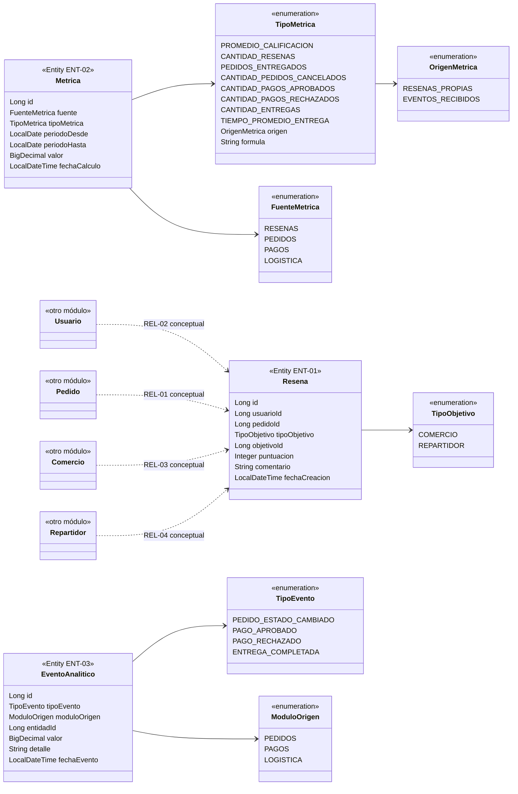

### **Diagrama de Entidad – Relación**

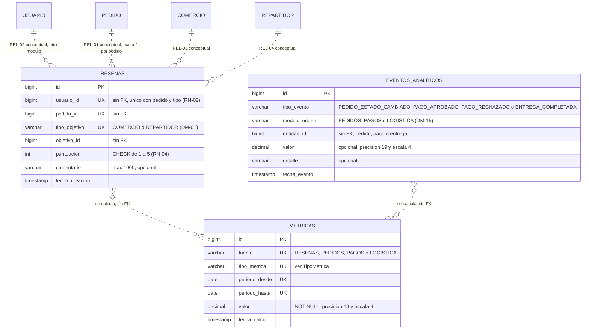

La clave única de RESENAS es (usuario_id, pedido_id, tipo_objetivo) y la de METRICAS es (fuente, tipo_metrica, periodo_desde, periodo_hasta). Las líneas punteadas son relaciones conceptuales: no hay claves foráneas ni relaciones JPA (DM-06). USUARIO, PEDIDO, COMERCIO y REPARTIDOR pertenecen a otros módulos y no existen como tablas propias.

###  **Entidades propias**

**ENT-01 Reseña**: Representa la calificación de un usuario sobre un pedido entregado, dirigida a un comercio o a un repartidor.

| Atributo | Tipo | Nota |
| :---- | :---- | :---- |
| id | Long | Clave propia (generada por la base) |
| usuarioId | Long | Referencia externa (sin FK). Se toma del claim sub del JWT (DM-13) |
| pedidoId | Long | Referencia externa (sin FK) |
| tipoObjetivo | Enum (COMERCIO, REPARTIDOR) | Discriminador (DM-01) |
| objetivoId | Long | Referencia externa (sin FK). Se deriva del pedido (DM-13) |
| puntuacion | Integer | 1 a 5 (RN-04) |
| comentario | String | Opcional, hasta 1000 caracteres |
| fechaCreacion | Timestamp | \- |

**ENT-02 Métrica**: Representa un resultado agregado ya calculado del tablero (snapshot, no se recalcula on-demand).

| Atributo | Tipo | Nota |
| :---- | :---- | :---- |
| id | Long | Clave propia (generada por la base) |
| fuente | Enum (RESENAS, PEDIDOS, PAGOS, LOGISTICA) | RN-03 |
| tipoMetrica | Enum (TipoMetrica) | PROMEDIO\_CALIFICACION, CANTIDAD\_RESENAS, PEDIDOS\_ENTREGADOS, CANTIDAD\_PEDIDOS\_CANCELADOS, CANTIDAD\_PAGOS\_APROBADOS, CANTIDAD\_PAGOS\_RECHAZADOS, CANTIDAD\_ENTREGAS y TIEMPO\_PROMEDIO\_ENTREGA. Cada valor lleva su origen (RESENAS\_PROPIAS o EVENTOS\_RECIBIDOS) y su fórmula, ver 12.4 y DM-21. La estructura de Métrica (ENT-02) no cambia, ver DM-17. |
| periodoDesde / periodoHasta | LocalDate | RN-03 |
| valor | BigDecimal (precisión 19, escala 4) | Resultado calculado. NOT NULL: un promedio sin observaciones no se guarda |
| fechaCalculo | Timestamp | Cuándo se generó el snapshot |

**ENT-03 EventoAnalítico**: Representa un evento operativo genérico emitido por otro módulo del ecosistema, utilizado como insumo para el cálculo de métricas (CU-08 a CU-10).

| Atributo | Tipo | Nota |
| :---- | :---- | :---- |
| id | Long | Clave propia (generada por la base) |
| tipoEvento | Enum (PEDIDO\_ESTADO\_CAMBIADO, PAGO\_APROBADO, PAGO\_RECHAZADO, ENTREGA\_COMPLETADA) | Discriminador (DM-14) |
| moduloOrigen | Enum (PEDIDOS, PAGOS, LOGISTICA) | DM-15 |
| entidadId | Long | Referencia externa (sin FK) al pedido/pago/entrega que originó el evento. Debe ser positivo (RN-09) |
| valor | BigDecimal | Nullable; magnitud numérica cuando aplica (ej. tiempo de entrega) |
| detalle | String | Nullable; dato cualitativo cuando aplica (ej. estado del pedido) |
| fechaEvento | Timestamp | RN-09: obligatoria y no futura. Zona horaria pendiente de acordar |

No existe relación persistente entre EventoAnalítico y Métrica, igual que ya ocurre entre Reseña y Métrica: el servicio de analítica consulta los eventos, calcula el resultado y luego guarda la métrica obtenida.

“Calificación” no se modela como entidad separada es el atributo “puntuacion” de “Reseña” (DM-01). “EventoAnalítico” se formaliza como ENT-03 para CU-06 (Evolución), implementado.

###  **Datos externos referenciados**

| Entidad externa | Propietario | Cómo se referencia | Justificación |
| :---- | :---- | :---- | :---- |
| Usuario | Equipo 1 | Solo usuarioId persistido; UsuarioDTO consultado al validar (INT-02), no se guarda. | Se usa una sola vez, al crear la reseña. |
| Pedido | Equipo 3 | Solo pedidoId persistido; PedidoDTO consultado al validar (INT-01). | Se usa una sola vez, al crear la reseña. |
| Comercio | Equipo 2 | Solo objetivoId; ningún otro dato del comercio se persiste. | Evita depender de datos que cambian y evita copiar entidades externas |
| Repartidor | Equipo 5 | Solo objetivoId. | Evita depender de datos que cambian y evita copiar entidades externas |

### 

### **Relaciones**

| ID | Relación | Cardinalidad | Nota |
| :---- | :---- | :---- | :---- |
| REL-01 | Pedido \- Reseña | 1 Pedido \-\> 0..2 Reseña | Conceptual. Pedido es de otro módulo, no hay FK real. |
| REL-02 | Usuario \- Reseña | 1 Usuario \-\> 0..N Reseña | Conceptual. Usuario es de otro módulo, no hay FK real. |
| REL-03 | Comercio \- Reseña | 1 Comercio \-\> 0..N Reseña | Conceptual. Comercio es de otro módulo, no hay FK real. |
| REL-04 | Repartidor \- Reseña | 1 Repartidor \-\> 0..N Reseña | Conceptual. Repartidor es de otro módulo, no hay FK real. |

## **7\. Registro de decisiones de modelado**

**DM-01: “Reseña” como entidad única con discriminador “tipoObjetivo”.**  
Alternativa descartada: Dos entidades separadas.  
Motivo: Evita duplicar la estructura para el mismo concepto de dominio.  
Impacta en: ENT-01, CU-01, CU-02.

**DM-02: Interpretación de "una opinión por pedido" como "por pedido y tipo de objetivo".**  
Alternativa descartada: Una sola reseña total por pedido.  
Motivo: Surge de la definición de DM-01.  
Impacta en: RN-02, CU-01, CU-02.

**DM-03: Sin edición o borrado de reseñas (Entrega actual).**  
Alternativa descartada: Agregar estados y endpoints de edición.  
Motivo: Fuera del alcance planteado por el enunciado del TP, evita sobrediseño.  
Impacta en: ENT-01, RN-05.

**DM-04: Validar "pedido entregado" consultando solo a Pedidos.**  
Alternativa descartada: Consultar también a Logística para ese dato.  
Motivo: Se asumió que Pedidos expone “comercioId”, “repartidorId”, “estado” y “usuarioId”. Evita duplicar consultas. El contrato que Pedidos publicó después no incluye repartidorId ni usuarioId, y usa ids UUID (ver 12.5).  
Impacta en: RN-01, INT-01.

**DM-05: Rating on-demand (CU-03/04), Métrica persistida (CU-05).**  
Alternativa descartada: Persistir también el agregado de rating.  
Motivo: Evita sincronización extra. Métrica se persiste porque el enunciado la sugiere como entidad propia.  
Impacta en: ENT-01, ENT-02, SRV-02, SRV-03, SRV-06, SRV-07, SRV-08.

**DM-06: Entidades externas referenciadas solo por ID, DTO transitorio.**  
Alternativa descartada: FK real o copia desnormalizada.  
Motivo: FK real no es posible al ser entidades externas, copiar datos contradice la indicación del enunciado del TPO.  
Impacta en: REL-01 a REL-04.

**DM-07: Proponer GET /merchants/{id} y GET /couriers/{id} como contratos a acordar con Comercio y Logística.**  
Alternativa descartada: Asumir que ya existen.  
Motivo: Ninguno de los dos módulos los publica en su lista de APIs obligatorias.  
Impacta en: INT-03, INT-04.  
Estado: la parte de /merchants/{id} fue reemplazada por DM-20. /couriers/{id} sigue propuesto: Logística no publica ningún GET de repartidor (ver 12.5).

**DM-08: CU-05 requiere un endpoint agregado de Pedidos (INT-05: GET /orders/stats) en vez de reutilizar INT-01 (corrección post-devolución).**   
Alternativa descartada: Reutilizar GET /orders/{id} trayendo los pedidos uno por uno, o integrar directamente con Pagos y Logística.  
Motivo: GET /orders/{id} es una consulta puntual, no agregable. Pagos y Logística tampoco publican endpoints agregados; esa integración pertenece a CU-09/CU-10 (Evolución).  
Impacta en: SRV-03, INT-05, CU-05.  
Estado: reemplazada por DM-21.

**DM-09: generarTablero(desde, hasta) recurre al snapshot del período exacto si Pedidos no responde; falla con 503 solo si ese snapshot no existe.**  
Alternativa descartada: Propagar 503 igual que en CU-01/02.  
Motivo: Es una lectura, no una escritura transaccional.  
Impacta en: SRV-03, REP-04.  
Estado: reemplazada por DM-21.

**DM-10: Separar ReviewService y AnalyticsService.**  
Alternativa descartada: Un único servicio para todo el módulo.  
Motivo: El enunciado del TPO describe el módulo como dos subdominios relacionados.  
Impacta en: SRV-01, SRV-02, SRV-03, SRV-04 a SRV-08 (AnalyticsService, Evolución).

**DM-11: Adapter para cada cliente de integración.**  
Alternativa descartada: Llamada HTTP directa desde el Service.  
Motivo: El enunciado del TPO sugiere el uso de mocks temporales mientras un servicio externo no esté disponible para su uso.  
Impacta en: Todos los “Client”.  
Estado actual: mock por defecto y cliente HTTP con el perfil integracion para Usuarios y Comercios. Pedidos y Logística solo tienen mock porque sus contratos no son compatibles con los ids de este módulo (ver 12.5).

**DM-12: GET .../rating devuelve 200 con cantidad=0 si no hay reseñas en lugar de 404\.**  
Alternativa descartada: Devolver 404\.  
Motivo: La ausencia de reseñas es un estado válido.  
Impacta en: API-02, API-03.

**DM-13 (post-devolución): ResenaRequest no recibe usuarioId ni objetivoId.**   
Alternativa descartada: Que el cliente los envíe en el body.  
Motivo: “usuarioId” se obtiene del JWT, objetivoId se deriva de PedidoDTO (INT-01) según tipoObjetivo, evitando que el cliente califique un objetivo arbitrario no vinculado al pedido.  
Impacta en: DTO-01, SRV-01, CU-01, CU-02.  

**DM-14: EventoAnalítico como entidad única con discriminador "tipoEvento".**  
Alternativa descartada: Una entidad por módulo emisor (EventoPedido/EventoPago/EventoEntrega).  
Motivo: Mismo criterio que DM-01, evita duplicar estructura para el mismo concepto.  
Impacta en: ENT-03, CU-06 a CU-10.

**DM-15: "moduloOrigen" como enum cerrado (PEDIDOS, PAGOS, LOGISTICA) en vez de String libre.**  
Alternativa descartada: String libre para admitir cualquier módulo futuro.  
Motivo: Solo esos tres módulos son analizados por CU-08/09/10 en esta entrega; un enum evita inconsistencias de datos que un String no previene. También permite asociar cada módulo con su X-Api-Key (RN-10).  
Impacta en: ENT-03, CU-08, CU-09, CU-10, RN-10.

**DM-16: generarTablero() y sus extensiones (SRV-06/07/08) reciben periodoDesde/periodoHasta como parámetros opcionales, con "hoy" como valor por defecto.**  
Alternativa descartada: Período siempre fijo e implícito a "hoy".  
Motivo: Permite calcular (o recalcular) el snapshot de un período puntual bajo demanda, que es lo que CU-07 necesita poder leer.  
Impacta en: SRV-03, SRV-06, SRV-07, SRV-08, CU-05, CU-07, CU-08, CU-09, CU-10.

**DM-17: CU-08 trackea pedidos cancelados mediante un valor específico del enum TipoMetrica (CANTIDAD\_PEDIDOS\_CANCELADOS), no un campo "detalle" en Métrica.**  
Alternativa descartada: Campo "detalle" (String) en ENT-02, con un tipoMetrica genérico y una fila por estado.  
Motivo: Evita modificar la estructura y la clave de unicidad (RN-06) de una entidad ya mergeada; agregar un nuevo estado a futuro requiere solo un nuevo valor de enum.  
Impacta en: TipoMetrica, ENT-02, CU-08.  
El mismo criterio se aplica a PEDIDOS_ENTREGADOS (DM-21).

**DM-18: CU-08, CU-09 y CU-10 no tienen API propia: enriquecen el mismo tablero de CU-05 (API-04).**  
Alternativa descartada: Un endpoint de analítica por cada fuente (pedidos/pagos/logística).  
Motivo: DTO-04/DTO-10 ya son suficientemente genéricos para no necesitar contratos nuevos; es fiel al alcance original de CU-05.  
Impacta en: API-04, SRV-03, SRV-06, SRV-07, SRV-08, CU-05, CU-08, CU-09, CU-10.

**DM-19: La identidad del usuario sale del JWT que emite Usuarios, validado con HS256 y clave compartida (JWT_SECRET); los permisos se controlan por rol.**  
Alternativa descartada: Header temporal X-Usuario-Id con HTTP Basic; emitir tokens propios en este módulo; firma asimétrica RS256 (en el contrato de Usuarios es una propuesta no confirmada entre equipos).  
Motivo: El header lo escribe el cliente y permite suplantar a cualquier usuario. Con el JWT, el usuarioId (claim "sub") no se puede alterar sin invalidar la firma. Este módulo solo valida el token (firma, vencimiento y que "sub" sea numérico); no lo emite. Sin token válido responde 401; con token válido pero rol incorrecto, 403. Reglas: POST /api/v1/reviews solo CLIENTE; GET /api/v1/analytics/dashboard y /metrics solo ADMIN; POST /api/v1/analytics/events solo módulos emisores con X-Api-Key (el contrato de Usuarios indica que los módulos usan API Key y que un ADMIN no es un módulo); GET /api/v1/status público; el resto, cualquier token válido.  
Los 401 y 403 usan ErrorResponseDTO (SecurityErrorHandler). Limitaciones: el token no se puede revocar, vale hasta vencer; HS256 obliga a compartir la clave con Usuarios; las claves X-Api-Key de demo están en application.properties y deben sobrescribirse con variables de entorno.  
Impacta en: SecurityConfig, JwtAuthFilter, JwtUtil, ApiKeyFilter, SecurityErrorHandler, OpinionesController, AnalyticsController, API-01, API-04, API-05, API-06, RN-07, RN-10, RN-11.

**DM-20: INT-03 consume GET /api/v1/comercios/{id}, la ruta publicada por el módulo Catálogo.**  
Alternativa descartada: GET /api/v1/merchants/{id} (la propuesta de DM-07) y GET /api/v1/merchant/{id} (la que usaba ComercioHttpClient).  
Motivo: Catálogo publicó su contrato (docs/contratos-equipos/openapi-catalogo.yaml) con GET /api/v1/comercios/{id}: endpoint público, sin token, que devuelve id, cuit, razonSocial y estado, incluso de comercios INACTIVOS, y 404 si el comercio no existe. Este módulo respeta ese contrato y traduce estado = ACTIVO al booleano activo de ComercioDTO (RN-08). Reemplaza la parte de DM-07 que proponía /merchants/{id}; la propuesta de /couriers/{id} para Logística sigue vigente.  
Impacta en: INT-03, ComercioHttpClient, DTO-07, RN-08.

**DM-21: PEDIDOS_ENTREGADOS se calcula desde los eventos PEDIDO_ESTADO_CAMBIADO con detalle ENTREGADO. Se retiran INT-05 y el modo parcial.**  
Alternativa descartada: GET /api/v1/orders/stats de Pedidos (INT-05, DM-08) con respaldo en el snapshot del período exacto (DM-09).  
Motivo: El contrato publicado por Pedidos solo tiene GET /api/v1/orders/{id}; el endpoint de estadísticas nunca existió y dependía de una propuesta sin confirmar. Con los eventos que Pedidos ya envía por API-05, el tablero usa solo datos propios o recibidos, no depende de que otro módulo esté disponible y cada indicador se puede explicar (origen y fórmula en 12.4). Desaparecen DTO-09 y el campo parcial de DTO-04. DTO-10 suma origen (RESENAS_PROPIAS o EVENTOS_RECIBIDOS) y formula, tomados de TipoMetrica.  
Impacta en: SRV-03, SRV-06, DTO-04, DTO-09, DTO-10, TipoMetrica, CU-05, CU-08. Reemplaza a DM-08 y DM-09.

**DM-22: Los errores se traducen a códigos HTTP según su causa: 400 datos de entrada inválidos, 401 sin identidad válida, 403 sin permiso, 409 duplicado, 422 regla de negocio no cumplida y 503 módulo externo no disponible.**  
Alternativa descartada: 404 para un pedido, usuario o comercio inexistente, y 403 para el pedido de otro usuario.  
Motivo: 404 describe un recurso de la URL que no existe, y acá el pedido es un dato del body. 422 indica que la petición se entendió pero no cumple una regla de negocio. Todos los errores usan un único formato (ErrorResponseDTO) con un code estable y un correlationId. Los de seguridad los arma SecurityErrorHandler, porque Spring Security los resuelve antes de llegar al controller.  
Impacta en: GlobalExceptionHandler, SecurityErrorHandler, ErrorResponseDTO, RN-01 a RN-11.

**DM-23: Las validaciones de entrada se hacen en el servicio y no con Bean Validation (@NotNull, @Positive).**  
Alternativa descartada: Anotaciones en los DTO y captura de la excepción de validación en el handler.  
Motivo: Permite responder todos los errores de negocio con ErrorResponseDTO y un code propio, y controlar el orden de las validaciones (por ejemplo, el duplicado se controla antes que la puntuación). Contrapartida: los DTO no declaran sus restricciones, y un body ilegible o un enum inexistente sigue usando la respuesta estándar de Spring.  
Impacta en: DTO-01, DTO-11, SRV-01, SRV-04.

**DM-24: GET /analytics/dashboard recalcula y guarda los snapshots; GET /analytics/metrics solo los lee.**  
Alternativa descartada: Separar el cálculo (POST o tarea programada) de la lectura.  
Motivo: Mantiene un único endpoint para CU-05, y los snapshots (RN-06) alimentan CU-07 sin recalcular. Contrapartida: un GET con efectos de escritura, ya que cada consulta actualiza fechaCalculo.  
Impacta en: SRV-03, SRV-05, API-04, API-06, RN-06.

## **8\. Diagramas de secuencia**

Los diagramas SEC-01 a SEC-10 están en Mermaid y reflejan el estado actual: JWT y roles (DM-19), X-Api-Key en los eventos (API-05) y el tablero calculado desde eventos (DM-21). Se pueden renderizar en mermaid.live para exportarlos como imagen.

### **SEC-01 \- Crear reseña de comercio (CU-01)**

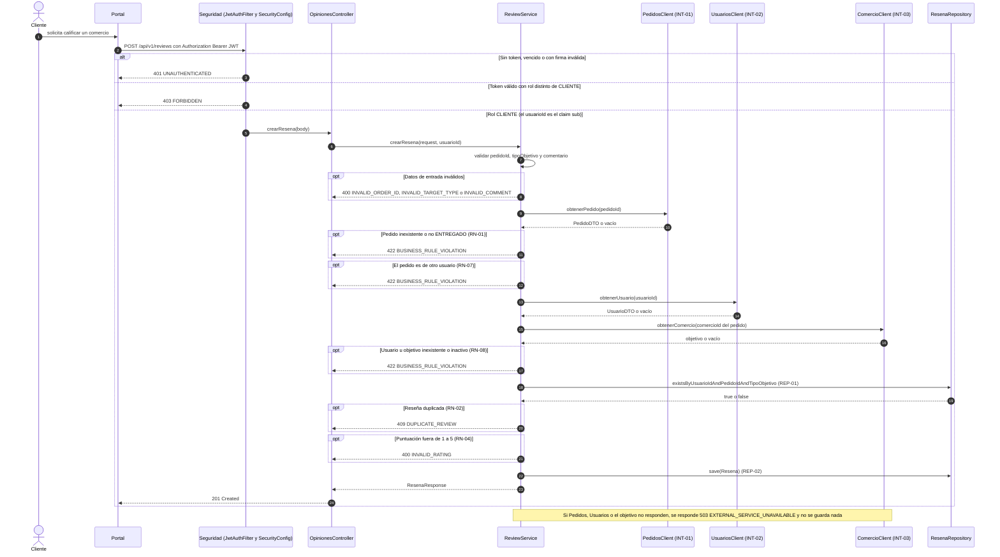

### **SEC-02 \- Crear reseña de repartidor (CU-02)**

### **SEC-03 \- Consultar promedio de comercio (CU-03)**

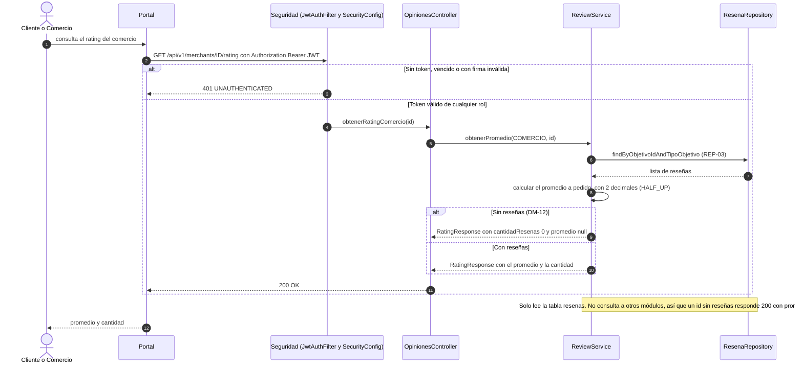

### **SEC-04 \- Consultar promedio de repartidor (CU-04)**

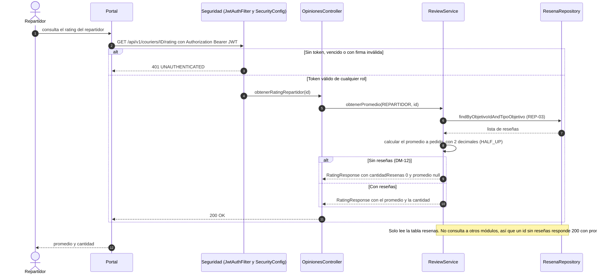

### **SEC-05 \- Generar tablero de métricas (CU-05)**

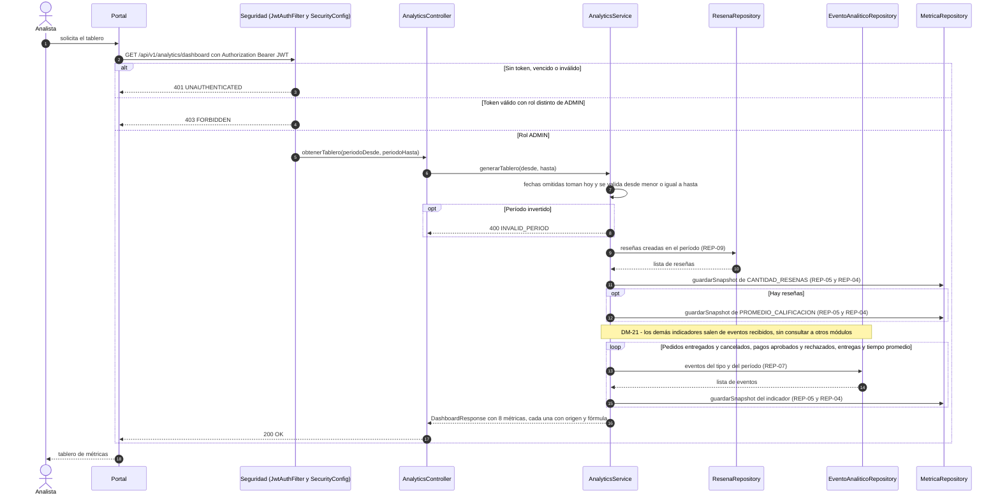

### **SEC-06 \- Registrar evento analítico (CU-06)**

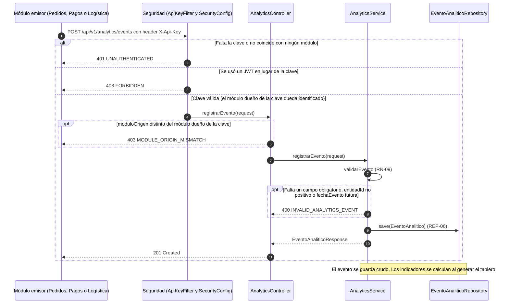

### **SEC-07 \- Consultar métricas por período (CU-07)**

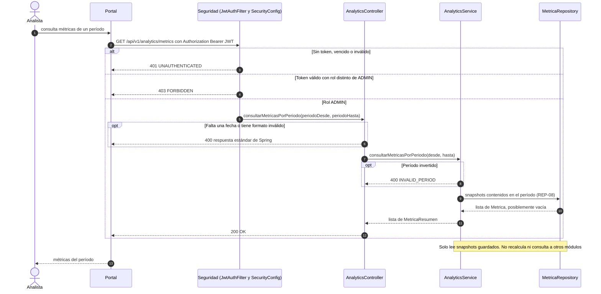

### **SEC-08 \- Analizar pedidos entregados y cancelados (CU-08)**

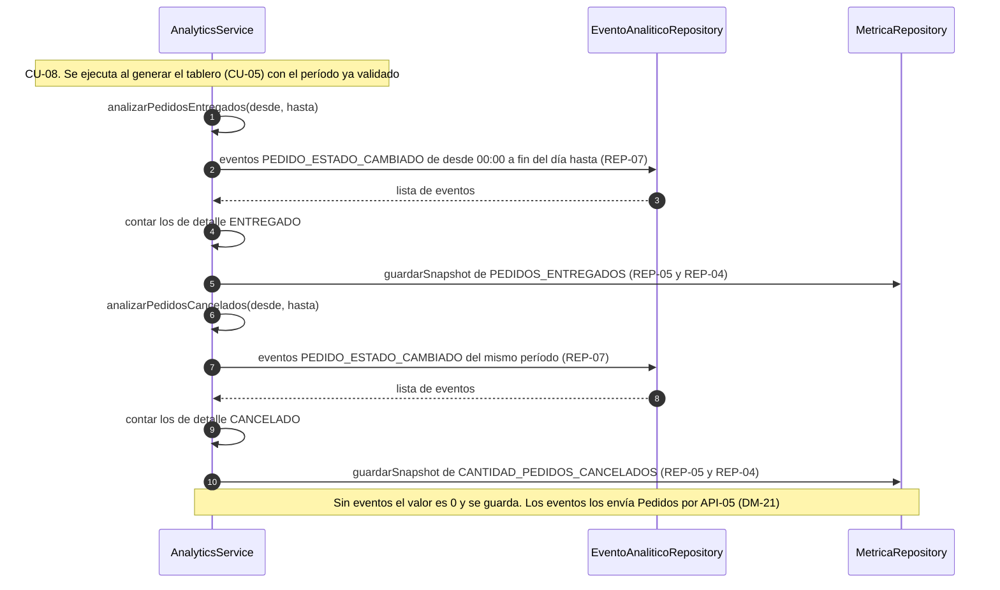

### **SEC-09 \- Analizar pagos (CU-09)**

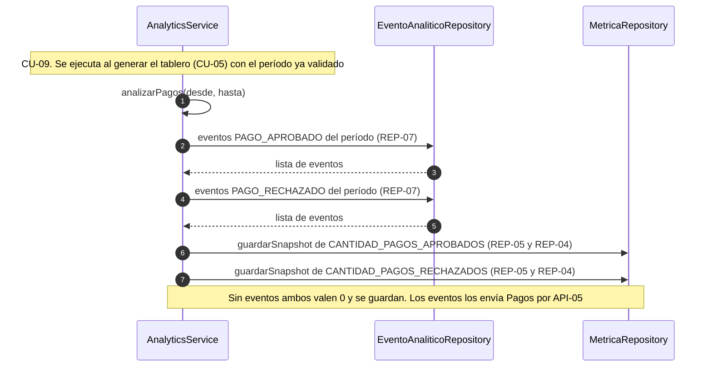

### **SEC-10 \- Analizar entregas (CU-10)**

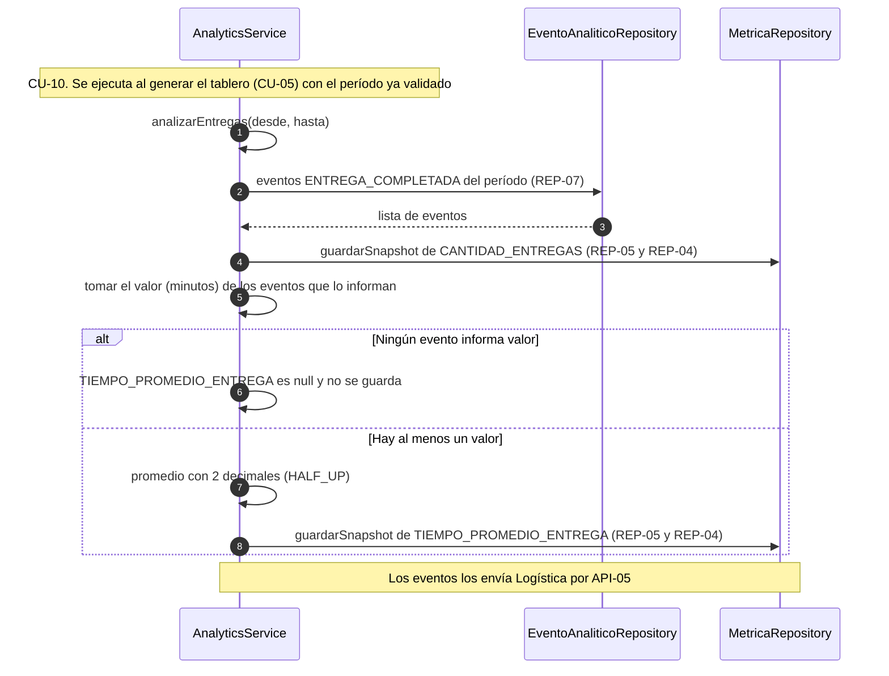

## **9\. Arquitectura y separación de responsabilidades**

| Capa / componente | Responsabilidad | Elementos trazables |
| :---- | :---- | :---- |
| Controller | Recibe y responde solicitudes HTTP, delega la lógica. | API, DTO, SEC |
| Service | Ejecuta casos de uso y reglas. Coordina persistencia e integraciones. | CU, RN, SRV, SEC, INT |
| Repository | Acceso a persistencia y consultas. | REP, ENT, SEC |
| Entity | Modelo persistido. | ENT, REL, RN |
| DTO | Contrato de entrada/salida. | DTO, API, CU |
| Client (Adapter) | Encapsula la comunicación con un módulo externo. Con el perfil integracion usa un cliente HTTP real y, sin él, un mock (DM-11). | INT, DTO |
| Mapper | Convierte entre entidades y DTOs. | ENT, DTO |
| Manejo de errores | Traduce excepciones de dominio y de integración al formato normalizado (ErrorResponseDTO) con un code estable y un correlationId (DM-22). | Transversal |
| Seguridad | Identifica al llamador (JWT o X-Api-Key) antes del controller y controla qué rol puede cada operación. Responde 401 y 403 con el mismo formato de error (DM-19). | RN-10, RN-11 |
| Config | Seguridad, OpenAPI y datos de demostración. | Transversal |

ReviewService (CU-01 a CU-04) y AnalyticsService (CU-05 a CU-10) están separados por subdominio (DM-10), no por capa. Cada petición recorre las capas en orden: Seguridad, Controller, Service y Repository. Ningún controller accede a un repositorio ni a un cliente, y los servicios dependen de las interfaces de los clientes, no de sus implementaciones.

## **10\. Estructura de implementación**

Paquete base: ar.edu.uade.api.deliverygo.

| Paquete | Clases | Trazabilidad |
| :---- | :---- | :---- |
| controller | OpinionesController, AnalyticsController | OpinionesController: API-01 a API-03 / CU-01 a CU-04. AnalyticsController: API-04 a API-06 / CU-05 a CU-10, y GET /status |
| services | ReviewService, AnalyticsService | ReviewService: SRV-01, SRV-02 / RN-01, RN-02, RN-04, RN-05, RN-07, RN-08. AnalyticsService: SRV-03 a SRV-08 / RN-03, RN-06, RN-09 |
| repository | ResenaRepository, MetricaRepository, EventoAnaliticoRepository | ResenaRepository: REP-01 a REP-03, REP-09 / ENT-01. MetricaRepository: REP-04, REP-05, REP-08 / ENT-02. EventoAnaliticoRepository: REP-06, REP-07 / ENT-03 |
| model | Resena, Metrica, EventoAnalitico; enums TipoObjetivo, FuenteMetrica, TipoMetrica, OrigenMetrica, TipoEvento, ModuloOrigen | ENT-01, ENT-02, ENT-03 / REL-01 a REL-04 |
| dto | ResenaRequest, ResenaResponse, RatingResponse, DashboardResponse, MetricaResumen, PedidoDTO, UsuarioDTO, ComercioDTO, RepartidorDTO, ErrorResponseDTO, EventoAnaliticoRequest, EventoAnaliticoResponse | DTO-01 a DTO-08 y DTO-10 (DTO-09 retirado, DM-21) / API-01 a API-04 y API-06; DTO-11, DTO-12 / API-05 |
| mapper | ResenaMapper, MetricaMapper, EventoAnaliticoMapper | ENT-01 / DTO-01, DTO-02; ENT-02 / DTO-10; ENT-03 / DTO-11, DTO-12 |
| client | Interfaces PedidosClient, UsuariosClient, ComercioClient, LogisticaClient | INT-01 a INT-04 |
| client/mock | PedidosClientMock, UsuariosClientMock, ComercioClientMock, LogisticaClientMock | INT-01 a INT-04 (datos fijos para la demo y los tests) |
| client/integracion | ComercioHttpClient, UsuariosHttpClient (perfil integracion) | INT-03 (DM-20), INT-02. Pedidos y Logística no tienen cliente HTTP (ver 12.5) |
| excepcion | GlobalExceptionHandler, OrderNotDeliveredException, OrderNotOwnedException, DuplicateReviewException, InvalidRatingException, InvalidPeriodException, InvalidOrderIdException, InvalidTargetTypeException, InvalidCommentException, InvalidAnalyticsEventException, ExternalEntityInvalidException, ExternalServiceUnavailableException, ModuloOrigenNoAutorizadoException | RN-01, RN-02, RN-04, RN-07, RN-08, RN-09, RN-10 / DM-22 |
| config | SecurityConfig, JwtAuthFilter, JwtUtil, ApiKeyFilter, SecurityErrorHandler, OpenApiConfig, DemoDataLoader | Seguridad: DM-19, RN-10, RN-11. OpenApiConfig y DemoDataLoader: transversal |

Pruebas automáticas (src/test): JwtUtilTest, TipoMetricaTest, ReviewServiceTest, AnalyticsServiceTest, OpinionesControllerTest y AnalyticsControllerTest. Verifican la seguridad (401, 403, token vencido o adulterado, X-Api-Key), las reglas RN-01 a RN-11, los períodos de fechas, el cálculo de los indicadores y los errores de comunicación con otros módulos.

## **11\. Repositorios y consultas**

| ID | Repositorio / consulta | Necesidad que resuelve | CU / RN | Entidad |
| :---- | :---- | :---- | :---- | :---- |
| REP-01 | ResenaRepository.existsByUsuarioIdAndPedidoIdAndTipoObjetivo(...) | Verificar que no exista ya una reseña antes de crearla. | CU-01, CU-02 / RN-02 | ENT-01 |
| REP-02 | ResenaRepository.save(...) | Persistir la reseña validada. | CU-01, CU-02 / RN-01, RN-04 | ENT-01 |
| REP-03 | ResenaRepository.findByObjetivoIdAndTipoObjetivo(...) | Traer las reseñas de un comercio/repartidor para calcular el promedio. | CU-03, CU-04 | ENT-01 |
| REP-04 | MetricaRepository.save(...) | Persistir los snapshots del tablero (CU-05) y de CU-08 a CU-10. La consulta del último snapshot por fuente y tipo (findFirstByFuenteAndTipoMetricaOrderByFechaCalculoDesc) se retiró del código porque ningún servicio la usa. | CU-05, CU-08, CU-09, CU-10 / RN-03, RN-06 | ENT-02 |
| REP-05 | MetricaRepository.findByFuenteAndTipoMetricaAndPeriodoDesdeAndPeriodoHasta(…) | Verificar si ya existe un snapshot para el período exacto, para decidir entre actualizarlo o crear uno nuevo (upsert). | CU-05, CU-08, CU-09, CU-10 / RN-06 | ENT-02 |
| REP-06 | EventoAnaliticoRepository.save(...) | Persistir el evento analítico recibido. | CU-06 / RN-09 | ENT-03 |
| REP-07 | EventoAnaliticoRepository.findByTipoEventoAndFechaEventoBetween(...) | Obtener eventos de un tipo dentro de un rango de fechas inclusivo (desde las 00:00 del día desde hasta el último instante del día hasta). Alimenta pedidos entregados y cancelados, pagos y entregas. | CU-08, CU-09, CU-10 / RN-03 | ENT-03 |
| REP-08 | MetricaRepository.findByPeriodoDesdeGreaterThanEqualAndPeriodoHastaLessThanEqual(...) | Leer snapshots completamente contenidos en el período. | CU-07 / RN-03 | ENT-02 |
| REP-09 | ResenaRepository.findByFechaCreacionGreaterThanEqualAndFechaCreacionLessThan(...) | Obtener reseñas creadas en el período para el promedio y el conteo del tablero (desde inclusivo, hasta exclusivo: se pasa el día siguiente a las 00:00). | CU-05 / RN-03 | ENT-01 |

## 

## **12\. Servicios, operaciones y contratos REST**

### **12.1 Servicios**

| ID | Operación | Responsabilidad | CU | RN | REP / INT |
| :---- | :---- | :---- | :---- | :---- | :---- |
| SRV-01 | crearResena(reseñaRequest, usuarioIdAutenticado) | Validar los datos de entrada, coordinar las validaciones externas, aplicar las reglas y persistir la reseña. El usuario sale del JWT (DM-13). | CU-01, CU-02 | RN-01, RN-02, RN-04, RN-05, RN-07, RN-08 | REP-01, REP-02 / INT-01, INT-02, INT-03, INT-04 |
| SRV-02 | obtenerPromedio(tipoObjetivo, objetivoId) | Agregar reseñas propias y calcular el promedio on-demand. | CU-03, CU-04 | \- | REP-03 / \- |
| SRV-03 | generarTablero(desde, hasta) | Consolidar métricas de reseñas y, a partir de eventos, pedidos entregados y cancelados, pagos y entregas (CU-08, CU-09, CU-10; DM-21). Parámetros opcionales, con "hoy" como valor por defecto (DM-16). No consulta a otros módulos. | CU-05 | RN-03, RN-06 | REP-04, REP-05, REP-07, REP-09 / \- |
| SRV-04 | registrarEvento(request) | Validar y persistir un evento analítico (CU-06). La coincidencia entre moduloOrigen y la X-Api-Key (RN-10) se verifica en el controller. | CU-06 | RN-09, RN-10 | REP-06 / \- |
| SRV-05 | consultarMetricasPorPeriodo(periodoDesde, periodoHasta) | Leer snapshots guardados contenidos en el período; no recalcula (CU-07). | CU-07 | RN-03 | REP-08 / \- |
| SRV-06 | analizarPedidosEntregados y analizarPedidosCancelados(periodoDesde, periodoHasta) | Contar eventos de cambio de estado a ENTREGADO y a CANCELADO y guardar cada snapshot (CU-08; DM-21). | CU-08 | RN-03, RN-06, RN-09 | REP-07, REP-04, REP-05 / \- |
| SRV-07 | analizarPagos(periodoDesde, periodoHasta) | Contar pagos aprobados y rechazados y guardar snapshots (CU-09). | CU-09 | RN-03, RN-06, RN-09 | REP-07, REP-04, REP-05 / \- |
| SRV-08 | analizarEntregas(periodoDesde, periodoHasta) | Contar entregas completadas y promediar tiempos (CU-10). | CU-10 | RN-03, RN-06, RN-09 | REP-07, REP-04, REP-05 / \- |

###  **12.2 APIs propias**

| ID | Método | Endpoint | CU | SRV | Acceso | Entrada / salida |
| :---- | :---- | :---- | :---- | :---- | :---- | :---- |
| API-01 | POST | /api/v1/reviews | CU-01, CU-02 | SRV-01 | Rol CLIENTE (JWT) | DTO-01 \-\> DTO-02 |
| API-02 | GET | /api/v1/merchants/{id}/rating | CU-03 | SRV-02 | Cualquier token válido | \- \-\> DTO-03 |
| API-03 | GET | /api/v1/couriers/{id}/rating | CU-04 | SRV-02 | Cualquier token válido | \- \-\> DTO-03 |
| API-04 | GET | /api/v1/analytics/dashboard | CU-05, CU-08, CU-09, CU-10 | SRV-03 | Rol ADMIN (JWT) | periodoDesde, periodoHasta (query, opcionales) \-\> DTO-04 |
| API-05 | POST | /api/v1/analytics/events | CU-06 | SRV-04 | X-Api-Key de un módulo emisor | DTO-11 \-\> DTO-12 |
| API-06 | GET | /api/v1/analytics/metrics | CU-07 | SRV-05 | Rol ADMIN (JWT) | periodoDesde, periodoHasta (query, obligatorios) \-\> DTO-10 |
| API-07 | GET | /api/v1/status | \- | \- | Público | \- \-\> estado, módulo y timestamp (disponibilidad) |

**Seguridad (DM-19, RN-10, RN-11).** Todas las APIs exigen el header Authorization: Bearer con un JWT de Usuarios, salvo GET /api/v1/status. Roles: API-01 solo CLIENTE (usuarioId = claim "sub"); API-04 y API-06 solo ADMIN; API-02 y API-03 cualquier token válido; API-05 solo los módulos emisores, con header X-Api-Key (una clave por módulo) y moduloOrigen igual al módulo dueño de la clave (403 MODULE_ORIGIN_MISMATCH si no coincide). Un JWT no sirve para API-05. Sin token o token inválido: 401 (code UNAUTHENTICATED). Rol incorrecto: 403 (code FORBIDDEN). Ambos usan el formato ErrorResponseDTO y el header WWW-Authenticate: Bearer en el 401.

**Códigos de respuesta por API.** Los errores de negocio usan ErrorResponseDTO (DM-22); los de formato del body o de los parámetros usan la respuesta estándar de Spring.

| API | Éxito | Errores |
| :---- | :---- | :---- |
| API-01 | 201 | 400 (entrada o puntuación inválida), 401, 403, 409 (duplicada), 422 (RN-01, RN-07, RN-08), 503 (módulo externo caído) |
| API-02, API-03 | 200 (también sin reseñas, DM-12) | 401 |
| API-04 | 200 | 400 (período inválido), 401, 403 |
| API-05 | 201 | 400 (RN-09), 401, 403 (JWT o módulo de otro origen) |
| API-06 | 200 (también lista vacía) | 400 (fechas), 401, 403 |
| API-07 | 200 | \- |

### 

### **12.3 APIs consumidas de otros módulos (integraciones salientes)**

| ID | Proveedor | Método | Endpoint | Propósito | CU | Códigos | DTO | Implementación |
| :---- | :---- | :---- | :---- | :---- | :---- | :---- | :---- | :---- |
| INT-01 | Pedidos | GET | /api/v1/orders/{id} | Validar el estado y obtener “usuarioId”, “comercioId” y “repartidorId” (RN-01, RN-07). Contrato propio: el que publicó Pedidos difiere (ver 12.5). | CU-01/02 | 200, 404, 503 | DTO-05 | Mock |
| INT-02 | Usuarios | GET | /api/v1/users/{id} | Validar que el usuario existe y está activo (RN-08). Se envía X-Api-Key. | CU-01/02 | 200, 404, 503 | DTO-06 | Cliente HTTP (perfil integracion) y mock |
| INT-03 | Comercios | GET | /api/v1/comercios/{id} | Validar que el comercio existe y está activo (RN-08, DM-20). Público, sin token. | CU-01 | 200, 404, 503 | DTO-07 | Cliente HTTP (perfil integracion) y mock |
| INT-04 | Logística | GET | /api/v1/couriers/{id} | Validar que el repartidor existe y está activo (RN-08). Propuesto: Logística no lo publica (ver 12.5). | CU-02 | 200, 404, 503 | DTO-08 | Mock |

Los clientes HTTP usan timeouts de 2 s de conexión y 3 s de lectura. Un 404 se traduce a “no existe” (422) y cualquier otro error, caída o timeout a ExternalServiceUnavailableException (503, sin guardar nada).

### **12.4 Indicadores del tablero: origen y fórmula**

El período es inclusivo en ambos extremos. Si se omiten las fechas, valen hoy. Cada indicador informa su origen y su fórmula en DTO-10, tomados de TipoMetrica.

| Indicador | Fuente | Origen | Fórmula | Sin datos |
| :---- | :---- | :---- | :---- | :---- |
| CANTIDAD\_RESENAS | RESENAS | RESENAS\_PROPIAS (REP-09) | Cantidad de reseñas creadas en el período | Vale 0 y se guarda |
| PROMEDIO\_CALIFICACION | RESENAS | RESENAS\_PROPIAS (REP-09) | Suma de las puntuaciones dividida por la cantidad, con 2 decimales (HALF\_UP) | null, no se guarda |
| PEDIDOS\_ENTREGADOS | PEDIDOS | EVENTOS\_RECIBIDOS (REP-07) | Cantidad de eventos PEDIDO\_ESTADO\_CAMBIADO con detalle ENTREGADO | Vale 0 y se guarda |
| CANTIDAD\_PEDIDOS\_CANCELADOS | PEDIDOS | EVENTOS\_RECIBIDOS (REP-07) | Cantidad de eventos PEDIDO\_ESTADO\_CAMBIADO con detalle CANCELADO | Vale 0 y se guarda |
| CANTIDAD\_PAGOS\_APROBADOS | PAGOS | EVENTOS\_RECIBIDOS (REP-07) | Cantidad de eventos PAGO\_APROBADO | Vale 0 y se guarda |
| CANTIDAD\_PAGOS\_RECHAZADOS | PAGOS | EVENTOS\_RECIBIDOS (REP-07) | Cantidad de eventos PAGO\_RECHAZADO | Vale 0 y se guarda |
| CANTIDAD\_ENTREGAS | LOGISTICA | EVENTOS\_RECIBIDOS (REP-07) | Cantidad de eventos ENTREGA\_COMPLETADA | Vale 0 y se guarda |
| TIEMPO\_PROMEDIO\_ENTREGA | LOGISTICA | EVENTOS\_RECIBIDOS (REP-07) | Promedio del campo valor (minutos) de los eventos ENTREGA\_COMPLETADA que lo informan, con 2 decimales (HALF\_UP) | null, no se guarda |

Los conteos valen 0 cuando no hubo nada. Los promedios son null cuando no hay observaciones, porque 0 sería un dato falso. Los null no se guardan porque Metrica.valor es NOT NULL. GET /analytics/dashboard recalcula y guarda los snapshots (RN-06); GET /analytics/metrics solo lee los ya guardados.

### **12.5 Discrepancias entre los contratos de otros módulos**

Los contratos publicados en docs/contratos-equipos no son compatibles con este módulo ni entre sí. Este módulo usa ids Long y su propio contrato para INT-01 e INT-04, y las brechas quedan a acordar con cada equipo. Los indicadores del tablero no dependen de ellas (DM-21).

| Dato | Pedidos | Otro módulo | Consecuencia | A acordar con |
| :---- | :---- | :---- | :---- | :---- |
| Id del pedido | UUID | Logística: int64 (pedidoId) | No se puede saber qué repartidor entregó un pedido | Pedidos y Logística |
| Id del comercio | UUID | Catálogo: int64 | No se puede validar en Catálogo el comercio de un pedido | Pedidos y Catálogo |
| Dueño del pedido | clienteId UUID | Usuarios: id int64 | RN-07 no se puede comprobar contra el sub del JWT | Pedidos y Usuarios |
| Repartidor del pedido | No figura en PedidoResponse | Logística: sin ningún GET de repartidor (INT-04) | No hay forma de validar un repartidor ni de reseñarlo con datos reales | Logística |
| Identidad al consultar un pedido | GET /orders/{id} exige el header provisorio X-Cliente-Id (UUID) | Usuarios emite JWT con id int64 | La identidad no es compatible | Pedidos |
| Id de entidad en eventos | Pedidos usa UUID | entidadId de este módulo es Long | Los eventos de Pedidos con id UUID no entran | Pedidos |

## **13\. DTO e integridad del contrato**

| ID | DTO | Uso | Campos principales | Restricciones | API / CU o INT |
| :---- | :---- | :---- | :---- | :---- | :---- |
| DTO-01 | ResenaRequest | Entrada | pedidoId, tipoObjetivo, puntuacion, comentario | pedidoId obligatorio y positivo. tipoObjetivo obligatorio (COMERCIO o REPARTIDOR). puntuacion de 1 a 5 (RN-04). comentario opcional, hasta 1000 caracteres. No lleva usuarioId ni objetivoId (DM-13) | API-01 / CU-01, CU-02 |
| DTO-02 | ResenaResponse | Salida | id, usuarioId, pedidoId, tipoObjetivo, objetivoId, puntuacion, comentario, fechaCreacion | usuarioId es el claim sub del token. objetivoId se deriva del pedido | API-01 / CU-01, CU-02 |
| DTO-03 | RatingResponse | Salida | objetivoId, tipoObjetivo, promedio, cantidadResenas | promedio con 2 decimales (HALF\_UP), null sin reseñas. cantidadResenas es 0 sin reseñas (DM-12) | API-02, API-03 / CU-03, CU-04 |
| DTO-04 | DashboardResponse | Salida | generadoEn, metricas\[\] (DTO-10) | metricas trae siempre los 8 indicadores | API-04 / CU-05, CU-08, CU-09, CU-10 |
| DTO-05 | PedidoDTO | Entrada | id, usuarioId, comercioId, repartidorId, estado | Se lee del otro módulo. estado debe ser ENTREGADO (RN-01). Contrato propio, ver 12.5 | INT-01 / CU-01, CU-02 |
| DTO-06 | UsuarioDTO | Entrada | id, activo | Se lee del otro módulo. Debe estar activo (RN-08) | INT-02 / CU-01, CU-02 |
| DTO-07 | ComercioDTO | Entrada | id, activo | Se lee del otro módulo. activo sale de estado \= ACTIVO. Debe estar activo (RN-08) | INT-03 / CU-01 |
| DTO-08 | RepartidorDTO | Entrada | id, activo | Se lee del otro módulo. Debe estar activo (RN-08). Contrato propuesto, ver 12.5 | INT-04 / CU-02 |
| DTO-09 | Retirado | \- | Número sin uso: era OrdersStatsDTO (INT-05), reemplazado por DM-21 | \- | \- |
| DTO-10 | MetricaResumen | Salida | fuente, tipoMetrica, origen, formula, periodoDesde, periodoHasta, valor | origen y formula salen de TipoMetrica. valor es null para PROMEDIO\_CALIFICACION sin reseñas y para TIEMPO\_PROMEDIO\_ENTREGA sin eventos con valor; esos casos no se guardan. No expone id ni fechaCalculo | API-04 / CU-05, CU-08, CU-09, CU-10; API-06 / CU-07 |
| DTO-11 | EventoAnaliticoRequest | Entrada | tipoEvento, moduloOrigen, entidadId, valor (opcional), detalle (opcional), fechaEvento | tipoEvento, moduloOrigen, entidadId y fechaEvento obligatorios (RN-09). entidadId positivo. fechaEvento no futura (se tolera 1 minuto). moduloOrigen igual al módulo dueño de la X-Api-Key (RN-10) | API-05 / CU-06 |
| DTO-12 | EventoAnaliticoResponse | Salida | id, tipoEvento, moduloOrigen, entidadId, valor, detalle, fechaEvento | Es DTO-11 más el id generado | API-05 / CU-06 |
| DTO-13 | ErrorResponseDTO | Salida | timestamp, status, code, message, path, correlationId | Lo devuelven todas las APIs ante un error de negocio, y los 401 y 403 de seguridad (DM-22). code es estable y el cliente puede compararlo sin leer el mensaje | Todas las APIs |

**Convenciones del contrato**

- **Ids:** numéricos (Long). Los de otros módulos se referencian solo por id (DM-06). Los contratos publicados por Pedidos, Catálogo y Logística no son compatibles entre sí en este punto (ver 12.5).
- **Fechas y horas:** LocalDate en formato yyyy-MM-dd, y LocalDateTime en ISO-8601 sin zona (por ejemplo 2026-11-24T10:00:00). La zona horaria de fechaEvento está pendiente de acordar entre módulos. El timestamp de los errores es un instante UTC.
- **Valores numéricos:** BigDecimal para los valores y promedios, con 2 decimales en los promedios.
- **Nulos:** un promedio sin observaciones es null, nunca 0. Los conteos sin datos valen 0.
- **Enums:** TipoObjetivo, TipoEvento, ModuloOrigen, FuenteMetrica, TipoMetrica y OrigenMetrica. Un valor inexistente en el body produce un 400 con la respuesta estándar de Spring.
- **Campos desconocidos de otros módulos:** los clientes HTTP leen solo los campos que necesitan (id y estado) e ignoran el resto.
- **Rastreo:** el header X-Correlation-Id se reutiliza en el error si es un UUID válido y, si no, se genera uno.

[image1]: <>

