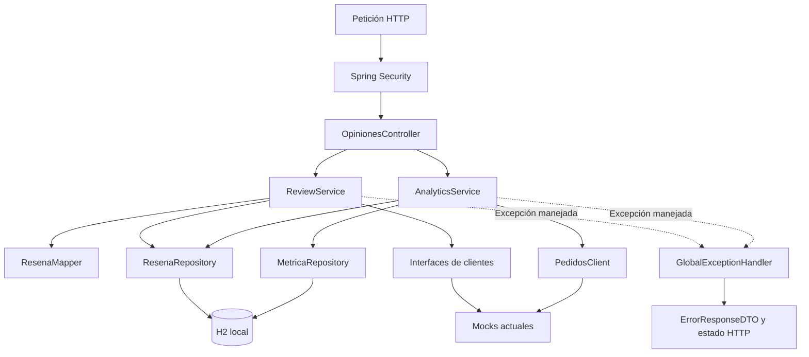
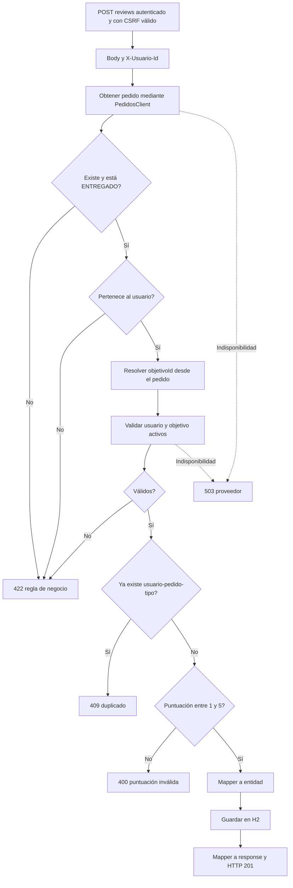
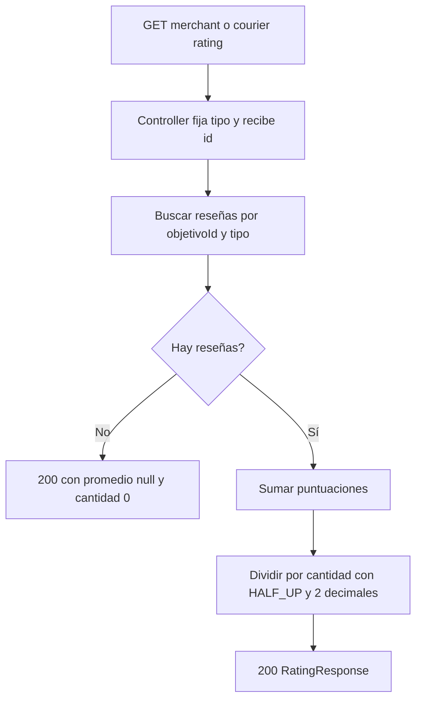
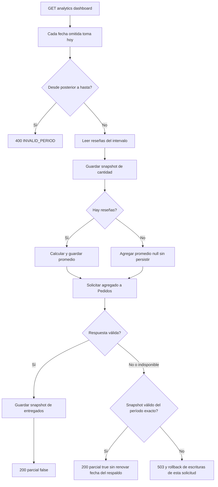
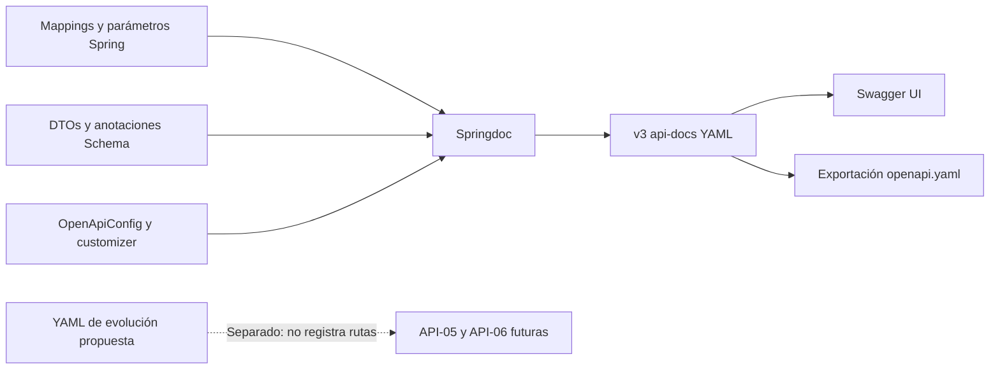
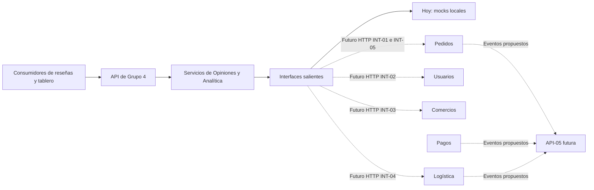

# DeliveryGo — Guía personal de estudio y defensa

## Índice

1. [Presentación y recorrido](#presentacion)
2. [Cómo se construyó](#historia)
3. [Mis commits y aportes](#aportes)
4. [Mapa del código](#mapa)
5. [Flujos de ejecución](#flujos)
6. [Swagger paso a paso](#swagger)
7. [Integraciones con otros equipos](#integraciones)
8. [Preguntas y respuestas](#preguntas)
9. [Práctica y simulacro](#practica)
10. [Repaso final y fuentes](#repaso)

<a id="presentacion"></a>
## 1. Presentación y recorrido

**Explicación de un minuto:** “Nuestro módulo es Opiniones y Analítica de DeliveryGo. Permite calificar comercios y repartidores de pedidos entregados, consultar sus promedios y generar un tablero por período. Usamos Java 25, Spring Boot, JPA y H2. El controller recibe HTTP, los servicios aplican reglas y los repositorios persisten. Las dependencias con otros módulos están aisladas mediante interfaces y hoy se resuelven con mocks. Mis aportes fueron consolidar código duplicado, ampliar los contratos Swagger, completar el CU-05 y su respaldo por snapshot, actualizar la documentación y normalizar errores.”

**Qué existe hoy:** CU-01 a CU-05 y cuatro operaciones HTTP. CU-06 a CU-10 son evolución; API-05 y API-06 propuestas no son endpoints activos. No hay clientes HTTP reales ni JWT integrado.

**Cómo estudiar:** primero seguir una reseña desde HTTP hasta H2; después estudiar el dashboard con sus errores; luego relacionar cada cambio propio con su commit. Finalmente practicar sin mirar las respuestas. Los diagramas Mermaid requieren un visor compatible para visualizarse; su texto también permite seguir las decisiones.

<a id="historia"></a>
## 2. Cómo se construyó

La siguiente es una reconstrucción verificable del historial, no una afirmación sobre conversaciones o decisiones fuera de Git.

| Fecha | Paso | Evidencia y autor |
| --- | --- | --- |
| 17/10 | Inicio y scaffold Spring Boot/Maven | `f4d29fc`, `00e572a`; scaffold de Emiliano |
| 18/10 | Entidades, enums y repositorios | `94f0b7f`, Emiliano |
| 21/10 | DTOs de API e integraciones | `ad78bdd`, `f28f8fb`, Emiliano |
| 22/10 | Variante de DTOs para CU-01 | `8c7a79c`, Alejandro; posteriormente se eliminan duplicados |
| 24/10 | Interfaces de clientes, mocks, ReviewService y excepciones | `325ba60`, `df98831`, `a3b61b0`, Emiliano |
| 25/10 | Mapper, handler de errores y controller | `8a192d8`, `b2d8c80`, `be9b0ea`, Emiliano |
| 27/10 | Documentación OpenAPI de reseñas y configuración inicial | `e4f0c74`, Emiliano |
| 28–29/10 | Base del dashboard y período inválido | `718cccb`, `7a80f93`, Alejandro |
| 29–30/10 | Consolidación, contratos, CU-05, documentación y errores | Tus cinco commits detallados abajo |

La aplicación se construyó incrementalmente: dominio y persistencia → objetos de intercambio → dependencias simuladas → reglas → exposición HTTP → documentación y consolidación. Las ramas y merges registran integración de trabajo, no prueban quién escribió cada línea.

<a id="aportes"></a>
## 3. Mis commits y aportes

Identidades confirmadas: `Nicolasgh91 <nicolasgabrielh91@gmail.com>` y `Nicolás Gabriel Hruszczak <100943553+Nicolasgh91@users.noreply.github.com>`.

### Cómo interpretar este desglose

Cada cambio se compara contra el primer padre del commit: lo que estaba inmediatamente antes y lo que dejó ese commit. Los fragmentos son extractos del cambio, no clases completas. La explicación técnica del beneficio no prueba una motivación personal fuera de Git. Se cubren los archivos de cada commit; las rutas Java se abrevian desde el paquete `ar.edu.uade.api.deliverygo`.

### `3c3899f` — 29/10 — fix: remuevo archivos obsoletos y duplicados

**Estado previo:** coexistían variantes de DTOs y servicios en carpetas `Dto`/`Services` junto con las clases vigentes `dto`/`services`. Además, el dashboard necesitaba una consulta por fecha y al controller le faltaban imports de elementos que ya utilizaba.

**Balance del commit:** seis archivos afectados, 12 líneas agregadas y 115 eliminadas; incluye un movimiento sin cambios de contenido.

#### 1. Eliminación de `Dto/ReseniaRequest.java`

La variante eliminada recibía `usuarioId`, `pedidoId`, `tipoObjetivo`, `objetivoId`, `punticion` y `comentario`. `punticion` era un int con `@Min(1) @Max(5)` y tenía ese nombre distinto de `puntuacion`.

La versión vigente `dto/ResenaRequest` recibe pedidoId, tipoObjetivo, puntuacion y comentario. Usuario y objetivo se resuelven fuera del body: el primero por header temporal y el segundo desde el pedido. Eliminar la variante evita mantener dos estructuras incompatibles de entrada.

**Efecto:** consolidación de código, no implementación nueva de identidad ni validación. La clase vigente no tiene Bean Validation; la puntuación se valida en ReviewService. No afirmar que este commit agregó o quitó validación efectiva de todos los requests sin demostrar qué clase se utilizaba.

#### 2. Eliminación de `Dto/ReseniaResponse.java`

Era una variante con campos como `conmentario`, fecha LocalDate y un constructor parcial. La respuesta vigente tiene el detalle de la reseña, pedido, usuario, objetivo, puntuación, comentario y fechaCreacion LocalDateTime. Quitaste una representación duplicada, no creaste la respuesta vigente en este commit.

#### 3. Eliminación de `Services/ReviewServices.java`

La clase eliminada era un esqueleto: mantenía un ResenaRepository recibido por constructor, sin operaciones de negocio. La implementación real era ReviewService en `services`. El cambio evita confundir una clase incompleta con el servicio que procesa reseñas.

#### 4. Movimiento de `Services/AnalyticsService.java` a `services/AnalyticsService.java`

Git registra similitud del 100%: cambió la ubicación del archivo, no sus métodos. La ruta queda alineada con el paquete `services` y con la convención de nombres en minúscula. No corresponde atribuirte el cálculo del tablero por este movimiento.

#### 5. Imports de `controller/OpinionesController.java`

Agregaste imports de Operation, Parameter, ApiResponse, ApiResponses, Tag, RequestParam y LocalDate. Permiten resolver tipos/anotaciones que el archivo utiliza. Un import no agrega una regla de negocio ni una ruta por sí mismo.

#### 6. Consulta de `repository/ResenaRepository.java`

Agregaste el import LocalDateTime y esta firma:

```java
List<Resena> findByFechaCreacionGreaterThanEqualAndFechaCreacionLessThan(
        LocalDateTime desde, LocalDateTime hasta);
```

Spring Data deriva la consulta del nombre: fechaCreacion mayor o igual al primer valor y menor al segundo. Así se pueden obtener reseñas de un período para el dashboard, en lugar de consultar por objetivo. Ejemplo: desde 01/10 a las 00:00 hasta 02/10 a las 00:00 excluido incluye todo el 01/10.

**Defensa oral:** “Consolidé clases duplicadas, corregí organización/imports y agregué la consulta temporal que necesitaba analítica. El servicio de reseñas y el cuerpo del dashboard ya existían.”

**Pregunta:** ¿Programaste SQL para esa consulta? **Respuesta:** No; declaré una consulta derivada en la interfaz Spring Data, que interpreta el nombre del método.

### `8bf78eb` — 30/10 — docs: documento contratos REST

**Estado previo:** ya existían las rutas y una primera documentación OpenAPI del equipo, pero faltaba precisión en esquemas, entradas y resultados. **Balance:** siete archivos, 100 líneas agregadas y nueve eliminadas. El cambio se concentra en documentación, no en reescribir métodos de negocio.

#### 1. `controller/OpinionesController.java`: contrato de creación

- Ampliaste @Operation para vincular crearResena con CU-01/CU-02 y explicar header temporal, JWT futuro y ausencia de Bean Validation en los otros campos.
- Vinculaste 201 con ResenaResponse y 400/409/422/503 con ErrorResponseDTO mediante Content/Schema.
- Precisaste 422: pedido inexistente/no entregado, propiedad incorrecta o entidad externa inválida/inactiva.
- Agregaste la anotación RequestBody de OpenAPI, requerida y con esquema ResenaRequest, manteniendo el @RequestBody de Spring que procesa realmente el body.
- Documentaste X-Usuario-Id con nombre, ubicación HEADER, obligatoriedad, descripción y ejemplo 100.

Extracto agregado:

```java
@Parameter(name = "X-Usuario-Id", in = ParameterIn.HEADER, required = true,
        description = "Id del usuario que realiza la operación. Header temporal hasta integrar JWT.",
        example = "100")
```

**Antes/después:** un consumidor veía descripciones generales; después podía identificar dónde enviar la identidad y qué modelo esperar por estado. En este commit el 400 se documentó con ErrorResponseDTO; la alternativa de error de Spring se incorporó después, en 484d8f0.

#### 2. Mismo controller: consultas de rating

En comercio y repartidor agregaste descripción de CU-03/CU-04, parámetros id con ejemplos 10/20 y esquema RatingResponse para 200. Explicaste null y cantidad cero cuando no hay reseñas.

Quitaste el 503 de proveedor de esas dos operaciones documentadas: el cálculo usa repositorio local, sin clientes externos. No eliminaste una llamada remota del servicio: esa llamada no formaba parte de este diff.

#### 3. Mismo controller: dashboard

Agregaste @Operation, respuestas 200/400 y descripción de fechas ISO requeridas con ejemplos. **En ese momento los parámetros todavía eran `desde` y `hasta`, obligatorios.** También describiste parcial como métricas disponibles ante caída. Es el contrato anterior a 6c22644: no mezclar aquí las fechas opcionales ni el respaldo exacto posterior.

#### 4. `dto/ResenaRequest.java`

Agregaste @Schema a clase y campos: pedidoId (ejemplo 501), tipoObjetivo COMERCIO, puntuacion 5 con minimum 1/maximum 5, y comentario opcional. La descripción advierte que la puntuación se valida en servicio y no hay restricciones Bean Validation declaradas.

```java
@Schema(description = "Puntuación de la reseña. La aplicación rechaza valores nulos o fuera del rango 1 a 5.",
        example = "5", minimum = "1", maximum = "5")
```

Minimum/maximum aquí describen el contrato; no ejecutan el if de validación. El ejemplo 501 es ilustrativo y no coincide con los IDs 1/2 disponibles en el mock local.

#### 5. `dto/ResenaResponse.java`

Documentaste clase y los ocho campos: id de reseña, usuarioId, pedidoId, tipoObjetivo, objetivoId derivado del pedido, puntuacion, comentario y fechaCreacion. Los ejemplos facilitan distinguir IDs locales y externos. No agregaste estos campos de negocio: agregaste su descripción.

#### 6. `dto/RatingResponse.java`

Documentaste objetivoId, tipoObjetivo, promedio y cantidadResenas. Marcaste promedio como nullable y explicaste dos decimales y ausencia de reseñas. Ejemplos: promedio 4.75 y cantidad 12. Son ejemplos de esquema, no una simulación que altere datos reales.

#### 7. `dto/DashboardResponse.java`, `dto/MetricaResumen.java` y `dto/ErrorResponseDTO.java`

| Archivo | Qué documentaste en este commit |
| --- | --- |
| DashboardResponse | generadoEn, lista metricas y parcial; la descripción de parcial todavía hablaba de fuente no disponible |
| MetricaResumen | fuente, tipoMetrica, periodoDesde, periodoHasta y valor con ejemplos |
| ErrorResponseDTO | timestamp local, status, error, mensaje y path; eran los nombres anteriores a la normalización |

Estos tres archivos más los otros cuatro anteriores completan los siete del commit. Los imports de Schema y tipos OpenAPI sostienen las anotaciones; no cambiaste getters/setters ni la lógica de los servicios.

**Defensa oral:** “Hice explícito el contrato que Swagger mostraba: entradas, modelos y respuestas. También corregí documentación de fallos externos en ratings, porque esas consultas son locales.”

**Pregunta:** ¿El contrato ya era el definitivo? **Respuesta:** No: posteriormente cambié fechas del dashboard y formato de errores; cada commit refleja una etapa.

### `6c22644` — 30/10 — feat: se completó el desarrollo del CU-05 dashboard

**Estado previo:** AnalyticsService ya tenía transacción, consulta temporal de reseñas, cantidad, promedio con HALF_UP, consulta de estadísticas y guardarSnapshot con búsqueda/actualización por período. Al caer Pedidos, el catch solo marcaba parcial=true y devolvía lo disponible. **Balance:** ocho archivos, 147 líneas agregadas y 21 eliminadas.

#### 1. `services/AnalyticsService.java`: fechas por defecto

Antes se rechazaba cualquier extremo null. Agregaste:

```java
LocalDate hoy = LocalDate.now();
desde = desde == null ? hoy : desde;
hasta = hasta == null ? hoy : hasta;
```

Luego se conserva la validación desde posterior a hasta. Leer hoy una vez mantiene el mismo día por defecto para ambos extremos. Si solo se omite hasta, toma hoy; no copia desde ni infiere un mes completo.

#### 2. Mismo servicio: promedio sin observaciones

Antes, sin reseñas no se agregaba la métrica de promedio. Incorporaste un else que construye MetricaResumen con valor null. No llama a guardarSnapshot: Metrica.valor es NOT NULL. El cliente ve explícitamente “sin promedio”, sin confundirlo con cero ni intentar persistir null.

#### 3. Mismo servicio: validar la respuesta de Pedidos

Antes se usaba stats.getCantidad directamente. Agregaste controles cortocircuitados de respuesta null, cantidad null/negativa, estado distinto de ENTREGADO y fechas diferentes de las solicitadas. El operador || evita evaluar getters si stats es null.

Una respuesta inválida lanza ExternalServiceUnavailableException, por lo que sigue la misma recuperación que una caída. Ejemplo: pedir octubre y recibir cantidad 2 para septiembre ya no permite guardar ese valor bajo octubre.

#### 4. Mismo servicio: recuperación exacta

Agregaste al catch la búsqueda y validación:

```java
.findByFuenteAndTipoMetricaAndPeriodoDesdeAndPeriodoHasta(
        FuenteMetrica.PEDIDOS, TipoMetrica.PEDIDOS_ENTREGADOS, desde, hasta)
.filter(metrica -> metrica.getValor() != null && metrica.getValor().signum() >= 0)
.orElseThrow(() -> new ExternalServiceUnavailableException(
        "Pedidos no disponible y no existe un snapshot válido para el período solicitado"));
```

Optional.filter descarta un respaldo inválido; orElseThrow falla si no existe uno utilizable. Con respaldo construís MetricaResumen a partir de la fila y marcás parcial=true. No guardás de nuevo esa fila ni renovás fechaCalculo. Sin respaldo, la excepción sale de la transacción existente y provoca rollback de las escrituras locales de la solicitud.

**Antes:** caída → 200 con solo métricas disponibles. **Después:** caída + respaldo exacto válido → 200 con métrica recuperada; caída sin respaldo → 503. Un snapshot de otro período no sirve.

**Lo que no creaste aquí:** @Transactional, el redondeo del promedio, guardarSnapshot, el UNIQUE ni su mecanismo de actualización. Ya estaban en el padre del commit.

#### 5. `controller/OpinionesController.java`

Cambiaste el binding real a `periodoDesde`/`periodoHasta`, required=false, manteniendo LocalDate y formato ISO. También alineaste documentación con valores por defecto, días inclusivos, null sin reseñas, respaldo exacto y 503.

```java
@RequestParam(value = "periodoDesde", required = false)
@DateTimeFormat(iso = DateTimeFormat.ISO.DATE) LocalDate desde
```

**Impacto:** un consumidor que antes enviaba `desde/hasta` debe migrar. Con los nombres antiguos, los nuevos parámetros quedan ausentes y pueden tomar hoy; no es solo un cambio cosmético del texto Swagger.

#### 6. `client/PedidosClient.java`

Ampliaste comentarios del contrato obtenerEstadisticas: ruta propuesta, query parameters, coincidencia de estado/período, cantidad no negativa y error de indisponibilidad. La firma ya existía. No implementaste un cliente HTTP ni confirmaste la ruta con Pedidos.

#### 7. `client/mock/PedidosClientMock.java` y `application.properties`

Antes el mock contaba pedidos de su Map cuyo estado coincidía, sin historia por fechas. Lo reemplazaste por un agregado configurado mediante @Value:

```properties
app.pedidos.mock.stats.disponible=true
app.pedidos.mock.stats.cantidad-entregados=2
```

Si disponible es false o la cantidad es negativa lanza ExternalServiceUnavailableException. Si no, devuelve estado y período solicitados con la cantidad configurada. Esto hace explícita la simulación del agregado y permite preparar fallos; no transforma el mock en conteo histórico. obtenerPedido conserva su Map y comportamiento.

Las propiedades se leen al iniciar. Reiniciar también borra H2, por lo que para demostrar respaldo hay que conservar/sembrar snapshot en esa ejecución o cambiar disponibilidad mediante depurador.

#### 8. `dto/DashboardResponse.java`, `dto/MetricaResumen.java` y `README.md`

- DashboardResponse: aclaraste que generadoEn fecha la respuesta, no el respaldo; parcial pasa a significar uso del snapshot exacto.
- MetricaResumen: documentaste nullable para promedio sin reseñas y que no se persiste ese promedio.
- README: agregaste explicación de CU-05, contrato INT-05 propuesto, configuración del mock, concurrencia, pérdida de H2, ejemplos y escenarios manuales. El commit no agrega tests automatizados.

**Defensa oral:** “Completé los casos límite y el comportamiento ante caída de una base de dashboard existente. Validé el agregado y cambié la respuesta degradada por recuperación de un período exacto o 503.”

**Pregunta:** ¿Qué garantiza el snapshot? **Respuesta:** Conserva un resultado anterior para esa fuente/tipo/período; no garantiza actualidad del proveedor ni resuelve concurrencia por sí solo.

### `e84aaa4` — 30/10 — docs: Actualizo documentación del TPO

**Estado previo:** el README se centraba en dashboard y faltaba una organización integral de referencias, reglas, casos e integraciones. **Balance:** 19 archivos, 601 líneas agregadas y 63 eliminadas, más binarios. Es un commit documental; no modifica Java.

#### Documentación redactada u organizada

| Archivo | Contenido incorporado y utilidad para defenderlo |
| --- | --- |
| README.md | Reorganización de portada: propósito, tecnologías, arquitectura, diez CU con estado, cuatro APIs, arranque, integraciones, enlaces y equipo. Permite ubicar implementación y futuro |
| docs/arquitectura.md | Capas, responsabilidades, dominio/persistencia, decisiones DM-01 a DM-18, componentes futuros, discrepancias y acuerdos abiertos. Hace visible que diseño y ejecución no siempre coinciden |
| docs/casos-de-uso.md | Matriz CU/RN/ENT/REL/SEC/SRV/REP/API/DTO/INT y fichas de CU-01 a CU-10 con flujos, alternativas y estado; preserva IDs del diseño sin inventar equivalencias |
| docs/reglas-de-negocio.md | RN-01 a RN-09, su relación con CU y dónde se aplican; separa reglas vigentes de eventos futuros y registra diferencias documentales |
| docs/integraciones.md | INT-01 a INT-05 con proveedor, propósito, endpoint esperado, DTO y estado; agregado propuesto y eventos futuros con acuerdos pendientes |
| docs/api/README.md | Ejecución local, datos mock, uso de las cuatro APIs, seguridad/CSRF, límites de la especificación disponible, regeneración pendiente, evolución y escenarios manuales |
| docs/diagramas/README.md | Catálogo de imágenes históricas, secuencias disponibles y SEC-06 a SEC-10 pendientes; advierte diferencias con el código |
| docs/referencias/README.md | Inventario y SHA-256 de cuatro fuentes preservadas, distinción diseño/consigna/ejecución y explicación de versiones de los documentos |

**Ejemplo de valor técnico:** una ficha puede decir “JWT previsto”, mientras el código recibe X-Usuario-Id. Al registrar la discrepancia evitaste documentar autenticación que no estaba implementada.

**Estado histórico importante:** en este commit la guía API todavía señalaba problemas de la especificación y regeneración pendiente. Los YAML y correcciones finales llegaron en 484d8f0; no atribuirlos a esta actualización documental.

#### Diagramas añadidos: siete imágenes

- `docs/diagramas/clases/clases.png`: diagrama de clases original.
- `docs/diagramas/clases/entidad-relacion.png`: entidades y referencias conceptuales.
- `docs/diagramas/secuencia/SEC-01.png` y `SEC-02.png`: calificar comercio y repartidor.
- `docs/diagramas/secuencia/SEC-03.png` y `SEC-04.png`: consultar sus promedios.
- `docs/diagramas/secuencia/SEC-05.png`: tablero original, con advertencia de revisar el respaldo exacto vigente.

El catálogo dice que se extrajeron del TPO corregido sin modificaciones. Tu aporte verificable en este commit es incorporarlas y contextualizarlas; Git no prueba que hayas diseñado personalmente las imágenes originales.

#### Referencias añadidas: cuatro archivos originales

En `docs/referencias/` incorporaste:

1. `Endpoints para controllers _ swagger.docx`: referencia de endpoints, incluidos elementos futuros.
2. `Evolucion a agregar en doc del TPO.docx`: propuesta de ampliación, no prueba de código implementado.
3. `TPO Aplicaciones Interactivas - Grupo 4(Corregido).docx`: diseño funcional corregido, con historial hasta v1.2.
4. `TPO DeliveryGo Aplicaciones Interactivas 2026 (1).pdf`: consigna general.

El inventario registra hashes para identificar los originales. Agregar un binario al repositorio demuestra incorporación, no autoría del contenido ni ejecución de sus propuestas.

**Defensa oral:** “Organicé una documentación trazable al código y preservé las fuentes. Registré las diferencias para que el equipo y los consumidores sepan qué está listo y qué requiere desarrollo o acuerdo.”

**Pregunta:** ¿La documentación prueba que funcionan las integraciones? **Respuesta:** No. Las describe como mocks/propuestas y enumera lo pendiente; solo una prueba entre módulos demostraría la conexión real.

### `484d8f0` — 30/10 — fix: normalizo errores

**Estado previo:** el handler ya traducía siete excepciones, pero el DTO usaba error/mensaje y LocalDateTime. OpenApiConfig solo tenía metadatos básicos; había errores de esquemas en la documentación. **Balance:** 14 archivos, 1084 líneas agregadas y 88 eliminadas. Combina cambio funcional del contrato de errores y documentación de API.

#### 1. `dto/ErrorResponseDTO.java`: cambio campo por campo

| Campo | Antes | Después y consecuencia |
| --- | --- | --- |
| timestamp | LocalDateTime sin offset | Instant; expresa instante UTC y requiere adaptar consumidores |
| status | int HTTP | Se conserva |
| error | Frase HTTP como Bad Request | Se reemplaza por code estable de aplicación |
| mensaje | Detalle humano | Se renombra message, conservando su propósito |
| path | Ruta solicitada | **Ya existía; se conserva, no lo agregaste aquí** |
| correlationId | No existía | Nuevo String UUID para errores manejados |

Actualizaste constructor, getters/setters e imports para estos tipos y nombres. @Schema declara las seis propiedades requeridas y ejemplos nuevos. Eso describe la respuesta esperada; no añade Bean Validation a la clase.

Ejemplo esquemático antes/después, sin cambiar el estado 400:

```json
{"timestamp":"2026-10-30T12:00:00","status":400,"error":"Bad Request","mensaje":"La puntuación debe estar entre 1 y 5","path":"/api/v1/reviews"}
```

```json
{"timestamp":"2026-10-30T12:00:00Z","status":400,"code":"INVALID_RATING","message":"La puntuación debe estar entre 1 y 5","path":"/api/v1/reviews","correlationId":"2aa05de5-76a4-46e3-a7a1-e4572cf602a6"}
```

Es una ruptura de contrato: no agregaste aliases para los nombres anteriores.

#### 2. `excepcion/GlobalExceptionHandler.java`: tres cambios concretos

**Nuevo correlationId(request):** lee X-Correlation-Id; intenta UUID.fromString; acepta solo si la representación canónica coincide ignorando mayúsculas. Devuelve el texto recibido válido. Si está ausente, es inválido o no canónico, genera UUID.randomUUID. Atrapa IllegalArgumentException para reemplazar el valor, sin reflejar la entrada inválida en el mensaje.

```java
UUID uuid = UUID.fromString(incoming);
if (uuid.toString().equalsIgnoreCase(incoming)) {
    return incoming;
}
```

**Nuevo codigo(ex):** DuplicateReview → DUPLICATE_REVIEW; InvalidRating → INVALID_RATING; InvalidPeriod → INVALID_PERIOD; ExternalServiceUnavailable → EXTERNAL_SERVICE_UNAVAILABLE; las otras excepciones manejadas quedan como BUSINESS_RULE_VIOLATION.

**Actualización de construir:** usa Instant.now, codigo(ex), ex.getMessage, request.getRequestURI y correlationId(request) en el nuevo constructor. Conserva status.value y ResponseEntity.status(status).

No agregaste nuevos @ExceptionHandler ni cambiaste los códigos HTTP de las siete excepciones. CorrelationId no se agrega a éxitos, cabeceras de respuesta o logging distribuido; este cambio solo lo incluye en cuerpos manejados.

#### 3. `config/OpenApiConfig.java`: metadatos y seguridad descrita

Ampliaste la descripción general para aclarar cuatro APIs implementadas, mocks, Basic/sesión con CSRF, header temporal, JWT futuro, propuesta separada y ruptura de errores.

Agregaste un componente SecurityScheme HTTP/basic llamado basicAuth y un SecurityRequirement global que lo referencia. Swagger puede comunicar cómo autenticarse; **esto no configura los filtros reales**, que siguen dependiendo de Spring Security.

#### 4. Mismo archivo: nuevo implementedExamples()

El bean OpenApiCustomizer recorre paths y operaciones ya generados y:

1. Agrega documentación del header opcional X-Correlation-Id.
2. Agrega respuesta 401 a operaciones y 403 para reviews, sin prometer ErrorResponseDTO de seguridad.
3. Recorre respuestas; si falta content o application/json, no intenta insertar ejemplos.
4. Para 201 agrega reseña creada; para rating agrega con/sin reseñas, adaptando ID y tipo a comercio/repartidor.
5. Para 200 del dashboard agrega completo y respaldoPeriodoExacto; este segundo ejemplo cambia parcial a true.
6. Para errores elige code/message según estado y ruta, e incorpora el ejemplo de negocio con timestamp, status, path y correlación.
7. Para 400 del dashboard agrega también fechaMalFormada con formato de Spring Boot.

El nuevo helper `example(String json)` convierte JSON a Map mediante el mapper de Swagger y lo guarda en Example.value. Si el texto no es JSON válido, lanza IllegalStateException. Los ejemplos son estáticos de documentación; no ejecutan una consulta a la base ni sustituyen una respuesta real.

#### 5. `controller/OpinionesController.java`: representación y variantes

- Cambiaste RequestMapping para declarar produces=application/json. Este atributo participa en negociación de contenido real, además de ayudar a documentar el formato.
- Agregaste el record SpringBootErrorSchema con timestamp/status/error/path y propiedades documentales requeridas. Solo describe un esquema; no es el retorno real de un método nuevo.
- Explicitaste mediaType=application/json en contenidos de respuestas y body documentado.
- Documentaste los 400 de reviews y dashboard mediante oneOf entre ErrorResponseDTO y SpringBootErrorSchema.

```java
@Schema(oneOf = {ErrorResponseDTO.class, SpringBootErrorSchema.class})
```

**Antes/después:** rango invertido y fecha mal formada ya podían recorrer manejadores distintos; ahora el contrato reconoce ambas estructuras en lugar de atribuir una respuesta de éxito o un único error a todos los casos. No agregaste un endpoint ni convertiste los errores del framework al DTO propio.

#### 6. `dto/DashboardResponse.java` y `dto/ResenaResponse.java`

En generadoEn y fechaCreacion agregaste @Schema(type="string", format="local-date-time") para describir LocalDateTime sin offset. En ResenaResponse.comentario agregaste nullable=true. Los tipos Java y la serialización de esos timestamps no se migraron a Instant; el cambio UTC fue para errores.

#### 7. `application.properties` y los dos YAML nuevos

Configuraste `springdoc.api-docs.version=OPENAPI_3_1` y agregaste comentario explicativo. No cambiaste con ello rutas HTTP ni autenticación.

- `docs/api/openapi.yaml`: contrato exportado del implementado, con cuatro operaciones, esquemas, seguridad y ejemplos. Documenta la API disponible; no genera servicios Java. El server 18092 refleja la captura, frente al 8089 habitual.
- `docs/api/openapi-evolucion-propuesta.yaml`: contrato separado para API-05 de eventos y API-06 de consulta de métricas, modelos futuros y referencias relativas al contrato actual. No se carga como controller ni hace que la evolución esté implementada.

#### 8. Los cinco archivos documentales restantes

| Archivo | Qué cambiaste |
| --- | --- |
| README.md | Enlaces a ambos contratos y aviso de migración incompatible de errores |
| docs/api/README.md | Publicación/trazabilidad de contratos, migración, correlación, diferencias de errores, regeneración, acuerdos abiertos y verificaciones manuales registradas |
| docs/arquitectura.md | Marcaste corregido el esquema 400 de dashboard y actualizaste el estado de anotaciones/errores; las discrepancias funcionales siguen pendientes |
| docs/casos-de-uso.md | Referencia al repositorio en lugar de una rama, cautela sobre contención/solapamiento de períodos en CU-07 y vínculos a contratos/ruptura de errores |
| docs/integraciones.md | Acuerdos pendientes de eventos/consulta, límites de autenticación y tipos provisionales, además de migración a code/message/UTC/correlationId |

La documentación de este commit registra compilación, validación de contratos y pruebas manuales históricas. No agrega una suite automatizada ni cambia servicios o persistencia; esta ampliación de la guía tampoco repite esas verificaciones en ejecución.

**Defensa oral:** “Normalicé el contrato de errores ya manejados y alineé su documentación y ejemplos con el comportamiento real. Separé APIs activas y propuestas; no implementé JWT ni un handler universal.”

**Preguntas:** ¿Por qué code si ya está status? **Respuesta:** 400 distingue INVALID_RATING de INVALID_PERIOD; 422 agrupa reglas de negocio. ¿Por qué no usar el header sin validar? **Respuesta:** Se exige UUID canónico y se reemplazan entradas inválidas para mantener el formato esperado. ¿path es nuevo? **Respuesta:** No, ya estaba en el DTO anterior.

### Tus merges: integración separada de implementación

| Commit | PR / rama | Qué queda registrado |
| --- | --- | --- |
| b540574 | #9 swagger | Integración de la rama de Swagger; la limpieza y consolidación propia se identifica en 3c3899f |
| 9fc7ebc | #10 docs | Integración de documentación de contratos; aporte propio detallado en 8bf78eb |
| 3c8b700 | #11 cu-05 | Integración de la finalización de dashboard; aporte propio detallado en 6c22644 |
| e190f04 | #12 docs | Integración de documentación del TPO; aporte propio detallado en e84aaa4 |
| 4219222 | #13 integration-contracts | Integración de normalización/contratos; aporte propio detallado en 484d8f0 |

El merge prueba integración con tu identidad, no que escribiste todo su contenido. No se adjudican cambios de resolución de conflictos sin inspeccionarlos específicamente. Para estudiar cada etapa podés usar `git diff <hash>^1 <hash>` y `git show <hash>:<ruta>`; el segundo permite ver el archivo de esa fecha, no solo su versión actual.

<a id="mapa"></a>
## 4. Mapa del código

Todos los enlaces siguientes son de consulta desde esta guía local; ningún otro documento enlaza hacia ella.

| Pieza | Qué estudiar y por qué |
| --- | --- |
| [pom.xml](pom.xml) | Java 25, Boot 3.5.16, Web, JPA, Security, H2, JJWT 0.12.6, Springdoc 2.9.1; tener dependencia JWT no implementa JWT |
| [DeliveryGoApplication](src/main/java/ar/edu/uade/api/deliverygo/DeliveryGoApplication.java) | `main`, `SpringApplication.run`, autoconfiguración y escaneo desde el paquete raíz |
| [application.properties](src/main/resources/application.properties) | Puerto 8089, H2 en memoria, create-drop, SQL visible, rutas H2/Swagger, mocks y OpenAPI 3.1 |
| [OpinionesController](src/main/java/ar/edu/uade/api/deliverygo/controller/OpinionesController.java) | Cuatro mappings, binding de entradas, ResponseEntity y anotaciones OpenAPI; contiene también analítica |
| [ReviewService](src/main/java/ar/edu/uade/api/deliverygo/services/ReviewService.java) | `crearResena`, `resolverObjetivoId`, validaciones y `obtenerPromedio` |
| [AnalyticsService](src/main/java/ar/edu/uade/api/deliverygo/services/AnalyticsService.java) | `generarTablero` y `guardarSnapshot`; promedio, período, respaldo y transacción |
| [ResenaMapper](src/main/java/ar/edu/uade/api/deliverygo/mapper/ResenaMapper.java) | Clase final de utilidad, constructor privado, conversión estática entidad/DTO |
| [Resena](src/main/java/ar/edu/uade/api/deliverygo/model/Resena.java) | ID generado, columnas inmutables en updates JPA, enums como texto y UNIQUE de reseña |
| [Metrica](src/main/java/ar/edu/uade/api/deliverygo/model/Metrica.java) | Snapshot por fuente/tipo/período; valor decimal (19,4), fecha de cálculo y setters de actualización |
| [ResenaRepository](src/main/java/ar/edu/uade/api/deliverygo/repository/ResenaRepository.java) | Exists de duplicado, búsqueda por objetivo y búsqueda por intervalo semiabierto |
| [MetricaRepository](src/main/java/ar/edu/uade/api/deliverygo/repository/MetricaRepository.java) | Búsqueda exacta utilizada y búsqueda del último snapshot que existe pero no usa el respaldo del tablero |
| [Clientes](src/main/java/ar/edu/uade/api/deliverygo/client) | Interfaces salientes y subcarpeta mock; Optional expresa ausencia |
| [DTOs](src/main/java/ar/edu/uade/api/deliverygo/dto) | JSON público y respuestas de proveedores; constructores, getters/setters, tipos envoltorio para null |
| [Excepciones](src/main/java/ar/edu/uade/api/deliverygo/excepcion) | Excepciones RuntimeException y traducción HTTP en GlobalExceptionHandler |
| [OpenApiConfig](src/main/java/ar/edu/uade/api/deliverygo/config/OpenApiConfig.java) | Beans OpenAPI y customizer de operaciones/ejemplos |

### DTOs y enums que conviene reconocer sin abrir el archivo

| Tipo | Contenido / función |
| --- | --- |
| ResenaRequest | pedidoId, tipoObjetivo, puntuacion, comentario; no recibe usuarioId ni objetivoId |
| ResenaResponse | id, usuarioId, pedidoId, tipoObjetivo, objetivoId, puntuacion, comentario, fechaCreacion |
| RatingResponse | objetivoId, tipoObjetivo, promedio, cantidadResenas |
| DashboardResponse | generadoEn, metricas, parcial |
| MetricaResumen | fuente, tipoMetrica, periodoDesde, periodoHasta, valor; sin ID ni fechaCalculo |
| PedidoDTO | id, usuarioId, comercioId, repartidorId, estado |
| UsuarioDTO / ComercioDTO / RepartidorDTO | id y activo |
| OrdersStatsDTO | estado, periodoDesde, periodoHasta, cantidad Long |
| ErrorResponseDTO | timestamp, status, code, message, path, correlationId |
| TipoObjetivo | COMERCIO, REPARTIDOR |
| FuenteMetrica | RESENAS, PEDIDOS |
| TipoMetrica | PROMEDIO_CALIFICACION, CANTIDAD_RESENAS, PEDIDOS_ENTREGADOS |

### Arquitectura



No hay consultas a bases de otros equipos. Las referencias externas son IDs, no asociaciones `@ManyToOne`. La división es por responsabilidad: HTTP, reglas, acceso a datos e integración.

<a id="flujos"></a>
## 5. Flujos de ejecución

### Crear reseña: respetar este orden al explicarlo



La validación previa que falla determina el error: una puntuación inválida no garantiza 400 si el pedido falla antes. Los campos nulos no están cubiertos de forma completa: el switch de tipoObjetivo nulo, por ejemplo, puede fallar sin una excepción de negocio manejada.

### Consultar promedio



Ejemplo: puntuaciones 4, 5 y 5 → 14 / 3 → 4.67. No se valida si el objetivo existe en otro módulo durante esta consulta; sin reseñas devuelve 200 incluso para un ID desconocido externamente.

### Dashboard y recuperación



La consulta local usa `fechaCreacion >= desde.atStartOfDay()` y `< hasta.plusDays(1).atStartOfDay()`. Incluye todo el día final, sin inventar una hora máxima con precisión específica. Fecha mal formada falla antes del servicio, durante binding de Spring.

`guardarSnapshot` busca fuente + tipo + período exacto. Si existe, actualiza valor y fecha; si no, construye una Metrica y la guarda. Es un upsert lógico de aplicación, no una sentencia SQL atómica. La restricción UNIQUE protege contra duplicados, pero no hay locks/reintentos para resolver carreras concurrentes.

<a id="swagger"></a>
## 6. Swagger: proceso real, paso a paso

### Términos para la defensa

**OpenAPI** es la especificación del contrato de la API. **Springdoc** genera ese contrato leyendo Spring y las anotaciones OpenAPI. **Swagger UI** muestra el contrato y permite probar operaciones. El YAML exportado es una captura del contrato generado; no crea controllers.

El flujo actual es principalmente **code-first**: código y anotaciones → documento generado → exportación. Hay diseño previo en documentos, pero eso no convierte la implementación en generación automática desde YAML.

### Reconstrucción del desarrollo

1. **Base del proyecto (`00e572a`).** El scaffold incorpora la infraestructura Maven/Spring Boot; el historial de pom.xml permite ubicar la dependencia Springdoc. Hoy es `springdoc-openapi-starter-webmvc-ui` 2.9.1. No atribuirme la instalación inicial.
2. **Rutas y DTOs antes del contrato ampliado.** Controller y clases Java establecen métodos HTTP, paths, parámetros y formas de datos. Las reglas quedan en servicios.
3. **Primera documentación (`e4f0c74`, Emiliano).** Documenta CU-01 a CU-04 y crea OpenApiConfig con título, versión y descripción. Swagger no comenzó desde cero con mis commits.
4. **Consolidación (`3c3899f`, mío).** Elimina variantes obsoletas, normaliza servicios y completa piezas de compilación/consulta. Reduce ambigüedades sobre clases vigentes.
5. **Ampliación de contratos (`8bf78eb`, mío).** Agrega precisión en controller y DTOs: descripción de operaciones, parámetros, respuestas, esquemas y ejemplos.
6. **Ajuste de CU-05 (`6c22644`, mío).** Alinea Swagger con fechas opcionales, nombres reales de parámetros, promedio null, respaldo exacto y 503 sin respaldo.
7. **Guía de contratos (`e84aaa4`, mío).** Organiza cómo ejecutar, consumir y exportar, además de distinguir implementación y evolución.
8. **Normalización final (`484d8f0`, mío).** Estandariza errores manejados, agrega ejemplos y seguridad documentada, expresa diferencias con errores de Spring y publica dos YAML separados. Configura OpenAPI 3.1.

Git prueba estas modificaciones, pero no prueba qué herramienta personal usó cada autor para redactar ni el orden de conversaciones con los equipos.

### Qué hace cada anotación o componente

| Elemento | Efecto |
| --- | --- |
| `@GetMapping`, `@PostMapping`, `@RequestMapping` | Registran rutas reales en Spring MVC |
| `@RequestBody`, `@RequestParam`, `@PathVariable`, `@RequestHeader` | Obtienen y convierten datos de la petición |
| `@Tag`, `@Operation` | Agrupan y describen operaciones en OpenAPI |
| `@Parameter` | Describe parámetro, ubicación, ejemplo y obligatoriedad documental |
| `@ApiResponses`, `@ApiResponse`, `@Content` | Describen estados y contenido de respuesta |
| `@Schema` | Describe modelos, formatos, ejemplos y variantes; no reemplaza validación de negocio |
| `OpenAPI` como `@Bean` | Define metadatos, componentes y esquema de seguridad |
| `OpenApiCustomizer` | Recorre operaciones generadas y agrega encabezado de correlación, respuestas de seguridad y ejemplos |

El customizer transforma strings JSON de ejemplos en Map usando el mapper JSON de Swagger; si un ejemplo no es JSON válido, lanza IllegalStateException. El record `SpringBootErrorSchema` sirve para documentar una forma de error; no es el DTO que retorna el controller en ejecución.

### Del código al contrato visible



### Cómo reproducirlo para estudiar

Desde la raíz del módulo, con JDK 25 y Maven instalado:

```sh
mvn -DskipTests compile
mvn spring-boot:run
```

Abrir `http://localhost:8089/swagger-ui.html` con las credenciales locales efectivas. Security usa normalmente usuario `user` y contraseña generada en el log, salvo configuración del entorno. Para inspeccionar YAML sin sobrescribir contratos compartidos:

```sh
curl --fail --show-error --user user http://localhost:8089/v3/api-docs.yaml
```

curl solicita la contraseña. La documentación compartida incluye exportación a `docs/api/openapi.yaml`; durante estudio se puede simplemente inspeccionar la salida. Corregir anotaciones/configuración antes de regenerar, porque editar solo la captura generada crea divergencia. El YAML publicado menciona servidor 18092 de la captura; la configuración habitual usa 8089.

Revisar que el contrato tenga las cuatro operaciones implementadas, referencias resolubles y ejemplos coherentes. API-05/06 quedan en [evolución propuesta](docs/api/openapi-evolucion-propuesta.yaml), separada de [OpenAPI implementado](docs/api/openapi.yaml). No se cargan automáticamente como endpoints.

### Contrato HTTP a memorizar

| API | Método / ruta | Éxito y fallos principales |
| --- | --- | --- |
| API-01 | POST `/api/v1/reviews` | 201; negocio 400, 409, 422, 503; seguridad/binding por separado |
| API-02 | GET `/api/v1/merchants/{id}/rating` | 200 con promedio o null |
| API-03 | GET `/api/v1/couriers/{id}/rating` | 200 con promedio o null |
| API-04 | GET `/api/v1/analytics/dashboard` | 200 completo/parcial, 400 y 503 |

Ejemplo conceptual de petición válida de comercio, **presuponiendo autenticación y CSRF resueltos**:

```http
POST /api/v1/reviews
Content-Type: application/json
X-Usuario-Id: 100
X-Correlation-Id: 2aa05de5-76a4-46e3-a7a1-e4572cf602a6

{"pedidoId":1,"tipoObjetivo":"COMERCIO","puntuacion":5,"comentario":"Buena atención"}
```

Respuesta ilustrativa 201; ID y fecha dependen de ejecución:

```json
{"id":1,"usuarioId":100,"pedidoId":1,"tipoObjetivo":"COMERCIO","objetivoId":10,"puntuacion":5,"comentario":"Buena atención","fechaCreacion":"2026-10-30T12:00:00"}
```

Si luego se repite la misma combinación usuario/pedido/tipo:

```json
{"timestamp":"2026-10-30T12:01:00Z","status":409,"code":"DUPLICATE_REVIEW","message":"Ya existe una reseña del usuario 100 para el pedido 1 y tipo COMERCIO","path":"/api/v1/reviews","correlationId":"2aa05de5-76a4-46e3-a7a1-e4572cf602a6"}
```

`oneOf` documenta formas alternativas: período invertido produce ErrorResponseDTO; fecha imposible de convertir produce el error estándar de Spring Boot. Los errores de Security tampoco garantizan ErrorResponseDTO. `local-date-time` en reseña/dashboard es un formato documental personalizado sin offset; el timestamp de error sí es Instant UTC.

<a id="integraciones"></a>
## 7. Integraciones con otros equipos

### Quién consume a quién



Las flechas HTTP futuras representan el diseño esperado, no conexiones verificadas. Los números de grupos proveedores no están confirmados en el código; se identifican por módulo.

| INT | Proveedor y finalidad | Contrato esperado/propuesto | Datos |
| --- | --- | --- | --- |
| 01 | Pedidos: existencia, estado, dueño y objetivo | GET `/api/v1/orders/{id}`; HTTP pendiente | PedidoDTO |
| 02 | Usuarios: existencia y actividad | GET `/api/v1/users/{id}`; HTTP pendiente | UsuarioDTO |
| 03 | Comercios: existencia y actividad | GET `/api/v1/merchants/{id}`; propuesto por acordar | ComercioDTO |
| 04 | Logística: repartidor existente y activo | GET `/api/v1/couriers/{id}`; propuesto por acordar | RepartidorDTO |
| 05 | Pedidos: agregado de entregados | GET `/api/v1/orders/stats`; explícitamente propuesto por confirmar | OrdersStatsDTO |

### Reseña integrada, paso a paso

1. Un consumidor llama a nuestra API. La identidad de negocio llega temporalmente en X-Usuario-Id; JWT es futuro.
2. Consultamos Pedidos: solo ese módulo define el estado del pedido, su dueño y el comercio/repartidor asociado.
3. Consultamos Usuarios y el módulo del objetivo para verificar existencia y actividad.
4. Aplicamos reglas locales y guardamos nuestra reseña en nuestra base.
5. Devolvemos nuestro DTO. No escribimos en la base de Pedidos ni compartimos entidades JPA.

Una ausencia externa puede representarse como Optional vacío en el adaptador. El servicio la traduce a una regla local 422 según el caso; no se copia mecánicamente el 404 remoto al consumidor de nuestra API.

### Agregado para el tablero

Propuesta que debe confirmar Pedidos:

```http
GET /api/v1/orders/stats?estado=ENTREGADO&periodoDesde=2026-10-01&periodoHasta=2026-10-30
```

```json
{"estado":"ENTREGADO","periodoDesde":"2026-10-01","periodoHasta":"2026-10-30","cantidad":2}
```

La validación compara estado y ambos extremos contra lo solicitado. No recorre pedidos individuales. Debemos acordar si la fecha relevante es entrega, creación u otra; límites inclusivos y zona horaria; nombres y tipos; URL y ambientes; autenticación; timeout; traducción de errores. El mock devuelve la cantidad configurada, no un conteo histórico real.

### Cómo se conectará técnicamente — trabajo futuro

1. Confirmar contratos con cada proveedor usando ejemplos de éxito, ausencia, inactividad y caída.
2. Crear implementaciones HTTP de las interfaces actuales y convertir respuestas al DTO interno cuando el contrato remoto difiera.
3. Configurar URL, autenticación y timeout por ambiente. Elegir/configurar mecanismo HTTP en esa implementación; el repositorio todavía no fija uno.
4. Seleccionar mock o implementación real mediante configuración/perfiles para evitar dos beans ambiguos. Hoy los mocks son `@Component` sin selección por perfil.
5. Traducir ausencia e indisponibilidad a los resultados esperados por el servicio. El respaldo del dashboard solo captura ExternalServiceUnavailableException: el adaptador debe traducir los fallos relevantes.
6. Probar contrato y flujo completo entre equipos antes de declarar integración terminada.

Estos pasos explican cómo evolucionará el diseño; no son cambios realizados en esta guía ni acuerdos ya cerrados.

### Eventos propuestos y resto de la evolución

API-05 propone `POST /api/v1/analytics/events`: Pedidos enviaría PEDIDO_ESTADO_CAMBIADO; Pagos, PAGO_APROBADO/PAGO_RECHAZADO; Logística, ENTREGA_COMPLETADA con minutos. DTO previsto: tipoEvento, moduloOrigen, entidadId, valor, detalle y fechaEvento; respuesta agregaría id.

API-06 propone `GET /api/v1/analytics/metrics` para consultar métricas por período; su esquema se estudia en el YAML de evolución. CU-08/09/10 ampliarían el tablero con eventos locales, sin nuevos endpoints propios. No existe todavía EventoAnalitico ni persistencia de eventos.

Antes de integrar eventos faltan acuerdos sobre identificación, duplicados/idempotencia, reintentos y entrega, autorización entre servicios, zona/offset, validación origen-tipo y significado de fechas. Omitir X-Usuario-Id no significa permitir acceso anónimo. No hay broker ni garantías de entrega implementadas.

<a id="preguntas"></a>
## 8. Banco de 75 preguntas y respuestas

### Arquitectura y Java

**1. ¿Qué problema resuelve este módulo?**
Registra opiniones sobre comercios y repartidores y calcula calificaciones y métricas operativas. Mantiene información propia y consulta datos de otros módulos mediante clientes.

**2. ¿Dónde empieza la aplicación?**
En `DeliveryGoApplication.main`, que llama a SpringApplication.run. `@SpringBootApplication` habilita configuración, autoconfiguración y escaneo de componentes.

**3. ¿Por qué el paquete raíz importa?**
El escaneo por defecto alcanza sus subpaquetes: controller, services, repository, config y mocks. Clases fuera de ese árbol pueden requerir configuración adicional.

**4. ¿Qué hace cada capa?**
Controller adapta HTTP; service aplica reglas y coordina; repository abstrae persistencia. Los clientes abstraen proveedores y los DTOs transportan datos.

**5. ¿Qué es inyección por constructor aquí?**
Spring construye servicios con sus repositorios/clientes y el controller con sus servicios. Los campos final explicitan dependencias y permiten sustituirlas al probar.

**6. ¿Qué diferencias hay entre @Component, @Service y @RestController?**
Todos permiten detectar beans; Service expresa lógica de aplicación. RestController incorpora semántica MVC y serialización del retorno como cuerpo HTTP.

**7. ¿Por qué programar contra interfaces de clientes?**
El servicio necesita operaciones de negocio, no detalles HTTP. Hoy recibe mocks; mañana podría recibir un adaptador real sin reescribir sus reglas.

**8. ¿Qué pasa si registro mock y cliente real a la vez?**
Puede haber ambigüedad de inyección. La evolución debe seleccionar implementación por configuración/perfil o mecanismo equivalente; hoy no está resuelto para dos implementaciones.

**9. ¿Para qué sirven constructores vacíos y getters/setters?**
Facilitan creación y acceso de frameworks como JPA/Jackson según su configuración. Los constructores con parámetros permiten construir objetos completos desde el código.

**10. ¿Por qué Integer/Long en vez de int/long en ciertos DTOs?**
Permiten representar null. OrdersStatsDTO.cantidad debe distinguir ausencia de cero; el servicio valida ambas situaciones de forma distinta.

### Dominio y persistencia

**11. ¿Por qué una entidad Resena para dos objetivos?**
Ambas reseñas comparten datos y reglas. TipoObjetivo discrimina COMERCIO/REPARTIDOR y objetivoId contiene la referencia correspondiente.

**12. ¿Qué evita confundir comercio 10 con repartidor 10?**
Las consultas usan objetivoId junto con tipoObjetivo. Un número aislado no identifica el tipo de entidad externa.

**13. ¿Por qué no hay @ManyToOne a Pedido o Usuario?**
Son entidades de otros módulos. Guardamos sus IDs sin FK ni asociación JPA porque no administramos sus tablas.

**14. ¿Qué hace GenerationType.IDENTITY?**
Delega la generación de la clave a la base mediante identidad. El ID identifica la fila local, no reemplaza los IDs externos.

**15. ¿Por qué EnumType.STRING?**
Persiste los nombres de enums. Evita depender de posiciones numéricas; renombrar un literal igualmente requiere considerar datos y contratos.

**16. ¿Qué UNIQUE tiene Resena?**
Usuario + pedido + tipoObjetivo. Permite una reseña de cada tipo por usuario/pedido, si el pedido tiene los objetivos válidos.

**17. ¿La consulta exists evita toda carrera de duplicados?**
No: dos solicitudes pueden observar false antes de insertar. La restricción de base evita la segunda fila, pero el conflicto de persistencia no tiene traducción específica a 409 en el handler actual.

**18. ¿La reseña es totalmente inmutable?**
La API no ofrece edición/borrado, la clase no expone setters de negocio y sus columnas usan updatable=false. Eso no impide cambios directos por SQL ni constituye una política global de permisos de base.

**19. ¿Qué es Metrica?**
Un snapshot agregado identificado lógicamente por fuente, tipo y período. Guarda valor y fechaCalculo para consulta/respaldo.

**20. ¿Qué hace JpaRepository y dónde está su implementación?**
Spring Data proporciona la implementación en ejecución y operaciones como save. Deriva consultas adicionales de los nombres de métodos.

**21. ¿Qué expresa el nombre largo de consulta por fecha?**
GreaterThanEqual es límite inicial incluido; LessThan es final excluido. Con el inicio del día siguiente cubre el día final completo.

**22. ¿Qué significa precision=19, scale=4?**
Hasta 19 dígitos totales, cuatro decimales en la columna de valor. El cálculo del promedio usa dos decimales; almacenamiento y redondeo son decisiones diferentes.

**23. ¿Qué implica H2 con create-drop?**
La configuración local crea y elimina el esquema durante el ciclo de vida de la aplicación. La base en memoria no conserva reseñas ni snapshots tras reiniciar.

### Reseñas y promedios

**24. ¿De dónde salen usuarioId y objetivoId?**
UsuarioId llega temporalmente por X-Usuario-Id. ObjetivoId se deriva del PedidoDTO según el tipo solicitado; ninguno viene en ResenaRequest.

**25. ¿Cuál es el orden real de crearResena?**
Pedido existente/entregado → dueño → resolver objetivo → usuario y objetivo válidos → duplicado → puntuación → mapper → save → response.

**26. ¿Qué ocurre si el pedido no existe?**
Optional vacío provoca OrderNotDeliveredException y se traduce a 422. El nombre de la excepción agrupa también ausencia, no solo estado no entregado.

**27. ¿Quién determina que el pedido está entregado?**
Pedidos, mediante el estado del DTO. Nuestro servicio compara con ENTREGADO; no calcula el estado leyendo logística por su cuenta.

**28. ¿Cómo se controla que el pedido sea del usuario?**
Se compara pedido.usuarioId con el ID recibido por header. Es una comprobación de negocio basada en identidad temporal; el header no prueba identidad autenticada por sí mismo.

**29. ¿Qué hacen validarUsuario y validarObjetivo?**
Consultan los clientes, exigen existencia y `Boolean.TRUE.equals(activo)`. Esa forma trata null como no activo sin desreferenciarlo.

**30. ¿Qué hace resolverObjetivoId?**
Un switch del enum selecciona comercioId o repartidorId del pedido. Si tipoObjetivo es null no existe una validación explícita previa que lo convierta en error de negocio.

**31. ¿Dónde se valida la puntuación?**
En ReviewService.validarPuntuacion: rechaza null, menor que 1 o mayor que 5. La entidad no declara un CHECK explícito del rango.

**32. ¿Para qué sirve ResenaMapper?**
Construye la entidad con el request más identidad y objetivo derivados; luego construye ResenaResponse. No consulta proveedores ni decide si la reseña está permitida.

**33. ¿Por qué responder 201?**
Se creó un recurso. El controller usa ResponseEntity.status(CREATED).body(response); no agrega una cabecera Location en la implementación actual.

**34. ¿Cómo se calcula el promedio?**
Se suman puntuaciones con stream de enteros y se divide con BigDecimal, escala 2 y HALF_UP. La suma int podría desbordar con volúmenes extremos; no existe mitigación específica actual.

**35. ¿Por qué devolver null y no cero sin reseñas?**
No hay observaciones para calcular una media. Cero sería un valor de calificación ajeno al rango de 1 a 5 y confundiría ausencia con resultado.

**36. ¿El GET de rating consulta a Comercios/Logística?**
No. Usa reseñas locales por ID/tipo; por eso un ID sin reseñas devuelve 200 con null y cantidad cero sin confirmar existencia externa.

### Dashboard

**37. ¿Qué ocurre si omito las dos fechas?**
Ambas toman la fecha actual del servidor, obtenida una vez por solicitud. El tablero corresponde al día actual.

**38. ¿Qué ocurre si omito una sola?**
Solo la omitida toma hoy. No copia el otro extremo: si desde queda posterior a hasta, falla con INVALID_PERIOD.

**39. ¿Los extremos son inclusivos?**
Sí para días. Internamente se consulta desde inicio del primer día hasta inicio del siguiente al último, excluyendo ese límite final.

**40. ¿Qué métricas devuelve?**
Cantidad de reseñas, promedio de calificación y pedidos entregados. El promedio del dashboard agrupa las reseñas del período, sin separar por objetivo.

**41. ¿Qué devuelve sin reseñas?**
Cantidad cero y promedio null, más entregados si Pedidos responde o hay respaldo válido. No persiste el promedio null porque Metrica.valor es NOT NULL.

**42. ¿Guardar snapshot siempre inserta?**
No. Busca la clave lógica exacta; actualiza valor y fecha si existe, o crea una fila si no. La búsqueda más guardado no constituye un upsert atómico de base.

**43. ¿Qué exige de OrdersStatsDTO?**
Respuesta y cantidad no nulas, cantidad no negativa, estado ENTREGADO y fechas iguales a las pedidas. Si no coincide, trata la fuente como no disponible.

**44. ¿Qué significa parcial=true?**
Que se usó un snapshot de Pedidos del período exacto. No significa que falten siempre métricas ni que todos los valores sean recién consultados.

**45. ¿Se puede usar el último snapshot de cualquier período?**
No. Aunque existe un método para buscar el último, el tablero utiliza fuente/tipo/desde/hasta exactos y valor no negativo.

**46. ¿Qué sucede sin respaldo válido?**
Lanza ExternalServiceUnavailableException, termina con 503 y se revierten escrituras locales de esa transacción. No modifica datos de módulos externos.

**47. ¿generadoEn indica cuándo se calculó el respaldo?**
No: indica generación de la respuesta actual. MetricaResumen omite fechaCalculo y el uso del respaldo no actualiza esa fecha.

**48. ¿Cómo simular caída y respaldo?**
El mock lee disponibilidad/cantidad al iniciar. Para ver respaldo durante una misma ejecución se necesita cambiar disponibilidad en ejecución con depurador o iniciar con snapshot sembrado; reiniciar normalmente borra H2. Poner disponible=false desde el arranque sin sembrar respaldo lleva a 503.

**49. ¿El servicio captura cualquier error de Pedidos?**
No: captura ExternalServiceUnavailableException. Un adaptador HTTP futuro debe traducir fallos relevantes a esa excepción; no existe captura general de todos los RuntimeException.

### Errores y seguridad

**50. ¿Qué hace @Transactional en estos servicios?**
Agrupa operaciones locales en una transacción. Una RuntimeException no recuperada provoca rollback según la configuración transaccional por defecto; no es una transacción distribuida con proveedores.

**51. ¿Qué significa readOnly=true en obtenerPromedio?**
Declara intención de solo lectura y permite optimizaciones del proveedor. No es por sí mismo un sistema de permisos que impida toda escritura imaginable.

**52. ¿Qué excepciones maneja el handler?**
OrderNotDelivered, OrderNotOwned y ExternalEntityInvalid → 422; DuplicateReview → 409; InvalidRating e InvalidPeriod → 400; ExternalServiceUnavailable → 503.

**53. ¿Para qué separar code y message?**
Code es estable para lógica de clientes; message describe el caso para personas. Los tres casos de 422 comparten BUSINESS_RULE_VIOLATION.

**54. ¿Cómo funciona correlationId?**
Acepta X-Correlation-Id si parsea como UUID y coincide con su representación canónica ignorando mayúsculas. Si falta o no es válido genera UUID; lo devuelve solo en el cuerpo de errores manejados.

**55. ¿Todos los errores tienen el mismo JSON?**
No. Binding, seguridad y excepciones no manejadas quedan fuera del contrato uniforme. No hay un catch global de cualquier excepción.

**56. ¿Por qué Instant para errores y LocalDateTime para reseñas?**
Instant representa un instante UTC; LocalDateTime no tiene zona ni offset. El cambio de errores no migró todos los timestamps de dominio a UTC.

**57. ¿Hay autenticación aunque JWT esté pendiente?**
Sí: Spring Security está autoconfigurado con Basic o formulario/sesión. La dependencia JJWT y propiedades comentadas no constituyen una integración JWT.

**58. ¿X-Usuario-Id autentica al usuario?**
No. Es identidad de negocio temporal y no está vinculada al principal autenticado por una configuración propia. No hay que presentarla como protección contra suplantación.

**59. ¿Por qué falla un POST aun con Basic correcto?**
CSRF sigue activo. Se necesita token CSRF válido junto con la sesión correspondiente; la guía existente describe 403 con sesión y posibles 401 por despacho de error en otros contextos.

**60. ¿Hay autorización por roles y SecurityConfig propia?**
No en el código actual. Los actores descritos en casos de uso no prueban controles de roles implementados.

### Swagger y contratos

**61. ¿Swagger y OpenAPI son lo mismo?**
OpenAPI define el contrato; Swagger UI es una herramienta para verlo/probarlo. Springdoc genera el documento desde la aplicación.

**62. ¿El enfoque usado es contract-first o code-first?**
La generación actual es code-first: mappings, DTOs y anotaciones producen el documento. Los documentos de diseño previos aportan requisitos, pero el YAML no genera el Java actual.

**63. ¿Qué parte de Swagger implementé yo?**
Amplié controller/DTOs, alineé CU-05 y normalicé/documenté errores, ejemplos y contratos. Emiliano había creado la documentación inicial de reseñas y OpenApiConfig.

**64. ¿Cambiar @ApiResponse cambia el estado HTTP real?**
No. Documenta una respuesta; el estado real lo decide ResponseEntity, el handler o el framework. Deben mantenerse alineados.

**65. ¿Qué aporta oneOf para 400?**
Permite describir alternativas de esquema: errores manejados de negocio y errores de binding de Spring Boot. No convierte un error del framework al DTO propio.

**66. ¿Declarar basicAuth en OpenAPI activa Basic?**
No. Describe seguridad al consumidor. La autenticación efectiva proviene de Spring Security; OpenApiConfig no instala filtros de autenticación.

**67. ¿Cómo actualizo el YAML implementado?**
Corrijo anotaciones/configuración, inicio la aplicación, consulto v3/api-docs.yaml y exporto. Valido referencias, ejemplos y las cuatro operaciones; no edito solo la captura como si fuera fuente única.

**68. ¿Por qué separar el YAML de evolución?**
Evita anunciar APIs futuras como operativas. API-05/06 no tienen controllers actuales y sus acuerdos siguen abiertos; conservar juntos los YAML permite resolver referencias relativas.

### Integraciones y autoría

**69. ¿Qué necesito de cada equipo para crear una reseña?**
Pedidos aporta estado/dueño/objetivo; Usuarios valida actividad; Comercios o Logística valida el objetivo. Todo se consume hoy mediante mocks, sin HTTP.

**70. ¿Por qué Pedidos devuelve agregado al dashboard?**
El módulo propietario calcula la estadística. Nuestro servicio no recorre pedidos individuales ni reproduce consultas sobre la base ajena; INT-05 aún debe confirmarse.

**71. ¿Cómo representamos un 404 remoto?**
La interfaz espera Optional vacío en consultas de entidades. La regla local decide el resultado al consumidor, actualmente 422 para entidades requeridas inválidas.

**72. ¿Qué necesita un cliente real además de la URL?**
Contrato acordado, autenticación, timeout, mapeo de JSON y errores, selección de bean y pruebas entre equipos. No basta sustituir un Map por una llamada sin definir fallos.

**73. ¿Ya recibimos eventos de Pagos y Logística?**
No. API-05, entidad de evento y análisis derivados son evolución propuesta. Tampoco hay garantías de entrega, deduplicación ni broker implementados.

**74. ¿Qué puedo afirmar personalmente sobre CU-05?**
Que completé su comportamiento sobre una base ajena: fechas opcionales, validación del agregado, promedio null, mock configurable y respaldo exacto. No que creé desde cero toda la analítica.

**75. ¿Un merge demuestra que escribí todo el código integrado?**
No. Prueba la integración realizada con mi identidad. La autoría de implementación debe sostenerse con commits de cambios y diffs, distinguiendo aportes del equipo.

<a id="practica"></a>
## 9. Práctica y simulacro

### Preparación de demostración local

La guía no ejecuta estas acciones por sí misma. Usar los comandos de arranque de la sección Swagger. No hay Maven Wrapper ni carpeta src/test en la revisión actual. Los casos manuales documentados por el equipo no equivalen a una suite automatizada.

| Dato mock | Valor |
| --- | --- |
| Usuario activo | 100 |
| Comercio activo | 10 |
| Repartidor activo | 20 |
| Pedido 1 | Usuario 100, comercio 10, ENTREGADO; repartidor null |
| Pedido 2 | Usuario 100, repartidor 20, ENTREGADO; comercio null |
| Pedido 3 | Usuario 100, comercio 10, EN_CAMINO |
| Agregado | cantidad 2 para cualquier período, configurable |

No usar pedido 1 para reseñar repartidor ni pedido 2 para comercio: sus objetivos correspondientes están nulos. El mock no representa un catálogo completo de producción.

Ejemplo GET autenticado, curl solicita contraseña:

```sh
curl --fail --show-error --user user -H 'Accept: application/json' http://localhost:8089/api/v1/merchants/10/rating
```

Para POST, resolver autenticación de sesión y CSRF: obtener formulario `/login`, conservar cookie y `_csrf`, iniciar sesión con el token del formulario y usar el token válido de la sesión en `X-CSRF-TOKEN`. Un body correcto no evita filtros de seguridad. La guía API existente explica esta limitación; no desactivar seguridad para fingir que está integrada.

### Escenarios para recorrer con el profesor

| Prueba | Resultado / explicación |
| --- | --- |
| Pedido 1, COMERCIO, usuario 100, puntuación 5 | 201 si autenticación/CSRF están resueltos |
| Pedido 2, REPARTIDOR, usuario 100 | 201 con objetivo 20 |
| Repetir misma reseña | 409 por duplicado |
| Pedido 3 | 422 por no entregado |
| Pedido 1 con usuario diferente | 422 por propietario antes de validar usuario |
| Puntuación 0 con pedido/objetivo válidos y sin reseña previa | 400 INVALID_RATING |
| Rating sin reseñas | 200, promedio null, cantidad cero |
| Dashboard sin fechas | Período hoy/hoy |
| Dashboard con rango invertido | 400 INVALID_PERIOD del handler |
| Dashboard con fecha no interpretable | 400 del framework |
| Dashboard sin reseñas y Pedidos disponible | Tres métricas; promedio null sin persistir |
| Repetir dashboard mismo período | Actualiza snapshots, no crea duplicados en ejecución secuencial |
| Caída con snapshot exacto válido | 200 parcial=true |
| Caída solo con snapshot de otro período | 503 y rollback |
| GET sin credenciales y Accept JSON | 401 con configuración local documentada |
| POST con sesión autenticada sin CSRF | 403; no demuestra un fallo de ReviewService |

### Simulacro de defensa de 15 minutos

1. **Minutos 0–2:** explicar responsabilidad del módulo y estado real. Abrir controller y ubicar las cuatro operaciones.
2. **Minutos 2–5:** seguir crearResena. Explicar origen de IDs, orden de validaciones, mapper y UNIQUE. Responder qué pasa con dos solicitudes simultáneas.
3. **Minutos 5–8:** explicar generarTablero y guardarSnapshot. Resolver de palabra: “Pedidos cae y solo tengo un snapshot del mes anterior”. Debe responder 503, no reutilizarlo.
4. **Minutos 8–10:** explicar Swagger desde anotaciones hasta exportación. Diferenciar descripción de seguridad y seguridad efectiva.
5. **Minutos 10–12:** abrir el diff de `6c22644` y señalar cambios propios frente a la base previa. Luego explicar ruptura de contrato de `484d8f0`.
6. **Minutos 12–15:** explicar integración con Pedidos/Usuarios/Comercios/Logística y eventos futuros. Enumerar acuerdos pendientes sin inventar políticas.

**Repreguntas difíciles para ensayar:** ¿qué pasa si tipoObjetivo es null?, ¿por qué un GET de dashboard escribe?, ¿qué fecha del pedido cuenta INT-05?, ¿qué antigüedad tiene el respaldo?, ¿un @Schema valida?, ¿cómo distinguís un 400 de negocio de uno de binding?, ¿quién escribió la base del dashboard?

Sobre el GET que escribe: hoy recalcula y persiste snapshots bajo demanda; por tanto tiene efectos en base aunque el recurso HTTP sea de consulta. Se puede reconocer como una decisión actual discutible desde semántica HTTP, sin afirmar que existe otro mecanismo implementado.

<a id="repaso"></a>
## 10. Repaso final y fuentes

### Prioridad de estudio

1. Explicar mis cinco commits con un ejemplo de antes/después y reconocer los aportes previos.
2. Recitar el flujo de crearResena, los estados HTTP y el origen de IDs.
3. Dominar fechas del dashboard, promedio null, upsert lógico, snapshot exacto y rollback.
4. Explicar Springdoc/OpenAPI/Swagger UI y qué anotaciones documentan frente a cuáles ejecutan comportamiento.
5. Diferenciar seguridad Basic/sesión actual, header temporal y JWT pendiente.
6. Explicar contratos esperados frente a integraciones reales y evolución de eventos.
7. Reconocer límites: concurrencia, validación incompleta, datos temporales y zona horaria no acordada.

### Frases que requieren precisión

| Evitar afirmar | Forma defendible |
| --- | --- |
| “Implementé toda la aplicación” | “Mis aportes están en estos cinco commits; el resto fue trabajo del equipo” |
| “Hice Swagger desde cero” | “Amplié una base OpenAPI previa y consolidé contratos” |
| “Ya integramos con los otros equipos” | “Tenemos interfaces y mocks; faltan adaptadores y acuerdos” |
| “Tenemos JWT porque está la librería” | “JWT está pendiente; hoy Security usa su configuración automática” |
| “Siempre sale tablero parcial si cae Pedidos” | “Solo si existe respaldo válido del período exacto; si no, 503” |
| “El último snapshot sirve” | “Se exige la misma fuente, tipo y período” |
| “Swagger valida todos los datos” | “Describe el contrato; las comprobaciones reales están en servicio/framework/base” |
| “correlationId está en toda respuesta” | “Está en el cuerpo de errores manejados, no es trazabilidad integral implementada” |

### Fuentes verificables dentro del proyecto

- [Arquitectura y discrepancias](docs/arquitectura.md), [casos de uso](docs/casos-de-uso.md) y [reglas](docs/reglas-de-negocio.md).
- [Integraciones](docs/integraciones.md) y [guía API](docs/api/README.md).
- [OpenAPI implementado](docs/api/openapi.yaml) y [evolución propuesta](docs/api/openapi-evolucion-propuesta.yaml).
- [Diagramas históricos](docs/diagramas/README.md): muestran el diseño original y pueden diferir del código; los seis diagramas de esta guía distinguen ejecución actual y futuro.
- Código enlazado en el mapa y commits citados. Para la cronología y autoría se inspeccionaron historial y diffs; no se infieren conversaciones, herramientas personales ni acuerdos remotos no registrados.

Esta entrega es documental. No se ejecutó la aplicación ni se repitieron pruebas HTTP para crear la guía; las pruebas históricas que describe docs/api/README.md son antecedentes del equipo, no verificaciones nuevas de esta entrega.
