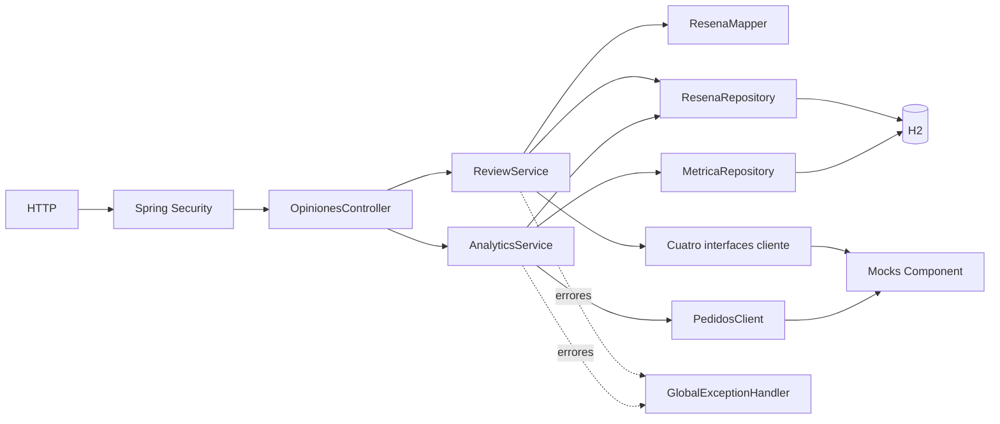
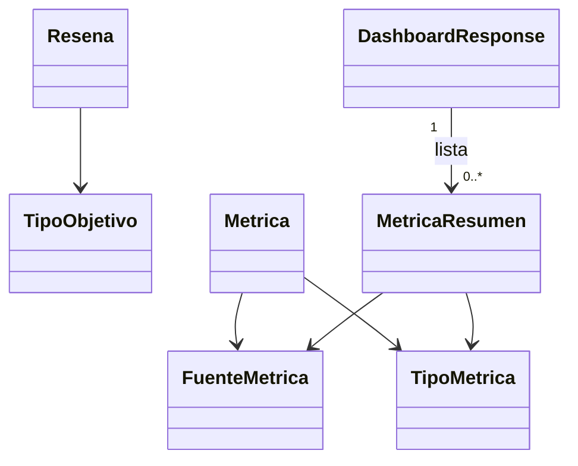
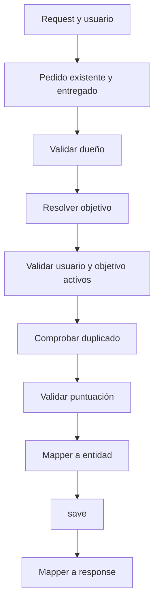
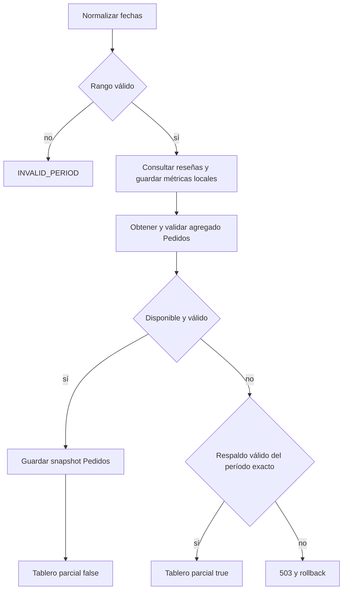

# DeliveryGo — Roadmap local de reconstrucción por ingeniería inversa

Documento didáctico para construir el mismo módulo en un repositorio vacío. Referencia: [guía de estudio](guia-de-estudio-local.md), contrastada con las clases de producción. El código es la fuente de verdad para firmas y comportamiento; los documentos de evolución no agregan funcionalidad ejecutable.

## Cómo trabajar

Realizar las tareas T01–T17 en orden. Cada tarea explica qué construir y cómo comprobarlo. El inventario técnico incluido en cada tarea enumera los miembros reales de las clases, incluidos constructores, accesores y métodos privados. No copiar archivos completos como sustituto del ejercicio: escribirlos y explicar por qué existen sus miembros. Se conservan nombres, paquetes, versiones y límites actuales. Las verificaciones son instrucciones para la futura reconstrucción, no pruebas ejecutadas durante la elaboración de este documento.

Crear el repositorio de destino fuera del original. Los enlaces de este documento apuntan al código original para consulta. No es necesario reproducir el historial de commits ni las variantes obsoletas eliminadas. Al completar una tarea compilable, ejecutar `mvn -DskipTests compile` desde la raíz del nuevo módulo. No intentar arrancar un contexto incompleto con dependencias aún pendientes.

**Resultado funcional:** crear reseñas de comercios y repartidores, consultar sus promedios y generar un tablero por período. Son CU-01 a CU-05, expuestos mediante cuatro operaciones HTTP. Se usan H2 en memoria y cuatro proveedores simulados; no hay comunicación HTTP saliente, JWT integrado ni endpoints de evolución.



## T01 — Preparar el repositorio y Maven

**Objetivo funcional:** disponer de un proyecto Java ejecutable sin funcionalidades de negocio. **Dependencias:** ninguna.

1. Crear un repositorio vacío y la estructura estándar Maven `src/main/java` y `src/main/resources`.
2. Configurar `groupId=ar.edu.uade.api`, `artifactId=deliverygo-ops-analitica`, versión `1.0.0-SNAPSHOT`, parent `spring-boot-starter-parent:3.5.16` y `java.version=25`.
3. Incorporar starters Web, Data JPA y Security; H2 con scope runtime; `jjwt-api:0.12.6`, `jjwt-impl:0.12.6` y `jjwt-jackson:0.12.6` (últimos dos runtime); `springdoc-openapi-starter-webmvc-ui:2.9.1`. Agregar `spring-boot-maven-plugin`. Consultar [pom original](pom.xml).
4. Crear el paquete raíz `ar.edu.uade.api.deliverygo` y subpaquetes `model`, `repository`, `dto`, `client`, `client.mock`, `excepcion`, `mapper`, `services`, `controller` y `config`. Respetar minúsculas.
5. Ignorar `target/`, `.idea/`, `*.iml`, `out/`, clases, logs y archivos locales. No incluir secretos ni artefactos compilados.

**Clases/métodos:** todavía ninguno. Maven declara dependencias, no objetos del dominio. La librería JJWT se conserva por fidelidad; no implica autenticación JWT.

**Verificación:** `java -version` y `mvn -version` deben usar JDK 25; `mvn validate` debe aceptar el POM. Si una dependencia no se resuelve, diagnosticar el entorno/repositorio Maven sin cambiar silenciosamente las versiones.

**Aprendizaje:** distinguir configuración de construcción y configuración de ejecución. ¿Por qué una dependencia runtime no necesita usarse directamente en el código?

## T02 — Crear arranque y propiedades

**Objetivo funcional:** iniciar la aplicación en el puerto 8089. **Dependencias:** T01.

Crear `DeliveryGoApplication` en el paquete raíz con `@SpringBootApplication`; su `main` llama a `SpringApplication.run(DeliveryGoApplication.class, args)`. La posición del paquete determina el escaneo de componentes y entidades.

Crear `application.properties` con el contenido operativo siguiente; las propiedades JWT comentadas del original son solo referencias futuras:

```properties
spring.application.name=deliverygo-ops-analitica
server.port=8089
spring.datasource.url=jdbc:h2:mem:deliverygo-ops-analitica
spring.datasource.driverClassName=org.h2.Driver
spring.datasource.username=sa
spring.datasource.password=
spring.jpa.hibernate.ddl-auto=create-drop
spring.jpa.show-sql=true
spring.h2.console.enabled=true
spring.h2.console.path=/h2-console
springdoc.swagger-ui.path=/swagger-ui.html
app.pedidos.mock.stats.disponible=true
app.pedidos.mock.stats.cantidad-entregados=2
springdoc.api-docs.version=OPENAPI_3_1
```

**Relaciones:** Spring crea el contexto y autoconfigura MVC, JPA y Security. No agregar `SecurityConfig` ni filtros propios.

**Verificación:** ejecutar `mvn spring-boot:run`, observar puerto y contraseña generada de Security. Detener la aplicación. H2 se pierde al reiniciar; habilitar su consola no garantiza que los filtros permitan usarla sin obstáculos.

**Aprendizaje:** ¿por qué `create-drop` no conserva reseñas entre ejecuciones?

### Inventario técnico de esta tarea

Los bloques siguientes son firmas, no archivos Java completos. Los campos conservan su visibilidad; los métodos de interfaces son implícitamente públicos. Reproducir los cuerpos según los pasos funcionales de la tarea.

#### `DeliveryGoApplication`

Fuente: [DeliveryGoApplication.java](src/main/java/ar/edu/uade/api/deliverygo/DeliveryGoApplication.java).

```java
public class DeliveryGoApplication
public static void main(String[] args);
```

## T03 — Modelar reseñas y snapshots

**Objetivo funcional:** almacenar opiniones y resultados agregados. **Dependencias:** T02.

1. Crear `TipoObjetivo` (COMERCIO, REPARTIDOR), `FuenteMetrica` (RESENAS, PEDIDOS) y `TipoMetrica` (PROMEDIO_CALIFICACION, CANTIDAD_RESENAS, PEDIDOS_ENTREGADOS).
2. Crear `Resena` con `@Entity`, tabla `resenas`, ID `Long` con `@Id` y `IDENTITY`. Todos los campos excepto ID son `updatable=false`. Todos son NOT NULL salvo comentario; comentario tiene longitud 1000. Persistir tipoObjetivo mediante `EnumType.STRING`. Declarar UNIQUE `uk_resena_usuario_pedido_tipo` sobre `usuario_id,pedido_id,tipo_objetivo`.
3. El constructor vacío permite materializar JPA; el constructor de negocio asigna sus seis parámetros y `fechaCreacion=LocalDateTime.now()`. No agregar setters. `toString()` muestra los campos salvo comentario.
4. Crear `Metrica`, tabla `metricas`, ID IDENTITY, todos los campos de negocio NOT NULL, enums STRING y valor decimal de precisión 19 y escala 4. UNIQUE `uk_metrica_fuente_tipo_periodo` sobre `fuente,tipo_metrica,periodo_desde,periodo_hasta`. Constructor completo recibe seis campos, incluida fechaCalculo; solo valor y fechaCalculo tienen setters. `toString()` incluye todos sus campos.

**Relaciones:** usuarioId, pedidoId y objetivoId son referencias externas escalares, sin FK ni `@ManyToOne`. No existe relación JPA entre Resena y Metrica: el servicio calcula agregados. La estrategia de nombres de Boot convierte camelCase a columnas snake_case.



**Verificación:** arrancar y revisar SQL de creación de ambas tablas y restricciones. Al persistir más adelante, comprobar ID generado, enum como texto y rechazo de duplicados por UNIQUE. `updatable=false` limita SQL de JPA; no es una política general de inmutabilidad de la base.

**Aprendizaje:** ¿por qué no se modela Usuario como entidad local?

### Inventario técnico de esta tarea

Los bloques siguientes son firmas, no archivos Java completos. Los campos conservan su visibilidad; los métodos de interfaces son implícitamente públicos. Reproducir los cuerpos según los pasos funcionales de la tarea.

#### `TipoObjetivo`

Fuente: [model/TipoObjetivo.java](src/main/java/ar/edu/uade/api/deliverygo/model/TipoObjetivo.java).

```java
public enum TipoObjetivo
Valores: COMERCIO, REPARTIDOR
```

#### `FuenteMetrica`

Fuente: [model/FuenteMetrica.java](src/main/java/ar/edu/uade/api/deliverygo/model/FuenteMetrica.java).

```java
public enum FuenteMetrica
Valores: RESENAS, PEDIDOS
```

#### `TipoMetrica`

Fuente: [model/TipoMetrica.java](src/main/java/ar/edu/uade/api/deliverygo/model/TipoMetrica.java).

```java
public enum TipoMetrica
Valores: PROMEDIO_CALIFICACION, CANTIDAD_RESENAS, PEDIDOS_ENTREGADOS
```

#### `Resena`

Fuente: [model/Resena.java](src/main/java/ar/edu/uade/api/deliverygo/model/Resena.java).

```java
public class Resena
private Long id;
private Long usuarioId;
private Long pedidoId;
private TipoObjetivo tipoObjetivo;
private Long objetivoId;
private Integer puntuacion;
private String comentario;
private LocalDateTime fechaCreacion;
public Resena();
public Resena(Long usuarioId, Long pedidoId, TipoObjetivo tipoObjetivo, Long objetivoId, Integer puntuacion, String comentario);
public Long getId();
public Long getUsuarioId();
public Long getPedidoId();
public TipoObjetivo getTipoObjetivo();
public Long getObjetivoId();
public Integer getPuntuacion();
public String getComentario();
public LocalDateTime getFechaCreacion();
public String toString();
```

#### `Metrica`

Fuente: [model/Metrica.java](src/main/java/ar/edu/uade/api/deliverygo/model/Metrica.java).

```java
public class Metrica
private Long id;
private FuenteMetrica fuente;
private TipoMetrica tipoMetrica;
private LocalDate periodoDesde;
private LocalDate periodoHasta;
private BigDecimal valor;
private LocalDateTime fechaCalculo;
public Metrica();
public Metrica(FuenteMetrica fuente, TipoMetrica tipoMetrica, LocalDate periodoDesde, LocalDate periodoHasta, BigDecimal valor, LocalDateTime fechaCalculo);
public Long getId();
public FuenteMetrica getFuente();
public TipoMetrica getTipoMetrica();
public LocalDate getPeriodoDesde();
public LocalDate getPeriodoHasta();
public BigDecimal getValor();
public void setValor(BigDecimal valor);
public LocalDateTime getFechaCalculo();
public void setFechaCalculo(LocalDateTime fechaCalculo);
public String toString();
```

## T04 — Implementar contratos de persistencia

**Objetivo funcional:** guardar y localizar reseñas y snapshots sin escribir SQL manual. **Dependencias:** T03.

Crear interfaces que extiendan `JpaRepository<Resena, Long>` y `JpaRepository<Metrica, Long>`. Spring Data genera sus implementaciones. No crear clases RepositoryImpl.

- `existsByUsuarioIdAndPedidoIdAndTipoObjetivo`: anticipa duplicados de negocio.
- `findByObjetivoIdAndTipoObjetivo`: lista usada para promedio; no mezclar IDs iguales de comercio y repartidor.
- `findByFechaCreacionGreaterThanEqualAndFechaCreacionLessThan`: intervalo `[desde,hasta)` con LocalDateTime.
- Búsqueda de Metrica por fuente, tipo y ambos extremos: devuelve Optional del snapshot exacto.
- Búsqueda `findFirstByFuenteAndTipoMetricaOrderByFechaCalculoDesc`: conservar aunque no se use actualmente para fallback.

**Métodos heredados usados:** `<S extends T> S save(S entity)` persiste/actualiza; JPA implementa el acceso concreto. `findAll()` y `count()` pueden ayudar a verificar datos, pero no son consultas nuevas del contrato de negocio.

**Verificación:** iniciar contexto para validar que Spring interpreta los nombres. Más adelante verificar listas vacías, Optional vacío y aislamiento por tipo/período. No reemplazar el respaldo exacto por el snapshot más reciente.

**Aprendizaje:** ¿qué diferencia hay entre `List` vacía y `Optional.empty()`?

### Inventario técnico de esta tarea

Los bloques siguientes son firmas, no archivos Java completos. Los campos conservan su visibilidad; los métodos de interfaces son implícitamente públicos. Reproducir los cuerpos según los pasos funcionales de la tarea.

#### `ResenaRepository`

Fuente: [repository/ResenaRepository.java](src/main/java/ar/edu/uade/api/deliverygo/repository/ResenaRepository.java).

```java
public interface ResenaRepository extends JpaRepository<Resena, Long>
```

#### `MetricaRepository`

Fuente: [repository/MetricaRepository.java](src/main/java/ar/edu/uade/api/deliverygo/repository/MetricaRepository.java).

```java
public interface MetricaRepository extends JpaRepository<Metrica, Long>
```

## T05 — Definir objetos de intercambio

**Objetivo funcional:** separar datos HTTP, datos de proveedores y entidades. **Dependencias:** T03.

Crear las once clases del inventario. Todos sus campos son privados; cada DTO tiene constructor público vacío, constructor público con todos los campos en el orden listado y getters/setters públicos. `DashboardResponse` usa `isParcial()` por tratarse de boolean primitivo. No agregar Lombok ni records para sustituir estas clases.

| DTO | Uso y significado |
| --- | --- |
| ResenaRequest | Entrada: pedido, tipo, puntuación y comentario; usuario y objetivo no se aceptan del body |
| ResenaResponse | Salida de creación con ID, identidad, objetivo y fecha |
| RatingResponse | Agregado por objetivo; promedio BigDecimal nullable y cantidad Long |
| DashboardResponse | Fecha actual de generación, lista de resúmenes y boolean parcial |
| MetricaResumen | Fuente, tipo, fechas y valor; omite ID y fechaCalculo |
| PedidoDTO | Estado textual, dueño y dos posibles IDs de objetivo |
| UsuarioDTO / ComercioDTO / RepartidorDTO | ID Long y actividad Boolean; null no equivale a activo |
| OrdersStatsDTO | Estado, período y cantidad Long; null permite detectar respuesta inválida |
| ErrorResponseDTO | Instant UTC, estado int, code, message, path y correlationId |

**Implementación:** copiar las anotaciones `@Schema` del contrato actual al llegar a T16. No agregar Bean Validation: `@Schema(minimum,maximum)` documenta, pero la puntuación se comprueba en servicio. LocalDate se serializa como fecha ISO; LocalDateTime no contiene zona; Instant representa UTC. El formato documental `local-date-time` no agrega un offset al dato.

**Relaciones:** DashboardResponse contiene una lista de MetricaResumen. Los DTOs que usan enums dependen del dominio; ninguno es una entidad JPA. Los campos pueden ser null en Java salvo primitivos; las reglas semánticas se aplican donde se especifica, no automáticamente por el tipo.

**Verificación:** instanciar cada constructor y comprobar accesores; contrastar JSON con las muestras de T14 y T17. No exponer Resena directamente.

**Aprendizaje:** ¿por qué el promedio vacío es null y no cero?

### Inventario técnico de esta tarea

Los bloques siguientes son firmas, no archivos Java completos. Los campos conservan su visibilidad; los métodos de interfaces son implícitamente públicos. Reproducir los cuerpos según los pasos funcionales de la tarea.

#### `ResenaRequest`

Fuente: [dto/ResenaRequest.java](src/main/java/ar/edu/uade/api/deliverygo/dto/ResenaRequest.java).

```java
public class ResenaRequest
private Long pedidoId;
private TipoObjetivo tipoObjetivo;
private Integer puntuacion;
private String comentario;
public ResenaRequest();
public ResenaRequest(Long pedidoId, TipoObjetivo tipoObjetivo, Integer puntuacion, String comentario);
public Long getPedidoId();
public void setPedidoId(Long pedidoId);
public TipoObjetivo getTipoObjetivo();
public void setTipoObjetivo(TipoObjetivo tipoObjetivo);
public Integer getPuntuacion();
public void setPuntuacion(Integer puntuacion);
public String getComentario();
public void setComentario(String comentario);
```

#### `ResenaResponse`

Fuente: [dto/ResenaResponse.java](src/main/java/ar/edu/uade/api/deliverygo/dto/ResenaResponse.java).

```java
public class ResenaResponse
private Long id;
private Long usuarioId;
private Long pedidoId;
private TipoObjetivo tipoObjetivo;
private Long objetivoId;
private Integer puntuacion;
private String comentario;
private LocalDateTime fechaCreacion;
public ResenaResponse();
public ResenaResponse(Long id, Long usuarioId, Long pedidoId, TipoObjetivo tipoObjetivo, Long objetivoId, Integer puntuacion, String comentario, LocalDateTime fechaCreacion);
public Long getId();
public void setId(Long id);
public Long getUsuarioId();
public void setUsuarioId(Long usuarioId);
public Long getPedidoId();
public void setPedidoId(Long pedidoId);
public TipoObjetivo getTipoObjetivo();
public void setTipoObjetivo(TipoObjetivo tipoObjetivo);
public Long getObjetivoId();
public void setObjetivoId(Long objetivoId);
public Integer getPuntuacion();
public void setPuntuacion(Integer puntuacion);
public String getComentario();
public void setComentario(String comentario);
public LocalDateTime getFechaCreacion();
public void setFechaCreacion(LocalDateTime fechaCreacion);
```

#### `RatingResponse`

Fuente: [dto/RatingResponse.java](src/main/java/ar/edu/uade/api/deliverygo/dto/RatingResponse.java).

```java
public class RatingResponse
private Long objetivoId;
private TipoObjetivo tipoObjetivo;
private BigDecimal promedio;
private Long cantidadResenas;
public RatingResponse();
public RatingResponse(Long objetivoId, TipoObjetivo tipoObjetivo, BigDecimal promedio, Long cantidadResenas);
public Long getObjetivoId();
public void setObjetivoId(Long objetivoId);
public TipoObjetivo getTipoObjetivo();
public void setTipoObjetivo(TipoObjetivo tipoObjetivo);
public BigDecimal getPromedio();
public void setPromedio(BigDecimal promedio);
public Long getCantidadResenas();
public void setCantidadResenas(Long cantidadResenas);
```

#### `DashboardResponse`

Fuente: [dto/DashboardResponse.java](src/main/java/ar/edu/uade/api/deliverygo/dto/DashboardResponse.java).

```java
public class DashboardResponse
private LocalDateTime generadoEn;
private List<ar.edu.uade.api.deliverygo.dto.MetricaResumen> metricas;
private boolean parcial; //DM-09
public DashboardResponse();
public DashboardResponse(LocalDateTime generadoEn, List<ar.edu.uade.api.deliverygo.dto.MetricaResumen> metricas, boolean parcial);
public LocalDateTime getGeneradoEn();
public void setGeneradoEn(LocalDateTime generadoEn);
public List<ar.edu.uade.api.deliverygo.dto.MetricaResumen> getMetricas();
public void setMetricas(List<ar.edu.uade.api.deliverygo.dto.MetricaResumen> metricas);
public boolean isParcial();
public void setParcial(boolean parcial);
```

#### `MetricaResumen`

Fuente: [dto/MetricaResumen.java](src/main/java/ar/edu/uade/api/deliverygo/dto/MetricaResumen.java).

```java
public class MetricaResumen
private FuenteMetrica fuente;
private TipoMetrica tipoMetrica;
private LocalDate periodoDesde;
private LocalDate periodoHasta;
private BigDecimal valor;
public MetricaResumen();
public MetricaResumen(FuenteMetrica fuente, TipoMetrica tipoMetrica, LocalDate periodoDesde, LocalDate periodoHasta, BigDecimal valor);
public FuenteMetrica getFuente();
public void setFuente(FuenteMetrica fuente);
public TipoMetrica getTipoMetrica();
public void setTipoMetrica(TipoMetrica tipoMetrica);
public LocalDate getPeriodoDesde();
public void setPeriodoDesde(LocalDate periodoDesde);
public LocalDate getPeriodoHasta();
public void setPeriodoHasta(LocalDate periodoHasta);
public BigDecimal getValor();
public void setValor(BigDecimal valor);
```

#### `PedidoDTO`

Fuente: [dto/PedidoDTO.java](src/main/java/ar/edu/uade/api/deliverygo/dto/PedidoDTO.java).

```java
public class PedidoDTO
private Long id;
private Long usuarioId;
private Long comercioId;
private Long repartidorId;
private String estado;
public PedidoDTO();
public PedidoDTO(Long id, Long usuarioId, Long comercioId, Long repartidorId, String estado);
public Long getId();
public void setId(Long id);
public Long getUsuarioId();
public void setUsuarioId(Long usuarioId);
public Long getComercioId();
public void setComercioId(Long comercioId);
public Long getRepartidorId();
public void setRepartidorId(Long repartidorId);
public String getEstado();
public void setEstado(String estado);
```

#### `UsuarioDTO`

Fuente: [dto/UsuarioDTO.java](src/main/java/ar/edu/uade/api/deliverygo/dto/UsuarioDTO.java).

```java
public class UsuarioDTO
private Long id;
private Boolean activo;
public UsuarioDTO();
public UsuarioDTO(Long id, Boolean activo);
public Long getId();
public void setId(Long id);
public Boolean getActivo();
public void setActivo(Boolean activo);
```

#### `ComercioDTO`

Fuente: [dto/ComercioDTO.java](src/main/java/ar/edu/uade/api/deliverygo/dto/ComercioDTO.java).

```java
public class ComercioDTO
private Long id;
private Boolean activo;
public ComercioDTO();
public ComercioDTO(Long id, Boolean activo);
public Long getId();
public void setId(Long id);
public Boolean getActivo();
public void setActivo(Boolean activo);
```

#### `RepartidorDTO`

Fuente: [dto/RepartidorDTO.java](src/main/java/ar/edu/uade/api/deliverygo/dto/RepartidorDTO.java).

```java
public class RepartidorDTO
private Long id;
private Boolean activo;
public RepartidorDTO();
public RepartidorDTO(Long id, Boolean activo);
public Long getId();
public void setId(Long id);
public Boolean getActivo();
public void setActivo(Boolean activo);
```

#### `OrdersStatsDTO`

Fuente: [dto/OrdersStatsDTO.java](src/main/java/ar/edu/uade/api/deliverygo/dto/OrdersStatsDTO.java).

```java
public class OrdersStatsDTO
private String estado;
private LocalDate periodoDesde;
private LocalDate periodoHasta;
private Long cantidad;
public OrdersStatsDTO();
public OrdersStatsDTO(String estado, LocalDate periodoDesde, LocalDate periodoHasta, Long cantidad);
public String getEstado();
public void setEstado(String estado);
public LocalDate getPeriodoDesde();
public void setPeriodoDesde(LocalDate periodoDesde);
public LocalDate getPeriodoHasta();
public void setPeriodoHasta(LocalDate periodoHasta);
public Long getCantidad();
public void setCantidad(Long cantidad);
```

#### `ErrorResponseDTO`

Fuente: [dto/ErrorResponseDTO.java](src/main/java/ar/edu/uade/api/deliverygo/dto/ErrorResponseDTO.java).

```java
public class ErrorResponseDTO
private Instant timestamp;
private int status;
private String code;
private String message;
private String path;
private String correlationId;
public String getCorrelationId();
public void setCorrelationId(String correlationId);
public ErrorResponseDTO();
public ErrorResponseDTO(Instant timestamp, int status, String code, String message, String path, String correlationId);
public Instant getTimestamp();
public void setTimestamp(Instant timestamp);
public int getStatus();
public void setStatus(int status);
public String getCode();
public void setCode(String code);
public String getMessage();
public void setMessage(String message);
public String getPath();
public void setPath(String path);
```

## T06 — Aislar contratos de proveedores

**Objetivo funcional:** consultar datos que pertenecen a otros módulos sin acceder a sus bases. **Dependencias:** T05.

Crear cuatro interfaces con las firmas listadas. Una entidad ausente se representa mediante Optional vacío; una indisponibilidad se expresa mediante ExternalServiceUnavailableException (T08). El agregado de Pedidos devuelve OrdersStatsDTO directamente y será validado por AnalyticsService.

**Relaciones:** ReviewService dependerá de las cuatro interfaces; AnalyticsService solo de PedidosClient. Las rutas remotas citadas en sus comentarios describen contratos esperados, no llamadas implementadas. INT-05 sigue siendo propuesta pendiente de acuerdo con Pedidos.

**Verificación:** compilar interfaces y DTOs; revisar que ningún import dependa de paquetes de otro equipo ni aparezca un cliente HTTP real.

**Aprendizaje:** ¿cómo permite una interfaz sustituir un mock por un adaptador en el futuro?

### Inventario técnico de esta tarea

Los bloques siguientes son firmas, no archivos Java completos. Los campos conservan su visibilidad; los métodos de interfaces son implícitamente públicos. Reproducir los cuerpos según los pasos funcionales de la tarea.

#### `PedidosClient`

Fuente: [client/PedidosClient.java](src/main/java/ar/edu/uade/api/deliverygo/client/PedidosClient.java).

```java
public interface PedidosClient
Optional<PedidoDTO> obtenerPedido(Long pedidoId);
OrdersStatsDTO obtenerEstadisticas(String estado, LocalDate periodoDesde, LocalDate periodoHasta);
```

#### `UsuariosClient`

Fuente: [client/UsuariosClient.java](src/main/java/ar/edu/uade/api/deliverygo/client/UsuariosClient.java).

```java
public interface UsuariosClient
Optional<UsuarioDTO> obtenerUsuario(Long usuarioId);
```

#### `ComercioClient`

Fuente: [client/ComercioClient.java](src/main/java/ar/edu/uade/api/deliverygo/client/ComercioClient.java).

```java
public interface ComercioClient
Optional<ComercioDTO> obtenerComercio(Long comercioId);
```

#### `LogisticaClient`

Fuente: [client/LogisticaClient.java](src/main/java/ar/edu/uade/api/deliverygo/client/LogisticaClient.java).

```java
public interface LogisticaClient
Optional<RepartidorDTO> obtenerRepartidor(Long repartidorId);
```

## T07 — Proveer datos simulados

**Objetivo funcional:** ejecutar los casos de uso sin otros equipos. **Dependencias:** T06; implementar primero T08 para compilar PedidosClientMock.

Crear las cuatro implementaciones con `@Component`, sin constructores explícitos (Java aporta constructor público sin argumentos). Usar campos `private final Map` inicializados con `Map.of`. Cada búsqueda devuelve `Optional.ofNullable(mapa.get(id))`.

| Mock | Datos exactos |
| --- | --- |
| UsuariosClientMock | usuarios: 100 → UsuarioDTO(100,true) |
| ComercioClientMock | comercios: 10 → ComercioDTO(10,true) |
| LogisticaClientMock | repartidores: 20 → RepartidorDTO(20,true) |
| PedidosClientMock | 1 → (1,100,10,null,ENTREGADO); 2 → (2,100,null,20,ENTREGADO); 3 → (3,100,10,null,EN_CAMINO) |

Inyectar con `@Value` `estadisticasDisponibles` desde `app.pedidos.mock.stats.disponible` (default true) y `cantidadEntregados` desde `app.pedidos.mock.stats.cantidad-entregados` (default 2). En obtenerEstadisticas, si no disponible o cantidad negativa, lanzar ExternalServiceUnavailableException; si no, devolver estado y fechas recibidos más la cantidad configurada. No contar elementos del mapa: la cantidad simulada aplica a cualquier período.

**Relaciones:** cada mock implementa una interfaz; Spring lo inyecta por tipo. No hay perfiles, selección condicional de beans ni setters públicos para cambiar estadísticas. Map.of no acepta claves null: no interpretar un ID null como una ausencia controlada garantizada.

**Verificación:** pedido 1 sirve para COMERCIO y pedido 2 para REPARTIDOR. Buscar ID desconocido no nulo devuelve Optional vacío. Desactivar estadísticas solo afecta dashboard, no búsqueda de pedidos.

**Aprendizaje:** ¿por qué cantidadEntregados=2 no demuestra dos entregas reales en el período?

### Inventario técnico de esta tarea

Los bloques siguientes son firmas, no archivos Java completos. Los campos conservan su visibilidad; los métodos de interfaces son implícitamente públicos. Reproducir los cuerpos según los pasos funcionales de la tarea.

#### `PedidosClientMock`

Fuente: [client/mock/PedidosClientMock.java](src/main/java/ar/edu/uade/api/deliverygo/client/mock/PedidosClientMock.java).

```java
public class PedidosClientMock implements PedidosClient
private boolean estadisticasDisponibles;
private long cantidadEntregados;
private final Map<Long, PedidoDTO> pedidos;
public Optional<PedidoDTO> obtenerPedido(Long pedidoId);
public OrdersStatsDTO obtenerEstadisticas(String estado, LocalDate periodoDesde, LocalDate periodoHasta);
```

#### `UsuariosClientMock`

Fuente: [client/mock/UsuariosClientMock.java](src/main/java/ar/edu/uade/api/deliverygo/client/mock/UsuariosClientMock.java).

```java
public class UsuariosClientMock implements UsuariosClient
private final Map<Long, UsuarioDTO> usuarios;
public Optional<UsuarioDTO> obtenerUsuario(Long usuarioId);
```

#### `ComercioClientMock`

Fuente: [client/mock/ComercioClientMock.java](src/main/java/ar/edu/uade/api/deliverygo/client/mock/ComercioClientMock.java).

```java
public class ComercioClientMock implements ComercioClient
private final Map<Long, ComercioDTO> comercios;
public Optional<ComercioDTO> obtenerComercio(Long comercioId);
```

#### `LogisticaClientMock`

Fuente: [client/mock/LogisticaClientMock.java](src/main/java/ar/edu/uade/api/deliverygo/client/mock/LogisticaClientMock.java).

```java
public class LogisticaClientMock implements LogisticaClient
private final Map<Long, RepartidorDTO> repartidores;
public Optional<RepartidorDTO> obtenerRepartidor(Long repartidorId);
```

## T08 — Definir excepciones de negocio

**Objetivo funcional:** expresar fallos sin acoplar servicios a HTTP. **Dependencias:** T01. Esta tarea puede completarse antes de T07.

Crear las siete clases de la tabla, cada una `extends RuntimeException` y con constructor público que recibe un String y ejecuta `super(...)`. No tienen atributos propios, getters ni otros métodos declarados. El mensaje y comportamiento de excepción se heredan.

| Excepción | Condición | HTTP en T13 | code |
| --- | --- | --- | --- |
| OrderNotDeliveredException | Pedido ausente o no ENTREGADO | 422 | BUSINESS_RULE_VIOLATION |
| OrderNotOwnedException | Dueño distinto | 422 | BUSINESS_RULE_VIOLATION |
| ExternalEntityInvalidException | Usuario u objetivo ausente/inactivo | 422 | BUSINESS_RULE_VIOLATION |
| DuplicateReviewException | Usuario/pedido/tipo ya reseñado | 409 | DUPLICATE_REVIEW |
| InvalidRatingException | Puntuación null o fuera de 1–5 | 400 | INVALID_RATING |
| ExternalServiceUnavailableException | Proveedor indisponible o estadísticas inválidas sin respaldo | 503 | EXTERNAL_SERVICE_UNAVAILABLE |
| InvalidPeriodException | Desde posterior a hasta | 400 | INVALID_PERIOD |

**Relaciones:** los servicios lanzan estas clases; el advice las traduce. Su carácter unchecked produce rollback por defecto en transacciones Spring cuando escapan del método transaccional.

**Verificación:** comprobar herencia y mensaje construido. No agregar catch global que cambie excepciones no manejadas.

**Aprendizaje:** ¿por qué una excepción de dominio no necesita conocer HttpStatus?

### Inventario técnico de esta tarea

Los bloques siguientes son firmas, no archivos Java completos. Los campos conservan su visibilidad; los métodos de interfaces son implícitamente públicos. Reproducir los cuerpos según los pasos funcionales de la tarea.

#### `OrderNotDeliveredException`

Fuente: [excepcion/OrderNotDeliveredException.java](src/main/java/ar/edu/uade/api/deliverygo/excepcion/OrderNotDeliveredException.java).

```java
public class OrderNotDeliveredException extends RuntimeException
public OrderNotDeliveredException(String mensaje);
```

#### `OrderNotOwnedException`

Fuente: [excepcion/OrderNotOwnedException.java](src/main/java/ar/edu/uade/api/deliverygo/excepcion/OrderNotOwnedException.java).

```java
public class OrderNotOwnedException extends RuntimeException
public OrderNotOwnedException(String mensaje);
```

#### `ExternalEntityInvalidException`

Fuente: [excepcion/ExternalEntityInvalidException.java](src/main/java/ar/edu/uade/api/deliverygo/excepcion/ExternalEntityInvalidException.java).

```java
public class ExternalEntityInvalidException extends RuntimeException
public ExternalEntityInvalidException(String mensaje);
```

#### `DuplicateReviewException`

Fuente: [excepcion/DuplicateReviewException.java](src/main/java/ar/edu/uade/api/deliverygo/excepcion/DuplicateReviewException.java).

```java
public class DuplicateReviewException extends RuntimeException
public DuplicateReviewException(String mensaje);
```

#### `InvalidRatingException`

Fuente: [excepcion/InvalidRatingException.java](src/main/java/ar/edu/uade/api/deliverygo/excepcion/InvalidRatingException.java).

```java
public class InvalidRatingException extends RuntimeException
public InvalidRatingException(String mensaje);
```

#### `ExternalServiceUnavailableException`

Fuente: [excepcion/ExternalServiceUnavailableException.java](src/main/java/ar/edu/uade/api/deliverygo/excepcion/ExternalServiceUnavailableException.java).

```java
public class ExternalServiceUnavailableException extends RuntimeException
public ExternalServiceUnavailableException(String mensaje);
```

#### `InvalidPeriodException`

Fuente: [excepcion/InvalidPeriodException.java](src/main/java/ar/edu/uade/api/deliverygo/excepcion/InvalidPeriodException.java).

```java
public class InvalidPeriodException extends RuntimeException
public InvalidPeriodException(String message);
```

## T09 — Convertir DTOs y entidades

**Objetivo funcional:** preparar una reseña persistible y una respuesta independiente de JPA. **Dependencias:** T03 y T05.

Crear `ResenaMapper` final, sin atributos, constructor privado vacío y dos métodos públicos estáticos. No es bean de Spring.

- toEntity pasa al constructor de Resena: usuarioIdAutenticado, request.pedidoId, request.tipoObjetivo, objetivoId resuelto, request.puntuacion y request.comentario. La fecha se genera en la entidad; no en el request ni en el mapper.
- toResponse copia todos los ocho campos mediante getters. El ID debe venir de la entidad después de save.

**Verificación:** una entrada con pedido 1 y tipo COMERCIO más usuario 100 y objetivo 10 debe producir esos IDs; la respuesta preserva campos e incluye fecha. Antes de persistir, ID es null.

**Aprendizaje:** ¿por qué toEntity recibe usuario y objetivo por parámetros separados?

### Inventario técnico de esta tarea

Los bloques siguientes son firmas, no archivos Java completos. Los campos conservan su visibilidad; los métodos de interfaces son implícitamente públicos. Reproducir los cuerpos según los pasos funcionales de la tarea.

#### `ResenaMapper`

Fuente: [mapper/ResenaMapper.java](src/main/java/ar/edu/uade/api/deliverygo/mapper/ResenaMapper.java).

```java
public final class ResenaMapper
private ResenaMapper();
public static Resena toEntity(ResenaRequest resenaRequest, Long usuarioIdAutenticado, Long objetivoId);
public static ResenaResponse toResponse(Resena resena);
```

## T10 — Crear reseñas con reglas ordenadas

**Objetivo funcional:** un usuario califica una entrega propia una vez por tipo. **Dependencias:** T04–T09.

Crear `ReviewService` con `@Service`, constante privada estática final ESTADO_ENTREGADO="ENTREGADO", cinco dependencias privadas final y constructor público de inyección. Implementar crearResena con `@Transactional` respetando este orden:

1. PedidosClient.obtenerPedido: vacío lanza OrderNotDeliveredException.
2. Comparar estado con ENTREGADO: rechazar otros estados.
3. Comparar pedido.usuarioId con usuarioIdAutenticado: rechazar dueño distinto.
4. resolverObjetivoId usa switch: COMERCIO → comercioId; REPARTIDOR → repartidorId.
5. validarUsuario consulta UsuariosClient; ausencia o activo diferente de Boolean.TRUE produce ExternalEntityInvalidException.
6. validarObjetivo consulta ComercioClient para COMERCIO o LogisticaClient para REPARTIDOR y exige actividad verdadera.
7. Consultar exists de usuario/pedido/tipo; si existe, DuplicateReviewException.
8. validarPuntuacion exige no null y rango inclusivo 1–5.
9. Convertir con mapper, guardar con repositorio y convertir a response.

**Relaciones:** servicio → interfaces de proveedores y repositorio; dependencia estática hacia mapper. No inyectar mocks concretos. No leer objetivoId del body.

**Límites que se conservan:** tipo null puede fallar en switch; no hay validación completa de IDs ni comentario; los fallos de base y carreras UNIQUE no están traducidos al error de duplicado. Dos solicitudes concurrentes pueden superar el exists. No alterar el orden: determina qué error gana si hay varios problemas.



**Verificación:** pedido 1/comercio/100/puntuación 5 crea; repetir falla por duplicado; pedido 3 falla por estado; pedido 1/usuario 101 falla por propietario antes de consultar actividad. Para puntuación inválida usar una combinación aún no reseñada y válida en las comprobaciones anteriores.

**Aprendizaje:** ¿por qué una puntuación 0 puede terminar en 422 o 409 antes de llegar a INVALID_RATING?

### Inventario técnico de esta tarea

Los bloques siguientes son firmas, no archivos Java completos. Los campos conservan su visibilidad; los métodos de interfaces son implícitamente públicos. Reproducir los cuerpos según los pasos funcionales de la tarea.

#### `ReviewService`

Fuente: [services/ReviewService.java](src/main/java/ar/edu/uade/api/deliverygo/services/ReviewService.java).

```java
public class ReviewService
private static final String ESTADO_ENTREGADO = "ENTREGADO";
private final ResenaRepository resenaRepository;
private final PedidosClient pedidosClient;
private final UsuariosClient usuariosClient;
private final ComercioClient comercioClient;
private final LogisticaClient logisticaClient;
public ReviewService(ResenaRepository resenaRepository, PedidosClient pedidosClient, UsuariosClient usuariosClient, ComercioClient comercioClient, LogisticaClient logisticaClient);
public ResenaResponse crearResena(ResenaRequest resenaRequest, Long usuarioIdAutenticado);
private Long resolverObjetivoId(TipoObjetivo tipoObjetivo, PedidoDTO pedido);
private void validarUsuario(Long usuarioId);
private void validarObjetivo(TipoObjetivo tipoObjetivo, Long objetivoId);
private void validarPuntuacion(Integer puntuacion);
public RatingResponse obtenerPromedio(TipoObjetivo tipoObjetivo, Long objetivoId);
```

## T11 — Consultar promedio por objetivo

**Objetivo funcional:** ver reputación de comercio o repartidor. **Dependencias:** T10; completar el método obtenerPromedio del mismo servicio, ya inventariado en T10.

Usar `@Transactional(readOnly=true)`. Consultar ResenaRepository por objetivoId y tipo. Si está vacío devolver RatingResponse(objetivoId,tipo,null,0L). Si contiene reseñas, sumar puntuaciones con stream/mapToInt, convertir total a BigDecimal y dividir por cantidad con escala 2 y RoundingMode.HALF_UP. Devolver cantidad como long/Long.

**Relaciones y métodos:** reutiliza dependencias de ReviewService, `obtenerPromedio(TipoObjetivo,Long)` y RatingResponse. No consulta proveedores para comprobar existencia del objetivo.

**Verificación:** objetivo desconocido sin reseñas devuelve promedio null y cantidad 0, no 404. Con puntuaciones 4,5,5 para el mismo objetivo devolver 4.67 y cantidad 3. Como los mocks originales solo permiten una reseña por objetivo, preparar esas tres entidades con distintos pedidos mediante una prueba de repositorio/servicio en el destino, sin ampliar datos de producción.

**Aprendizaje:** ¿por qué separar objetivoId y tipoObjetivo al consultar?

## T12 — Generar tablero y recuperar snapshots

**Objetivo funcional:** mostrar cantidad de reseñas, promedio global y pedidos entregados por período. **Dependencias:** T04–T08.

Crear `AnalyticsService @Service`, tres campos privados final y constructor de inyección. Implementar `generarTablero(LocalDate desde, LocalDate hasta)` con `@Transactional`:

1. Obtener hoy una vez. Reemplazar cada extremo null por hoy de forma independiente. Si desde>hasta lanzar InvalidPeriodException.
2. Buscar reseñas con fechaCreacion >= desde.atStartOfDay() y < hasta.plusDays(1).atStartOfDay(). Es un período inclusivo de días representado mediante intervalo semiabierto.
3. Añadir y persistir snapshot RESENAS/CANTIDAD_RESENAS con BigDecimal.valueOf(size).
4. Con reseñas, calcular promedio global de ambos tipos, escala 2 HALF_UP, persistir y añadir RESENAS/PROMEDIO_CALIFICACION. Sin reseñas, añadir resumen con valor null sin persistirlo (columna NOT NULL).
5. Pedir estadísticas con estado literal ENTREGADO y fechas normalizadas. Invalidar respuesta null, cantidad null/negativa, estado diferente o fechas diferentes lanzando ExternalServiceUnavailableException.
6. Si válido, persistir/añadir PEDIDOS/PEDIDOS_ENTREGADOS y mantener parcial=false.
7. Capturar exclusivamente ExternalServiceUnavailableException: buscar snapshot por fuente PEDIDOS, tipo PEDIDOS_ENTREGADOS y ambas fechas exactas. Exigir valor no null y >=0. Si existe añadir resumen y parcial=true sin modificar su fechaCalculo; si no, lanzar nueva ExternalServiceUnavailableException.
8. Devolver DashboardResponse(LocalDateTime.now(),metricas,parcial). La lista mantiene orden: cantidad reseñas, promedio, pedidos.

Implementar `guardarSnapshot` privado: buscar período exacto; si existe actualizar valor y fechaCalculo con now; si no, crear Metrica con now; guardar y devolver MetricaResumen. No escribir una consulta SQL upsert ni usar el snapshot de otro período.

**Relaciones y efectos:** usa ambos repositorios y PedidosClient. El GET de dashboard escribe snapshots. Si una excepción unchecked escapa, se revierten también las escrituras locales de esa solicitud. Si se usa respaldo y termina normalmente, las métricas locales se confirman. Es un upsert lógico, sin locks ni reintentos concurrentes.



**Verificación:** rango sin reseñas produce tres resúmenes y solo dos snapshots persistidos (cantidad y pedidos); repetir rango no duplica filas. Reseñas sobre inicio y durante el día final se incluyen, las del día siguiente se excluyen. Probar caída con/sin respaldo y comparar fechaCalculo y conteo de filas antes/después. El servicio no impone vencimiento al respaldo ni exige valor entero; solo no negativo. generadoEn es fecha de respuesta, no edad del respaldo.

**Aprendizaje:** ¿por qué la caída de Pedidos no puede interpretarse como cantidad 0?

### Inventario técnico de esta tarea

Los bloques siguientes son firmas, no archivos Java completos. Los campos conservan su visibilidad; los métodos de interfaces son implícitamente públicos. Reproducir los cuerpos según los pasos funcionales de la tarea.

#### `AnalyticsService`

Fuente: [services/AnalyticsService.java](src/main/java/ar/edu/uade/api/deliverygo/services/AnalyticsService.java).

```java
public class AnalyticsService
private  final ResenaRepository resenaRepository;
private final MetricaRepository metricaRepository;
private final PedidosClient pedidosClient;
public AnalyticsService(ResenaRepository resenaRepository, MetricaRepository metricaRepository, PedidosClient pedidosClient);
public DashboardResponse generarTablero(LocalDate desde, LocalDate hasta);
private MetricaResumen guardarSnapshot(FuenteMetrica fuente, TipoMetrica tipo, LocalDate desde, LocalDate hasta, BigDecimal valor);
```

## T13 — Traducir excepciones a respuestas HTTP

**Objetivo funcional:** comunicar fallos de negocio con un formato estable. **Dependencias:** T05 y T08.

Crear `GlobalExceptionHandler @RestControllerAdvice`. No declara atributos ni constructor explícito. Añadir siete métodos públicos con `@ExceptionHandler` para la clase correspondiente; usar los estados de la tabla T08. Cada uno delega a construir.

- `codigo(RuntimeException)` devuelve códigos de T08; las tres excepciones de regla comparten BUSINESS_RULE_VIOLATION.
- `correlationId(HttpServletRequest)` lee X-Correlation-Id. Acepta solo UUID que al parsear y volver a texto coincida ignorando mayúsculas; conserva el string recibido si válido. Si ausente o inválido genera UUID.randomUUID().toString(). No reflejar texto inválido en mensajes.
- `construir(HttpStatus,RuntimeException,HttpServletRequest)` crea ErrorResponseDTO con Instant.now(), status.value(), código, ex.getMessage(), request.getRequestURI() y correlación. Retorna ResponseEntity.status(status).body(error).

**Relaciones:** advice depende de DTO, excepciones y request Servlet. No agrega cabecera de respuesta, filtro de trazabilidad ni manejador general de Exception. Errores de binding, Security y excepciones no cubiertas mantienen otros formatos.

**Verificación:** errores controlados deben tener exactamente los campos timestamp/status/code/message/path/correlationId del contrato. Probar UUID válido, ausente y texto inválido. Fecha mal formada no debe documentarse como si pasara por este handler.

**Aprendizaje:** ¿por qué correlationId no garantiza trazabilidad integral de todas las respuestas?

### Inventario técnico de esta tarea

Los bloques siguientes son firmas, no archivos Java completos. Los campos conservan su visibilidad; los métodos de interfaces son implícitamente públicos. Reproducir los cuerpos según los pasos funcionales de la tarea.

#### `GlobalExceptionHandler`

Fuente: [excepcion/GlobalExceptionHandler.java](src/main/java/ar/edu/uade/api/deliverygo/excepcion/GlobalExceptionHandler.java).

```java
public class GlobalExceptionHandler
public ResponseEntity<ErrorResponseDTO> manejarOrderNotDelivered( OrderNotDeliveredException ex, HttpServletRequest request);
public ResponseEntity<ErrorResponseDTO> manejarOrderNotOwned( OrderNotOwnedException ex, HttpServletRequest request);
public ResponseEntity<ErrorResponseDTO> manejarExternalEntityInvalid( ExternalEntityInvalidException ex, HttpServletRequest request);
public ResponseEntity<ErrorResponseDTO> manejarDuplicateReview( DuplicateReviewException ex, HttpServletRequest request);
public ResponseEntity<ErrorResponseDTO> manejarInvalidRating( InvalidRatingException ex, HttpServletRequest request);
public ResponseEntity<ErrorResponseDTO> manejarExternalServiceUnavailable( ExternalServiceUnavailableException ex, HttpServletRequest request);
public ResponseEntity<ErrorResponseDTO> manejarInvalidPeriod( InvalidPeriodException ex, HttpServletRequest request);
private String correlationId(HttpServletRequest request);
private String codigo(RuntimeException ex);
private ResponseEntity<ErrorResponseDTO> construir( HttpStatus status, RuntimeException ex, HttpServletRequest request);
```

## T14 — Exponer cuatro operaciones HTTP

**Objetivo funcional:** acceder al módulo desde HTTP. **Dependencias:** T10–T13.

Crear OpinionesController con `@RestController`, `@RequestMapping(value="/api/v1",produces="application/json")`, dos campos privados final y constructor público. Sus métodos delegan sin duplicar validaciones.

| Método | Ruta completa | Binding | Respuesta |
| --- | --- | --- | --- |
| crearResena | POST /api/v1/reviews | @RequestBody ResenaRequest y @RequestHeader("X-Usuario-Id") Long | 201 ResenaResponse |
| obtenerRatingComercio | GET /api/v1/merchants/{id}/rating | @PathVariable("id") Long | 200 RatingResponse, tipo COMERCIO |
| obtenerRatingRepartidor | GET /api/v1/couriers/{id}/rating | @PathVariable("id") Long | 200 RatingResponse, tipo REPARTIDOR |
| obtenerTablero | GET /api/v1/analytics/dashboard | @RequestParam opcionales periodoDesde/periodoHasta, @DateTimeFormat ISO.DATE, LocalDate | 200 DashboardResponse |

El nombre Java desde/hasta no cambia el nombre HTTP periodoDesde/periodoHasta. Header ausente, JSON incorrecto o tipos no convertibles pueden fallar antes del servicio. No añadir @Valid ni endpoints PUT/DELETE.

Crear también el record público anidado `SpringBootErrorSchema(Instant timestamp,int status,String error,String path)` para documentación: genera constructor canónico y accesores timestamp(), status(), error(), path(), además de equals/hashCode/toString; no se usa para construir respuestas en ejecución.

**Ejemplo de entrada:** `{"pedidoId":1,"tipoObjetivo":"COMERCIO","puntuacion":5,"comentario":"Buena atención"}` con X-Usuario-Id:100. Respuesta incluye id generado, usuarioId 100, objetivoId 10 y fechaCreacion. Pedido 2 con REPARTIDOR resuelve objetivoId 20.

**Verificación:** recorrer los cuatro mappings, confirmar estados y formas de respuesta con seguridad resuelta en T15. No confundir un 403 de filtros con una regla fallida.

**Aprendizaje:** ¿por qué el cliente no puede elegir objetivoId en el body?

### Inventario técnico de esta tarea

Los bloques siguientes son firmas, no archivos Java completos. Los campos conservan su visibilidad; los métodos de interfaces son implícitamente públicos. Reproducir los cuerpos según los pasos funcionales de la tarea.

#### `OpinionesController`

Fuente: [controller/OpinionesController.java](src/main/java/ar/edu/uade/api/deliverygo/controller/OpinionesController.java).

```java
public class OpinionesController
public record SpringBootErrorSchema(java.time.Instant timestamp, int status, String error, String path);
private final ReviewService reviewService;
private final AnalyticsService analyticsService;
public OpinionesController(ReviewService reviewService, AnalyticsService analyticsService);
public ResponseEntity<ResenaResponse> crearResena( @io.swagger.v3.oas.annotations.parameters.RequestBody( description = "Datos de la reseña. El DTO no declara restricciones Bean Validation.", required = true, content = @Content(mediaType = "application/json", schema = @Schema(implementation = ResenaRequest.class))) @RequestBody ResenaRequest resenaRequest, @Parameter(name = "X-Usuario-Id", in = ParameterIn.HEADER, required = true, description = "Id del usuario que realiza la operación. Header temporal hasta integrar JWT.", example = "100") @RequestHeader("X-Usuario-Id") Long usuarioIdAutenticado);
public ResponseEntity<RatingResponse> obtenerRatingComercio( @Parameter(description = "Id del comercio", required = true, example = "10") @PathVariable("id") Long id);
public ResponseEntity<RatingResponse> obtenerRatingRepartidor( @Parameter(description = "Id del repartidor", required = true, example = "20") @PathVariable("id") Long id);
public ResponseEntity<DashboardResponse> obtenerTablero( @Parameter(description = "Inicio inclusivo, ISO-8601 (yyyy-MM-dd). Si se omite, fecha actual del servidor", example = "2025-01-01") @RequestParam(value = "periodoDesde", required = false) @DateTimeFormat(iso = DateTimeFormat.ISO.DATE) LocalDate desde, @Parameter(description = "Fin inclusivo, ISO-8601 (yyyy-MM-dd). Si se omite, fecha actual del servidor. Debe ser igual o posterior a periodoDesde.", example = "2025-01-31") @RequestParam(value = "periodoHasta", required = false) @DateTimeFormat(iso = DateTimeFormat.ISO.DATE) LocalDate hasta);
```

## T15 — Reproducir y comprender la seguridad actual

**Objetivo funcional:** ejecutar solicitudes con las protecciones automáticas existentes. **Dependencias:** T14.

No crear clases propias: no hay SecurityConfig, JWT filter, roles configurados ni resolución de usuario de negocio desde principal. Spring Security autoconfigura autenticación Basic/formulario y mantiene CSRF. Usar usuario `user` y contraseña generada al arrancar, o propiedades de ejecución locales para fijarla sin incorporarla al repositorio.

Para GET usar `curl --fail --show-error --user user -H 'Accept: application/json' http://localhost:8089/api/v1/merchants/10/rating`; curl solicita la contraseña. Swagger también requiere autenticación. Declarar basicAuth en OpenAPI documenta seguridad, no la instala.

Para POST didáctico con navegador: abrir /login, iniciar sesión con el formulario y su CSRF; en la misma sesión obtener el token vigente del formulario /logout sin enviarlo (o inspeccionar la petición/formulario correspondiente). Enviar con esa cookie el header X-CSRF-TOKEN, Content-Type application/json y X-Usuario-Id:100. El token debe pertenecer a la sesión autenticada actual: puede renovarse después del login. Se puede usar una petición desde consola del navegador en el mismo origen con credentials:'same-origin'. No ejecutar logout antes del POST. Consultar también [guía API](docs/api/README.md).

**Relaciones:** los filtros se ejecutan antes del controller. X-Usuario-Id no autentica ni se vincula al principal; esta limitación se conserva.

**Verificación:** GET sin credenciales con Accept JSON requiere autenticación; GET autenticado funciona. POST con sesión autenticada sin CSRF es rechazado; POST con sesión/token vigente alcanza el servicio. La respuesta de filtros no garantiza ErrorResponseDTO.

**Aprendizaje:** ¿por qué Basic correcto no basta para superar CSRF?

## T16 — Documentar OpenAPI y Swagger

**Objetivo funcional:** consultar y probar un contrato fiel al comportamiento. **Dependencias:** T14–T15.

1. Incorporar @Tag, @Operation, @Parameter y @ApiResponses del controller. Describir 201/400/409/422/503 para creación; 200 para ratings; 200/400/503 para dashboard. Para 400 usar oneOf de ErrorResponseDTO y SpringBootErrorSchema donde corresponde.
2. Agregar @Schema de los DTOs con descripciones, ejemplos, formatos, nulabilidad y campos requeridos del error. No presentar estas anotaciones como validaciones ejecutables.
3. Crear `OpenApiConfig @Configuration`, sin atributos ni constructor explícito. `deliveryGoOpenAPI() @Bean` retorna OpenAPI con título DeliveryGo API - Opiniones y Analítica, versión 1.0, descripción de límites, esquema HTTP basicAuth y requisito global.
4. `implementedExamples() @Bean` retorna customizer: recorre paths/operaciones, añade header opcional X-Correlation-Id, respuesta 401 a todas y 403 a reviews; en contenido JSON agrega ejemplos creada, ratings con/sin reseñas, dashboard completo/parcial y errores. En 400 de dashboard incluye fechaMalFormada con esquema Spring. Seguir las condiciones y ejemplos exactos del archivo fuente enlazado; no crear rutas mediante el customizer.
5. `example(String json)` privado estático parsea JSON con mapper de Swagger a Map y retorna Example.value; si falla parseo lanza IllegalStateException("Invalid OpenAPI example",ex).
6. Arrancar, consultar /swagger-ui.html y /v3/api-docs.yaml con autenticación. Exportar la respuesta YAML a docs/api/openapi.yaml en el destino y comprobar cuatro operaciones. Si se conservan documentos históricos, mantener openapi-evolucion-propuesta.yaml separado y sus referencias relativas válidas; no implementar API-05/06.

**Relaciones:** Springdoc lee mappings, DTOs y configuración. El record auxiliar solo describe error del framework. Este proceso es code-first; editar un YAML no registra endpoints.

**Verificación:** revisar paths, parámetros opcionales, ejemplos JSON válidos, promedio nullable, seguridad Basic y las dos formas de 400. Confirmar que no se anuncia JWT operativo.

**Aprendizaje:** ¿qué diferencia hay entre @ApiResponse y ResponseEntity?

### Inventario técnico de esta tarea

Los bloques siguientes son firmas, no archivos Java completos. Los campos conservan su visibilidad; los métodos de interfaces son implícitamente públicos. Reproducir los cuerpos según los pasos funcionales de la tarea.

#### `OpenApiConfig`

Fuente: [config/OpenApiConfig.java](src/main/java/ar/edu/uade/api/deliverygo/config/OpenApiConfig.java).

```java
public class OpenApiConfig
public OpenAPI deliveryGoOpenAPI();
public OpenApiCustomizer implementedExamples();
private static Example example(String json);
```

## T17 — Verificar equivalencia y cerrar el ejercicio

**Objetivo funcional:** demostrar que la reconstrucción reproduce los casos actuales. **Dependencias:** T01–T16.

### Procedimiento de validación

1. Compilar con `mvn -DskipTests compile` y arrancar con `mvn spring-boot:run`. El original no incluye Maven Wrapper ni suite src/test; compilar no prueba reglas.
2. Con una instancia limpia, consultar ambos ratings y obtener promedio null/cantidad 0.
3. Crear reseña pedido 1/COMERCIO/usuario 100/puntuación 5 y pedido 2/REPARTIDOR/100/puntuación 4 con sesión y CSRF válidos. Comprobar 201 y IDs derivados. Consultar ratings: 5.00/1 y 4.00/1.
4. Repetir pedido 1/COMERCIO: 409. Probar pedido 3: 422. Probar dueño incorrecto: 422. Para puntuación null/0/6 usar instancia limpia o prueba aislada, sin duplicados que oculten el error: 400.
5. Consultar dashboard hoy/hoy con las dos reseñas: cantidad 2, promedio 4.50, entregados simulados 2 y parcial=false. Repetir sin aumentar filas de snapshots. Sin fechas usa hoy/hoy; con solo un extremo, el otro sigue siendo hoy y puede resultar rango inválido.
6. Consultar período histórico sin reseñas: cantidad 0, promedio null y entregados 2; se guardan cantidad y pedidos, no promedio null. Período invertido da 400 INVALID_PERIOD; fecha mal formada falla en binding.

### Pruebas de servicio e integración en el repositorio de destino

Para casos no accesibles con los mocks fijos, agregar como apoyo didáctico `spring-boot-starter-test` con scope test en el destino; es infraestructura de verificación, no funcionalidad de producción del original. Usar JUnit/Mockito para reglas y pruebas Spring con H2 para transacciones. Mantener cada escenario aislado y no cambiar mocks de producción para fabricar resultados.

| Escenario | Preparación | Resultado esperado |
| --- | --- | --- |
| Promedio 4,5,5 | Repositorio simulado con tres reseñas del mismo objetivo | 4.67 y cantidad 3 |
| Usuario u objetivo ausente/inactivo | Clientes simulados devuelven empty, false o null en activo | ExternalEntityInvalidException |
| Proveedor de creación cae | Cliente lanza ExternalServiceUnavailableException | Se propaga; handler 503 |
| Estadísticas inválidas | Mock de Pedidos devuelve null, cantidad null/negativa, estado o fechas diferentes | Respaldo exacto o excepción 503 |
| Límite temporal | Entidades a inicio, durante fin y a inicio del día siguiente | Incluye primeras dos, excluye tercera |
| Upsert secuencial | Dos llamadas al mismo período | Mismos IDs de snapshots; valores y fecha actualizados |
| Recuperación exacta | Guardar snapshot correcto, después simular caída en el mismo contexto | parcial=true y mismo valor/fechaCalculo del respaldo |
| Respaldo inválido | Simular valor null o negativo en repositorio (null no se puede persistir normalmente) | No lo acepta; excepción si no hay otro respaldo exacto |
| Solo otro período | Sembrar snapshot de fechas diferentes y hacer caer proveedor | Excepción; no reutiliza el último |
| Rollback real | Sin respaldo exacto, proveedor falla tras escrituras locales | Tras escapar excepción no quedan esas escrituras |
| Correlación | Handler con UUID canónico, ausente e inválido | Reutiliza válido o genera nuevo |

Para probar recuperación, **no reiniciar** entre guardar y simular caída: H2 en memoria se borra. Usar en una prueba el mismo contexto Spring con PedidosClient reemplazado por doble controlable: primero responde bien, luego lanza excepción. No agregar setters públicos de producción. Para rollback invocar AnalyticsService a través del bean proxy Spring y verificar repositorios después de la excepción, fuera de una transacción de prueba que oculte el resultado. Una prueba unitaria con repositorios Mockito no prueba rollback.

### Checklist de cierre

- [ ] Las 40 unidades Java de producción y el record anidado están cubiertos por las tareas/inventarios.
- [ ] Las cuatro operaciones conservan rutas, tipos, estados y nombres HTTP.
- [ ] IDs externos siguen siendo escalares y los clientes siguen siendo mocks.
- [ ] Se conservaron las restricciones UNIQUE, tipos temporales y redondeo.
- [ ] El fallback usa período exacto sin renovar fecha del respaldo.
- [ ] Se distingue compilación, prueba de servicio, integración y verificación manual.
- [ ] Se explican los límites de validación, carreras, seguridad y persistencia temporal.
- [ ] El nuevo repositorio contiene el proyecto reconstruido y su documentación, sin datos locales privados.

**Aprendizaje:** explicar de memoria una solicitud desde filtros a H2 y de vuelta, indicando dónde puede fallar. El ejercicio termina cuando se puede justificar el comportamiento, además de reproducirlo.


## Matriz de trazabilidad y dependencias

| Tarea | Unidades principales | Requiere |
| --- | --- | --- |
| T01 | pom.xml, estructura | — |
| T02 | DeliveryGoApplication, application.properties | T01 |
| T03 | Resena, Metrica, TipoObjetivo, FuenteMetrica, TipoMetrica | T02 |
| T04 | ResenaRepository, MetricaRepository | T03 |
| T05 | Once DTOs inventariados | T03 |
| T06 | PedidosClient, UsuariosClient, ComercioClient, LogisticaClient | T05 |
| T07 | Cuatro ClientMock | T06 y T08 |
| T08 | Siete excepciones | T01 |
| T09 | ResenaMapper | T03 y T05 |
| T10–T11 | ReviewService | T04–T09 |
| T12 | AnalyticsService | T04–T08 |
| T13 | GlobalExceptionHandler | T05 y T08 |
| T14 | OpinionesController y SpringBootErrorSchema | T10–T13 |
| T15 | Autoconfiguración Security, sin clase propia | T14 |
| T16 | OpenApiConfig, anotaciones y contrato | T14–T15 |
| T17 | Escenarios de comprobación | Todas |

**Orden ejecutable sin dependencias adelantadas:** T01 → T02 → T03 → T04 → T05 → T06 → T08 → T07 → T09 → T10 → T11 → T12 → T13 → T14 → T15 → T16 → T17. T07 se presenta junto con clientes por afinidad conceptual, pero su excepción debe existir antes de compilarlo.

## Límites conservados y ejercicios posteriores

No integrar en la réplica: JWT y roles, clientes HTTP reales, eventos de Pagos/Logística, API-05/06, casos CU-06 a CU-10, persistencia permanente, manejo uniforme de todos los errores ni controles concurrentes nuevos. Se pueden estudiar después en una rama aparte, con requisitos y pruebas propios.

La identidad del header no está vinculada al principal. No hay validación exhaustiva de nulos ni manejo de colisiones concurrentes. El GET de dashboard escribe en base. Los timestamps de dominio son LocalDateTime sin zona y el error usa Instant UTC. Estas características describen el proyecto actual; no son recomendaciones generales de diseño.

## Fuentes de consulta

- [Guía personal](guia-de-estudio-local.md): explicación y defensa.
- [Arquitectura](docs/arquitectura.md), [reglas](docs/reglas-de-negocio.md) y [casos de uso](docs/casos-de-uso.md).
- [Integraciones](docs/integraciones.md) y [operación de la API](docs/api/README.md).
- [Contrato implementado](docs/api/openapi.yaml) y [evolución separada](docs/api/openapi-evolucion-propuesta.yaml).

Documento local: mantener `/roadmap-reconstruccion-local.md` ignorado por Git. No se modificó código de producción ni se ejecutó la reconstrucción para redactarlo.
